<!-- markdownlint-disable MD001 MD033 MD041 -->
# Percy V0 — a KV-block memory-safe vLLM

Percy is a fork of [vLLM](https://github.com/vllm-project/vllm) in which
**no KV block is read or written without a live grant**. One table in
EngineCore, the *GrantTable*, is the only record of who owns each KV block.
Workers and the GPU hold checked copies of it. Every reference to a block
carries a *generation* (`gen`), and a reference whose generation is stale is
refused instead of silently reading or overwriting another request's KV.

This repository implements **Phase 1** of the Percy V0 prototype spec:
a single engine, no KV connector, on the GPU model runner path. The upstream
vLLM README is kept in [README.vllm.md](README.vllm.md).

> Status: prototype. Phase 1 is implemented and unit-tested on CPU, and the
> Triton slot-mapping kernel has been tested under the Triton interpreter.
> **Nothing has run end to end on a GPU yet**; see
> [What has and has not been verified](#what-has-and-has-not-been-verified).

## Why

vLLM's KV blocks are plain integers handed between the scheduler, workers
and kernels. A bookkeeping bug anywhere (a double free, a block freed while
an in-flight step still writes it, a block published to the prefix cache
before its contents exist, a worker row that drifted from the scheduler's)
turns into one request reading or overwriting another's KV. Examples
from vLLM's own history include #58259 (writes into a published block),
#47728 (sliding-window frees on an optimistic count) and #33377 / #45357
(blocks reused while a transfer or step still touched them).

Percy turns those bugs from silent corruption into refusals:

| Bug class | What Percy does |
| --- | --- |
| Write into a block the request doesn't own | refused at planning (`check_writes`) and on the GPU (stale gen gives slot −1) |
| Reuse while an in-flight step still uses the block | the block stays in **Draining** until that step is processed |
| Prefix-cache hit on KV that was never written | blocks are published only after a processed step confirms every slot |
| Worker block table drifts from the scheduler | per-row digest and message sequence check: the request is refused and resynced |
| Cross-tenant or LoRA prefix confusion | a hit requires a matching domain and KV group |

## Architecture

<p align="center">
  
</p>

Purple boxes modify vLLM code, teal boxes are new, grey boxes are unchanged.
`P2`/`P3` boxes are later phases and are not implemented here.

| Id | Component | Phase 1 | Where |
| --- | --- | --- | --- |
| A4 | GrantTable: sole record of ownership | ✅ | `vllm/v1/core/grant_table.py` |
| A5 | BlockPool as a client of the GrantTable | ✅ | `vllm/v1/core/block_pool.py`, `kv_cache_utils.py`, `single_type_kv_cache_manager.py` |
| A1 | Scheduler: every free is a revoke; writes checked at planning | ✅ | `vllm/v1/core/sched/scheduler.py`, `kv_cache_manager.py` |
| A2 | Step ledger: drain before reuse, always on | ✅ | `vllm/v1/core/sched/scheduler.py` |
| M1 | Grants, revokes, digests and write windows in `SchedulerOutput` | ✅ | `vllm/v1/core/sched/output.py`, `sched/percy_messages.py` |
| M2 | Completion acks: publish only confirmed blocks | ✅ | `scheduler.update_from_output`, `kv_cache_manager.confirm_computed_tokens`, `vllm/v1/outputs.py` |
| W1 | Worker row copy, checked | ✅ | `vllm/v1/worker/gpu/percy_rows.py`, `gpu/model_runner.py` |
| W2 | Generation check in the slot-mapping kernel | ✅ | `vllm/v1/worker/gpu/block_table.py` |
| W5 | Writers that bypass slot_mapping (zero, copy-on-write, recurrent state) | ✅ | `vllm/v1/worker/gpu/percy_rows.py`, `gpu/model_runner.py` |
| G1 | GPU generation table | ✅ | `vllm/v1/worker/gpu/block_table.py` (`PercyGenCheck`) |
| G2–G4 | KV writers, attention kernels, KV pool | unchanged by design | — |
| A3, A6, W3 | Connector leases, engine identity, connector check | Phase 2 | — |
| W4 | HiSparse host pool grants | Phase 3 | — |

## Block state machine

<p align="center">
  
</p>

Every block is in exactly one state, stored in the GrantTable:

| State | Meaning |
| --- | --- |
| **Free** | In the free queue, owned by nobody. Entered only from Draining (or Quarantined after a transport fence). |
| **Exclusive** | Granted to one request. The only state that may be written. |
| **Shared** | Published to the prefix cache. Frozen; any number of readers. |
| **Cached idle** | Published, no readers, still in the LRU queue. A hit revives it without a gen bump. |
| **Draining** | Revoked: gen already bumped, waiting until no in-flight step or peer can touch it. |
| **Quarantined** | A write lease that never ended (phase 2). Costs capacity, never confidentiality. |

There is **no edge from Exclusive, Shared or Cached idle straight to Free**.
Every path out of ownership bumps the generation and passes through Draining.

## Invariants

- **I1.** The GrantTable is the only writer of ownership state; BlockPool changes a block only through it, in the same call.
- **I2.** Only the owner of an Exclusive block may write it.
- **I3.** A block is published to the prefix cache only when `valid == block_size`.
- **I4.** Every exit from an owner enters Draining, and the generation is bumped before the revoke is sent.
- **I5.** Draining returns to Free only when `processed_step_seq >= last_use` and no acks are pending.
- **I6.** Every reference carries `(pool, block, gen)`. A mismatch is refused: slot −1, a skipped zero or copy, a null state index.
- **I7.** Workers apply revokes before appends and verify `msg_seq`, row length and row digest. A mismatch refuses that request without breaking tensor-parallel lockstep.
- **I8.** The GrantTable's view of contents lags only toward refusal: `valid` rises only on acks.
- **I9.** A prefix hit requires a matching domain (LoRA identity, opt-in client cache salt) and KV group.
- **I10.** Generation updates reach the GPU in stream order before the step that depends on them.
- **I11.** Every GPU kernel that writes KV or recurrent state is covered by exactly one check (W2, W5 or W3); see the [writer audit](#writer-audit).

## How it works

### EngineCore

- **GrantTable** (`grant_table.py`). Per-block parallel numpy arrays: `gen`
  (u32, starts at 1; 0 means never valid; `0xFFFFFFFF` is reserved for the
  null block), `state`, `group`, `domain`, `owner`, `readers`, `valid`,
  `last_use`, and pending read/write acks. That's 32 bytes per block on the
  host. Refusals leave the table unchanged. `drain()` is O(draining blocks).
  Owner ids are never reused, so a finished request's id can never pass
  `check_writes` on a later request's block. A hypothesis property test
  drives random API sequences against a reference model and checks the
  invariants after every operation.
- **BlockPool** (A5). `get_new_blocks` grants (T1) and never evicts. Eviction
  is a separate `make_room()` call (T8), so a cached block is never evicted
  and re-granted in the same call. `free_blocks` releases through the table.
  Freed blocks reach the free queue **only** through `drain()`. `ref_cnt` is
  kept as the LRU counter and asserted equal to the table's `readers`.
- **Scheduler** (A1, A2). Every free is stamped with the holder's last
  scheduled step, so a released block drains once that step is processed.
  In synchronous scheduling this is immediate, so there are no extra
  preemptions; that's measured, with 5 preemptions before and after under
  KV pressure. Async/PP scheduling waits for the in-flight step. Each step's
  write set (new-token columns, copy-on-write destinations, zero list) is
  checked with `check_writes` inside `allocate_slots`. A refusal skips the
  request for that step and never preempts. A short `make_room` is
  reported as "no room" instead of raising.
- **Messages** (M1). Each `SchedulerOutput` carries:
  - `msg_seq`
  - `gen_updates`
  - per-block gens
  - row revokes as `(group, column)`
  - expected row length and an additive row digest
    `D = Σ splitmix64(col, block_id, gen) mod 2^64` per (request, group)
  - a write window per request per group (first column plus expected gens)
  - gens for the zero and copy-on-write lists

  A scheduler-side mirror replays exactly the deltas it sends, at O(delta)
  per step.
- **Acks** (M2). Prefix-cache entries planned at allocation stay unpublished
  until `update_from_output` confirms the slots a processed step actually
  wrote, after speculative rejections are rolled back. Confirmation only
  extends a contiguous prefix. A step that starts past it confirms nothing,
  which catches the #58259 bug class. The start position is exact under
  async scheduling at any queue depth, because it tracks rolled-back drafts.
  Requests a worker refused have that step's output discarded and are
  resynced (re-sent in full).

### Worker and GPU

- **Row verification** (W1). The worker keeps its own copy of each row (ids,
  gens, digest). For each message it checks `msg_seq` (a gap refuses the
  step), applies `gen_updates`, drops finished rows, applies revokes, then
  appends, then compares length and digest. A refused request stays in the
  batch, so tensor-parallel shapes and collectives are unchanged. Its row is
  pointed at the null block, and it is reported in
  `ModelRunnerOutput.row_check_failures`. Every rank applies the same
  message deterministically, so all ranks refuse the same set.
- **slot_mapping check** (W2). `_compute_slot_mappings_kernel` compares each
  written token's block gen in the device table against the request's write
  window. A mismatch, a token outside the window, the null block, or a
  refused request produces `PAD_SLOT_ID = -1`, which every KV writer already
  skips. Writer kernels are unchanged. Windows are a compact CSR keyed by
  request state, sized from a proven worst case; overflow raises instead of
  failing open.
- **Block-id writers** (W5). The zero list and copy-on-write copies are
  filtered against the worker's gen mirror (copies check source and
  destination). If a recurrent-state block (Mamba, GDN, linear attention)
  that a request holds has a newer gen, that request's whole row is refused
  and nulled. State kernels then see the null block id, which they skip.
- **GPU generation table** (G1). An `int32[num_blocks]` table (4 bytes per
  block) holds the u32 bit pattern. It is updated in place on the compute
  stream before the step that depends on it, and is never read from pinned
  host memory. Every reader (the slot-mapping kernel, speculator launches
  later in the step, CUDA-graph replays) runs on that same stream, so a
  running step never sees a later change (I10). The device table and the
  worker's CPU mirror apply each message through one shared
  `normalize_gen_updates`:
  - the last gen per block wins, because a CUDA scatter with duplicate
    indices is nondeterministic;
  - updates to the null block or out-of-range ids are dropped and logged.

  A test drives a real scheduler and checks that the device table, the
  CPU mirror and the scheduler's GrantTable agree on every block after
  every step.

## Deviations from the spec

Each of these is deliberate, and they are recorded here so reviewers can
challenge them:

1. **The domain is not folded into block hashes.** Folding it would break
   parity with the Rust frontend's block hasher (`test_prompt_block_hash_vectors`).
   LoRA identity and cache salt are already chained into every block hash,
   and a cross-domain or cross-group hit is turned into a miss at lookup time
   (I9 still holds).
2. **`last_use` is stamped at release, not by `note_use()` on every block
   every step.** It is stamped with the holder's last scheduled step, which
   gives the same drain decision for O(released) work instead of
   O(all rows) per step.
3. **`valid` is u32, not u16.** Mamba groups can have block sizes above
   65 535 tokens.
4. **A bounded own-prefix exemption in `check_writes`.** A request may
   rewrite confirmed slots of a Shared block only if that block's hash is
   exactly the request's own chained hash for that column. That is
   content-equivalent, and vLLM does it today for the last-token recompute
   after a full hit.
5. **Partial prefix entries** are registered only over confirmed slots, and
   a block carrying one is sealed only when its last holder leaves.
6. **A forced revoke (T7) emits a gen bump but no row revokes.** Finding every
   row holding the block would mean scanning all rows on a rare path. Writes
   to the block still fail the gen check, and recurrent-state holders are
   refused by W5.
7. **W1 merges a row's revokes and appends into one staged write**, because
   `StagedWriteTensor` applies at most one unordered write per row. Gens
   live in the CPU `RowVerifier`, not in `BlockTables`.
8. **W5 refuses the whole request** when a held state block goes stale,
   rather than redirecting a single index.
9. **Same-step prefix sharing is gone.** Two identical prompts in one step
   no longer share blocks: the writing step hasn't been processed, so its
   blocks aren't published yet.
10. **Message overhead is about 27 bytes per request per group** (pickle),
    against the spec's estimate of about 12. The 64-bit digest is most of it.

## Writer audit

Every GPU op that writes KV or recurrent state, and the check covering it
(I11). "Verified" means traced in code; nothing below has run on a GPU.

| Writer | Addressed by | Covered by | Status |
| --- | --- | --- | --- |
| `reshape_and_cache(_flash)`, `concat_and_cache_*mla`, `indexer_k_quant_and_cache` | slot_mapping | W2 | skip of `slot < 0` verified |
| CUDA flash / triton attention cache stores | slot_mapping | W2 | verified |
| flex / CPU attention, ROCm / AITER, MXFP4 / AMX MLA | slot_mapping | W2 | skip of −1 not traced |
| DeepSeek-V3.2 / V4.1 and Kimi-K3 fused pipelines | slot_mapping | W2 | unverified |
| Draft model / MTP / EAGLE KV | slot_mapping (windows include lookahead) | W2 | unverified on GPU |
| `KVBlockZeroer.zero_block_ids` | block-id list | W5 (list filter) | verified |
| `copy_kv_cache_blocks_inplace` (copy-on-write) | (src, dst) ids | W5 (list filter, both gens) | verified |
| Mamba2 SSU / SSD, `causal_conv1d*`, short conv | block-table state index; kernels skip block 0 | W5 (row refusal) | verified |
| GDN / gated delta rule (Qwen3.5 class) | block-table state index | W5 (row refusal) | addressing verified; kernel's index-0 handling unverified (worst case writes the null sink) |
| MiniMax linear attention | block-table state index; kernel skips −1, not 0 | W5 (row refusal) | a refused index writes the null sink, never the revoked block |
| Mamba align pre-copy / post-process | block table | W5 (row refusal) | verified |
| KDA, ReplaySSM rings | own metadata | W5 if block-table derived | unverified |
| KV connector loads (NIXL, LMCache, offload, Mooncake, …) | connector block ids | W3 | **gap: phase 2** |
| HiSparse host↔device copies | second pool | W4 | **gap: phase 3** |
| Standalone CPU runner (macOS without Triton) | own paths | — | **gap: not wired** |

## What has and has not been verified

**Verified on CPU** (macOS `.venv`, plus a Linux arm64 Docker image for Triton):

- **New tests:** 106 Percy test functions (more cases once parametrized):
  - `tests/v1/core/test_grant_table.py`
  - `tests/v1/core/test_percy_{block_pool,scheduler,messages,acks}.py`
  - `tests/v1/worker/test_percy_{rows,slot_gen_check,gen_table}.py`

  Each core mechanism has mutation tests: disabling it makes at least one
  test fail.
- **Regression:** the broader suite (`tests/v1/core`, `kv_connector/unit`,
  `simple_kv_offload`, `streaming_input`, `fault_tolerance`, `ec_connector/unit`,
  `worker`) has no failing test outside the pre-existing, environmental
  baseline. Existing tests that encoded unsafe behaviour (reusing a block
  while a step was in flight, publishing unconfirmed blocks, freeing blocks
  the pool never granted) were updated: their setup changed and their
  assertions were kept.
- **Spec acceptance scenarios covered:**
  - random API sequences preserve I1–I5 and I9;
  - a stale write gets slot −1;
  - a dropped delta refuses one request on every rank;
  - with batch queue depth 2, a freed block is not re-granted before its
    step is processed;
  - with spec decode and rejections, `valid` never exceeds the accepted
    tokens;
  - an injected write into another request's block is refused at planning;
  - stale zero, copy and state writes are skipped;
  - the #58259 replay.
- **Real Triton kernel:** the slot-mapping gen check was tested under
  `TRITON_INTERPRET=1`; passing tokens are bit-identical to the original
  kernel.

**Not yet verified (needs a CUDA machine):**

- end-to-end serving, CUDA-graph replay, stream ordering of gen updates, and
  the tests that check KV bytes are unchanged (GPU-gated tests exist and
  skip on CPU);
- performance: TPOT/throughput against the baseline, slot-mapping kernel time
  (`benchmarks/kernels/benchmark_percy_slot_mapping.py`), blocks in Draining
  under load, the one-step preemption bubble under async KV pressure, and the
  W5 per-step state check cost;
- TP=2 on real hardware;
- the #47728 replay and the phase-2 connector replays.

**Known gaps in Phase 1:**

- context parallelism (`cp_size > 1`) skips the W2 check;
- the standalone CPU runner is unchecked;
- connector loads (W3) and HiSparse host pools (W4) are later phases;
- residue in reused blocks beyond `valid` is still open (as in the spec).

## Running the Percy tests

```bash
uv venv --python 3.12 .venv
VLLM_TARGET_DEVICE=empty uv pip install --python .venv/bin/python -e .
uv pip install --python .venv/bin/python pytest pytest-xdist pytest-asyncio hypothesis tblib
```

```bash
.venv/bin/python -m pytest tests/v1/core/test_grant_table.py tests/v1/core/test_percy_block_pool.py tests/v1/core/test_percy_scheduler.py tests/v1/core/test_percy_messages.py tests/v1/core/test_percy_acks.py tests/v1/worker/test_percy_rows.py tests/v1/worker/test_percy_slot_gen_check.py tests/v1/worker/test_percy_gen_table.py -q
```

On macOS without Triton, vLLM rejects speculative-decoding configs during
validation, so some scheduler tests need a CUDA or Linux machine. On a CUDA
machine, the GPU-gated tests in `tests/v1/worker/test_percy_slot_gen_check.py`
and `tests/v1/worker/test_percy_rows.py` run automatically.

## Spec

The Percy V0 prototype spec defines the components (A1–A6, M1–M2, W1–W5,
G1–G4), the states S1–S6 and the transitions T1–T11 used throughout this
README and in code comments. It was written against vLLM commit
`0e3c8dbdae9d55149b0fba4e6c1014b4b08c9c73`; this fork is based on a later
`main` and locates code by function name rather than line number.

## License

Apache 2.0, like upstream vLLM. See [LICENSE](LICENSE).
