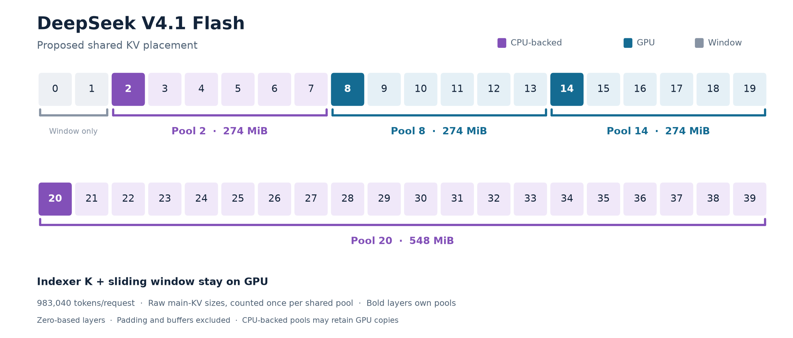
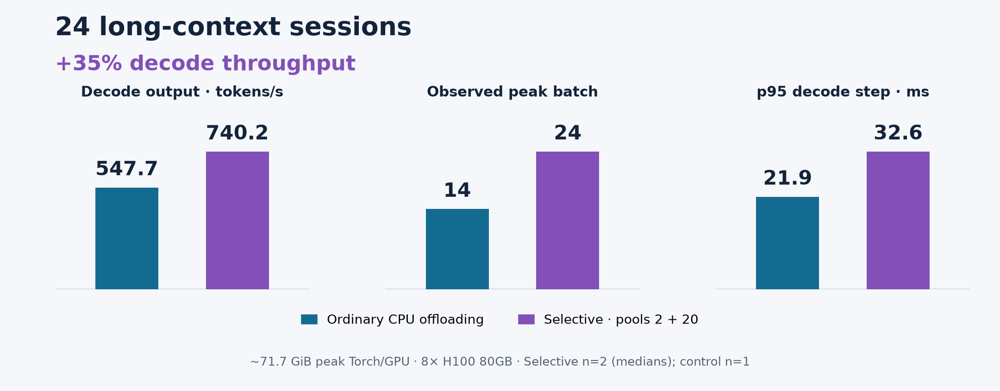

# [RFC][HiSparse] Selective shared KV offloading for DeepSeek V4.1

We tested keeping the shared KV pools owned by layers **2 and 20** on CPU,
with selected rows fetched into a GPU cache during decode. The model keeps
its existing indexers; indexer K and sliding-window state stay on GPU.
Pools **8 and 14** stay on GPU. When space is needed, reclaim clean
CPU-backed copies before evicting GPU-only cached prefixes.

The proposed home is HiSparse. Next steps are task-quality evaluation and
testing composition with OffloadingConnector for the remaining cache groups.
Feedback on that integration would be welcome.

## Results

| At 24 sessions | Ordinary OffloadingConnector | Selective pools 2 + 20 |
| --- | --- | --- |
| Decode output tokens/s | 547.7 | 732.8–747.6 (**+35% median**) |
| Observed peak decode batch | 14 | 24 |
| Configured max sequences | 14 | 32 |
| p95 decode-step interval | 21.9 ms | 31.7–33.6 ms |
| Peak Torch allocation/GPU | 71.68 GiB | 71.75 GiB |
| GPU utilization setting | 89% | 85% |
| Runs | 1 | 2 |

## What we ran

| Setup / workload | Value |
| --- | --- |
| Model | DeepSeek-V4.1-Flash-1017 |
| GPUs | 8× H100 80GB |
| Parallelism | TP8/EP, DCP=1 |
| Runtime | FP8 KV, CPU Engram, prefix caching, full decode CUDA graphs |
| Sessions | Grow 8 → 16 → 24 |
| Initial context/session | 983,040 tokens |
| Cached turns/session/stage | 2 |
| Each turn | 4,096 tool tokens + 512 generated tokens |
| Decode measurement | Pure-decode intervals within the serving replay; prefill excluded |

The gain comes with higher token latency. GPU-resident serving was faster
at eight sessions.
