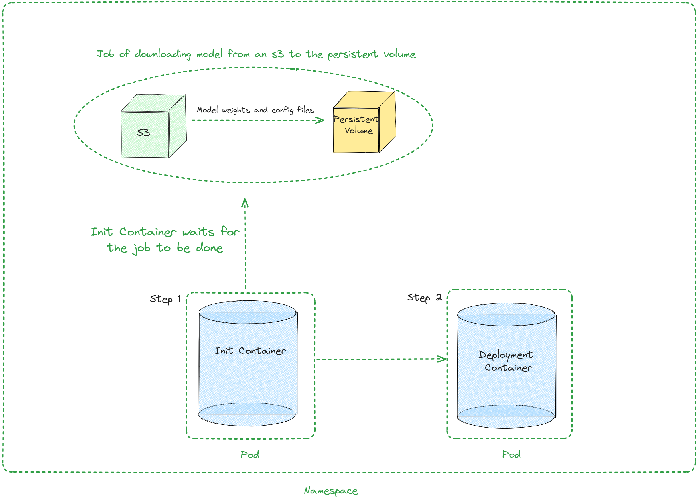

# Helm

A Helm chart to deploy vLLM for Kubernetes

Helm is a package manager for Kubernetes. It helps automate the deployment of vLLM applications on Kubernetes. With Helm, you can deploy the same framework architecture with different configurations to multiple namespaces by overriding variable values.

This guide will walk you through the process of deploying vLLM with Helm, including the necessary prerequisites, steps for Helm installation and documentation on architecture and values file.

## Prerequisites

Before you begin, ensure that you have the following:

- A running Kubernetes cluster
- NVIDIA Kubernetes Device Plugin (`k8s-device-plugin`): This can be found at [https://github.com/NVIDIA/k8s-device-plugin](https://github.com/NVIDIA/k8s-device-plugin)
- Available GPU resources in your cluster
- (Optional) An S3 bucket or other storage with the model weights, if using automatic model download

## Installing the chart

This guide uses the Helm chart at [examples/deployment/chart-helm](../../../examples/deployment/chart-helm).

To install the chart with the release name `test-vllm`:

```bash
helm upgrade --install --create-namespace \
  --namespace=ns-vllm test-vllm . \
  -f values.yaml \
  --set secrets.s3endpoint=$ACCESS_POINT \
  --set secrets.s3bucketname=$BUCKET \
  --set secrets.s3accesskeyid=$ACCESS_KEY \
  --set secrets.s3accesskey=$SECRET_KEY
```

## Uninstalling the chart

To uninstall the `test-vllm` deployment:

```bash
helm uninstall test-vllm --namespace=ns-vllm
```

The command removes all the Kubernetes components associated with the
chart **including persistent volumes** and deletes the release.

## Architecture



## Values

The following table describes configurable parameters of the chart in `values.yaml`:

| Key | Type | Default | Description |
| --- | ---- | ------- | ----------- |
| autoscaling | object | {"enabled":false,"maxReplicas":100,"minReplicas":1,"targetCPUUtilizationPercentage":80} | Autoscaling configuration |
| autoscaling.enabled | bool | false | Enable autoscaling |
| autoscaling.maxReplicas | int | 100 | Maximum replicas |
| autoscaling.minReplicas | int | 1 | Minimum replicas |
| autoscaling.targetCPUUtilizationPercentage | int | 80 | Target CPU utilization for autoscaling |
| configs | object | {} | Configmap |
| containerPort | int | 8000 | Container port |
| customObjects | list | [] | Custom Objects configuration |
| deploymentStrategy | object | {} | Deployment strategy configuration |
| externalConfigs | list | [] | External configuration |
| extraContainers | list | [] | Additional containers configuration |
| extraInit | object | {"modelDownload":{"enabled":true},"initContainers":[],"pvcStorage":"1Gi"} | Additional configuration for init containers |
| extraInit.modelDownload | object | {"enabled":true} | Model download functionality configuration |
| extraInit.modelDownload.enabled | bool | true | Enable automatic model download job and wait container |
| extraInit.modelDownload.image | object | {"repository":"amazon/aws-cli","tag":"2.6.4","pullPolicy":"IfNotPresent"} | Image for model download operations |
| extraInit.modelDownload.waitContainer | object | {} | Wait container configuration (command, args, env) |
| extraInit.modelDownload.downloadJob | object | {} | Download job configuration (command, args, env) |
| extraInit.initContainers | list | [] | Custom init containers (appended after model download if enabled) |
| extraInit.pvcStorage | string | "1Gi" | Storage size for the PVC |
| extraInit.s3modelpath | string | "relative_s3_model_path/opt-125m" | (Optional) Path of the model on S3 |
| extraInit.awsEc2MetadataDisabled | bool | true | (Optional) Disable AWS EC2 metadata service |
| extraPorts | list | [] | Additional ports configuration |
| gpuModels | list | ["TYPE_GPU_USED"] | Type of gpu used |
| image | object | {"command":["vllm","serve","/data/","--served-model-name","opt-125m","--host","0.0.0.0","--port","8000"],"repository":"vllm/vllm-openai","tag":"latest"} | Image configuration |
| image.command | list | ["vllm","serve","/data/","--served-model-name","opt-125m","--host","0.0.0.0","--port","8000"] | Container launch command |
| image.repository | string | "vllm/vllm-openai" | Image repository |
| image.tag | string | "latest" | Image tag |
| maxUnavailablePodDisruptionBudget | string | "" | Disruption Budget Configuration |
| livenessProbe | object | {"initialDelaySeconds":15,"periodSeconds":30,"timeoutSeconds":30,"failureThreshold":6} | Liveness probe configuration. Without a handler (`httpGet`, `exec`, `tcpSocket` or `grpc`), the chart generates an `exec` probe that sends `probeRequest` to the model |
| livenessProbe.failureThreshold | int | 6 | Number of consecutive failures after which the container is considered not alive and is restarted |
| livenessProbe.initialDelaySeconds | int | 15 | Number of seconds after the container has started before the liveness probe is initiated |
| livenessProbe.periodSeconds | int | 30 | How often (in seconds) to perform the liveness probe |
| livenessProbe.timeoutSeconds | int | 30 | Probe timeout in seconds. The generated curl command uses `timeoutSeconds - 1` as its maximum time |
| probeRequest | object | {"endpoint":"/v1/completions","model":"opt-125m","prompt":"Hello","maxTokens":1} | Request sent to the model by the generated startup, readiness and liveness probes. A probe succeeds only if the response contains a non-empty generated text |
| probeRequest.endpoint | string | "/v1/completions" | Completions endpoint called by the probes |
| probeRequest.model | string | "opt-125m" | Model name sent in the request. It must match `--served-model-name` |
| probeRequest.prompt | string | "Hello" | Prompt sent in the request |
| probeRequest.maxTokens | int | 1 | Maximum number of tokens generated per probe |
| readinessProbe | object | {"initialDelaySeconds":5,"periodSeconds":10,"timeoutSeconds":10,"failureThreshold":3} | Readiness probe configuration. Without a handler, the chart generates an `exec` probe that sends `probeRequest` to the model |
| readinessProbe.failureThreshold | int | 3 | Number of consecutive failures after which the container is considered not ready and removed from the Service endpoints |
| readinessProbe.initialDelaySeconds | int | 5 | Number of seconds after the container has started before the readiness probe is initiated |
| readinessProbe.periodSeconds | int | 10 | How often (in seconds) to perform the readiness probe |
| readinessProbe.timeoutSeconds | int | 10 | Probe timeout in seconds. The generated curl command uses `timeoutSeconds - 1` as its maximum time |
| replicaCount | int | 1 | Number of replicas |
| resources | object | {"limits":{"cpu":4,"memory":"16Gi","nvidia.com/gpu":1},"requests":{"cpu":4,"memory":"16Gi","nvidia.com/gpu":1}} | Resource configuration |
| resources.limits."nvidia.com/gpu" | int | 1 | Number of GPUs used |
| resources.limits.cpu | int | 4 | Number of CPUs |
| resources.limits.memory | string | "16Gi" | CPU memory configuration |
| resources.requests."nvidia.com/gpu" | int | 1 | Number of GPUs used |
| resources.requests.cpu | int | 4 | Number of CPUs |
| resources.requests.memory | string | "16Gi" | CPU memory configuration |
| secrets | object | {} | Secrets configuration |
| serviceName | string | "" | Service name |
| servicePort | int | 80 | Service port |
| startupProbe | object | {"initialDelaySeconds":10,"periodSeconds":10,"timeoutSeconds":10,"failureThreshold":120} | Startup probe configuration. Without a handler, the chart generates an `exec` probe that sends `probeRequest` to the model |
| startupProbe.failureThreshold | int | 120 | Number of consecutive failures after which the container is restarted. Together with `periodSeconds`, it must cover the model loading time |
| startupProbe.initialDelaySeconds | int | 10 | Number of seconds after the container has started before the startup probe is initiated |
| startupProbe.periodSeconds | int | 10 | How often (in seconds) to perform the startup probe |
| startupProbe.timeoutSeconds | int | 10 | Probe timeout in seconds. The generated curl command uses `timeoutSeconds - 1` as its maximum time |
| labels.environment | string | test | Environment name |

## Probes

By default, the chart checks that the model actually answers text, not only that the engine process is alive. The startup, readiness and liveness probes run an `exec` command inside the container that sends the `probeRequest` (a one-token completion with `temperature: 0`) to the local server with `curl`. The probe succeeds only if the response contains a non-empty `text`.

```yaml
probeRequest:
  endpoint: /v1/completions
  model: opt-125m # must match --served-model-name
  prompt: "Hello"
  maxTokens: 1
```

Things to be aware of:

- Each probe generates tokens, so it uses GPU time and competes with user traffic. The defaults are tolerant (long liveness period and timeout, `failureThreshold: 6`) so that a busy pod is not restarted prematurely. Tune them to your workload.
- The probes send no credentials. They do not work when the server runs with `--api-key`, because `/v1/*` is protected. Override the probes with `httpGet` on `/health` in that case.
- The image must provide `curl` and `grep`. The official `vllm/vllm-openai` image does.
- `probeRequest.model` must match the name served by the container (`--served-model-name`).

To use a different check for a probe, set your own handler. The chart then keeps it as is instead of generating the `exec` probe. For example, to fall back to the lightweight engine health check for liveness:

```yaml
livenessProbe:
  httpGet:
    path: /health
    port: 8000
  initialDelaySeconds: 15
  periodSeconds: 10
  timeoutSeconds: 5
  failureThreshold: 3
```

## Configuration Examples

### Using S3 Model Download (Default)

```yaml
extraInit:
  modelDownload:
    enabled: true
  pvcStorage: "10Gi"
  s3modelpath: "models/llama-7b"
```

### Using Custom Init Containers Only

For use cases like llm-d where you need custom sidecars without model download:

```yaml
extraInit:
  modelDownload:
    enabled: false
  initContainers:
    - name: llm-d-routing-proxy
      image: ghcr.io/llm-d/llm-d-routing-sidecar:v0.2.0
      imagePullPolicy: IfNotPresent
      ports:
        - containerPort: 8080
          name: proxy
      securityContext:
        runAsUser: 1000
      restartPolicy: Always
  pvcStorage: "10Gi"
```
