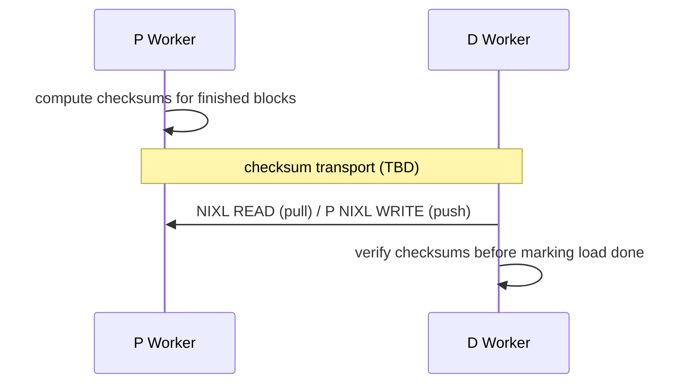

# NIXL KV Block Checksum

> **Status:** Draft / skeleton. Sections marked _TODO_ are still to be written.

This document describes adding per-block checksums to KV cache blocks moved by
`NixlConnector`, so that the receiving instance can detect corrupted or stale KV
data before it is used for decoding.

## Problem

_TODO: describe the failure modes that motivate this work._

- **Silent data corruption on the wire / in memory.** A NIXL `READ` (pull mode)
  or `WRITE` (push mode) can report success while the destination block holds
  wrong bytes (for example, an RDMA/NIC fault, a GPUDirect fault, a host-staging
  bug on the `kv_buffer_device="cpu"` path).
- **Stale or reused blocks.** The source block can be freed and reallocated
  before or during the transfer (see the lease/timeout behavior in
  [NIXL KV Cache Lease Renewal](nixl_kv_cache_lease.md)), so the receiver reads
  another request's KV.
- **Layout mismatches.** A TP, block-size, dtype, or layout mismatch between
  prefiller and decoder that the handshake does not catch produces KV that is
  well-formed but wrong.
- **Today's symptom.** All of the above show up as degraded or garbled model
  output, with nothing in the logs. It is hard to tell a transport bug from a
  model or kernel bug.

_TODO: add concrete incidents and repro notes, if any._

## Goals

_TODO: refine._

1. Detect KV block corruption on the receiver before the block is used for
   attention.
2. On a mismatch, fail the request clearly or fall back to local recompute,
   instead of producing silently bad output.
3. Cover both pull (`NixlPullConnector`) and push (`NixlPushConnector`)
   transfer modes.
4. Stay opt-in, with no cost when disabled.
5. Expose mismatch counts and checksum overhead as metrics, for debugging and
   for fleet health.

### Non-goals

- Correcting corrupted data (detection only).
- End-to-end integrity of the KV cache outside the connector (for example, GPU
  memory errors during compute, or KV offload tiers).
- Cryptographic integrity or authentication against a malicious peer.

## Requirements

_TODO: fill in numbers and finalize._

### Functional

- **R1. Granularity:** one checksum per (layer group, block), or per block
  across all layers. _TODO: decide._
- **R2. Coverage:** every block transferred by the connector is checked when
  the feature is on, including the heterogeneous-TP (`tp_mapping.py`) and mixed
  or hybrid KV cache paths (`_read_blocks_mixed`).
- **R3. Placement:** the checksum covers the bytes as they land in the
  destination KV cache, not an intermediate staging buffer (or both, for the
  host-buffer path).
- **R4. Failure policy:** configurable as `fail` (abort the request with a
  clear error), `recompute` (treat the blocks as an invalid load and recompute
  locally), or `log` (count and warn only).
- **R5. Compatibility:** peers with and without checksums must either work
  together or be rejected during the handshake, never fail silently.

### Non-functional

- **R6. Performance:** _TODO: overhead budget, for example less than X% of
  transfer time or TTFT at Y concurrency, measured on H100/H200 with
  Llama-3.1-8B._
- **R7. No added sync points:** checksum compute/verify must not block the
  scheduler or the forward pass (run on a side CUDA stream, overlapped with the
  transfer).
- **R8. Platforms:** CUDA required; XPU/ROCm/CPU behavior defined
  (supported or cleanly disabled).
- **R9. Observability:** metrics and logs identify the request, the peer
  (engine id / agent), the layer, and the block for each mismatch.

### Configuration

_TODO: finalize names._

```json
"kv_connector_extra_config": {
  "kv_checksum": "off | log | recompute | fail",
  "kv_checksum_algo": "crc32c | xxhash | ..."
}
```

## Design

_TODO: each subsection below is a placeholder to expand._

### Overview

_TODO: high-level flow diagram (P computes, then the checksum travels to D,
then D verifies after the transfer completes)._



### Checksum algorithm and kernel

- Candidates: CRC32C, xxHash, a simple fused sum/XOR reduction. Trade-offs:
  strength against throughput on the GPU.
- Kernel choice: Triton, CUDA, or a torch op. Must handle all KV cache dtypes
  (bf16, fp16, fp8) and layouts (`HND`/`NHD`, MLA).
- _TODO: microbenchmark results._

### Where checksums are computed (source side)

- Prefiller: after the KV for a block is final (end of the prefill step, before
  `get_finished` reports the request as sendable).
- Host-buffer path: around `save_kv_to_host` in `base_worker.py`.
- _TODO: interaction with chunked prefill and partially filled last blocks._

### How checksums travel to the receiver

Options to evaluate:

1. **Out-of-band in request metadata**, alongside `kv_transfer_params` /
   `ReqMeta` (`metadata.py`).
2. **Over NIXL notifications** (the same channel used for lease heartbeats).
3. **A checksum region registered with NIXL**, read/written together with the
   KV blocks in the same transfer.

_TODO: pick one; consider pull versus push asymmetry._

### Where checksums are verified (destination side)

- Pull mode: after the read completes in `_pop_done_transfers`
  (`base_worker.py`), before the request is reported done in `get_finished`.
  Read path: `pull_worker.py` (`_read_blocks`, `_read_blocks_mixed`).
- Push mode: on the D writer/receiver path in `push_worker.py`.
- Heterogeneous TP: checksums must be computed in a way that is invariant to
  the TP split (per head-shard, or recomputed after the mapping in
  `tp_mapping.py`).

### Failure handling

- How a mismatch maps onto the existing invalid-block / failed-load reporting,
  so that `recompute` reuses the current KV-load-failure recovery path.
- Peer handling: whether to quarantine a peer that repeatedly fails
  verification.

### Handshake and version negotiation

- Advertise checksum support/algorithm in `NixlAgentMetadata` /
  `NixlHandshakePayload` (`metadata.py`).
- Behavior on mismatch of capabilities (R5).

### Metrics

- `vllm:nixl_kv_checksum_mismatch_total` (labels: peer, mode).
- `vllm:nixl_kv_checksum_compute_seconds` / `_verify_seconds`.
- _TODO: wire into `stats.py` (`NixlKVConnectorStats`)._

### Testing plan

- Unit: checksum kernel correctness across dtypes/layouts; fault injection
  that corrupts a destination block and asserts detection.
- Integration: `tests/v1/kv_connector/nixl_integration/` with the feature on,
  pull and push, homogeneous and heterogeneous TP.
- Performance: TTFT/throughput with the feature off versus on.

### Alternatives considered

_TODO._

- Rely on transport-level integrity (RDMA ICRC / TCP checksums): does not cover
  stale blocks, layout bugs, or staging copies.
- Compare sampled output tokens instead: too late and too indirect.

## Open questions

- _TODO_
