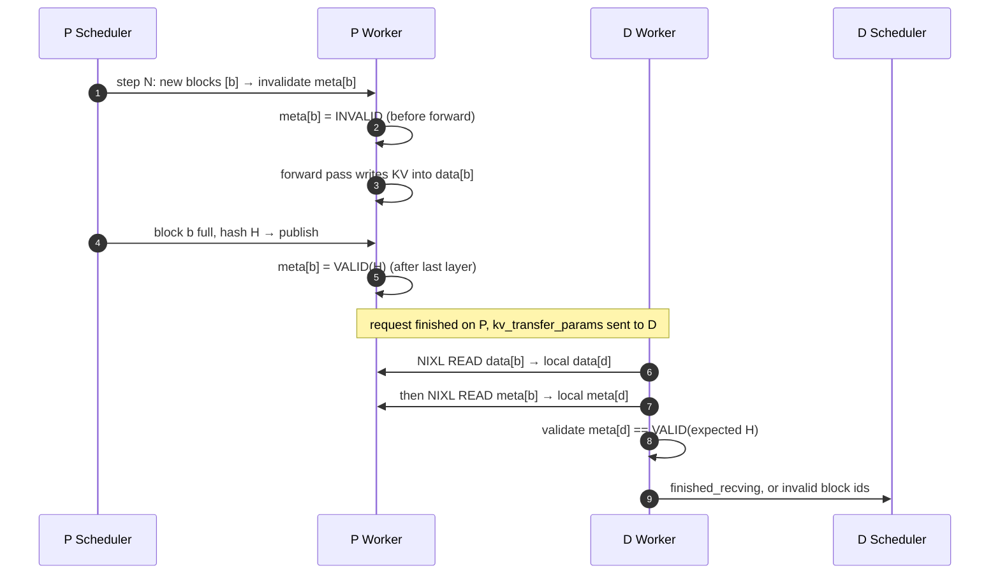

# NIXL KV Block Content Validation

> **Status:** Draft. A first implementation (pull mode only) is described in
> [Implementation status](#implementation-status). Sections marked _TODO_ are
> still open.

This document describes adding a **KV block metadata pool** to `NixlConnector`.
Every KV data block gets a small metadata entry that records which content the
block holds. Transfers move the metadata together with the data, and the
receiving instance (the decoder) validates each block's content identity
before the block is used for attention.

## Problem

`NixlConnector` moves KV blocks by block ID. The decoder (D) receives
`remote_block_ids` in `kv_transfer_params` and reads those physical blocks from
the prefiller (P) with NIXL `READ` (pull mode), or P writes them into D's
blocks with NIXL `WRITE` (push mode). Nothing in the transfer says which
content a block holds. A transfer that "succeeds" can still deliver the wrong
KV:

- **Stale or reused source blocks.** P frees a block (lease or timeout expiry,
  abort, preemption, a scheduler bug) and reallocates it to another request
  before or during D's read. D reads another request's KV. See
  [NIXL KV Cache Lease Renewal](nixl_kv_cache_lease.md) for the timing windows.
- **Torn reads.** P starts overwriting a block while D's read is in flight. D
  gets a mix of old and new data.
- **Block-ID mapping bugs.** Mistakes in heterogeneous TP mapping
  (`tp_mapping.py`), hybrid or multiple KV cache groups, or block-size
  conversion point D at the wrong physical block.
- **Missing writes (push).** A write that never landed leaves D's destination
  block with whatever it held before.

All of these show up only as degraded or garbled output, with nothing in the
logs. They are indistinguishable from model or kernel bugs.

_TODO: add concrete incidents and repro notes, if any._

## Goals

1. **Content identity per block.** Every block in the KV data pool has a
   metadata entry that says what content it holds, or that it holds nothing
   valid.
2. **Validate before use.** After a transfer completes, and before the request
   is scheduled for decode, D checks that every received block is the block it
   expected.
3. **Independent verification.** D compares against hashes it computes itself
   from its own prompt tokens, not against claims made by P.
4. **Clear failure handling.** A mismatch fails the request or triggers local
   recompute through the existing KV-load-failure path. It never produces
   silently wrong output.
5. **Both transfer modes.** Pull (`NixlPullConnector`) and push
   (`NixlPushConnector`).
6. **Opt-in and cheap.** No cost when disabled. When enabled, the cost is small
   compared with the KV transfer itself. Benchmarks must verify that the change
   carries no significant performance penalty before it lands (see
   [Performance verification](#performance-verification)).

### Non-goals

- Detecting bit-level corruption inside a block whose identity is correct. The
  metadata identifies the content; it does not checksum the bytes. A per-block
  data checksum can be added to the same metadata entry later (see
  [Extensions](#extensions)).
- Correcting bad data (detection only; recovery is recompute).
- Integrity of the KV cache outside the connector (offload tiers, GPU memory
  errors during compute).
- Protection against a malicious peer.

## Requirements

### Functional

- **R1. One metadata entry per KV block,** per KV cache group, indexed by the
  same block ID as the data pool.
- **R2. Invalidate before reuse.** Before any new data is written into a block,
  its metadata entry must read `INVALID`.
- **R3. Publish after write.** A block's content hash is written to its
  metadata entry only after all layers' KV for that block has been written.
- **R4. Transfer together.** Every block transfer also transfers the matching
  metadata entries, ordered so that the metadata a receiver sees is never newer
  than the data it read (see
  [Ordering and correctness](#ordering-and-correctness)).
- **R5. Validation stage on D.** After the transfer completes, D compares each
  received metadata entry with the hash it expects and reports any mismatching
  block.
- **R6. Failure policy:** `log` (count and warn), or `enforce` (fail the load,
  which then follows the existing `kv_load_failure_policy`: recompute or fail
  the request).
- **R7. Compatibility.** P and D must agree in the handshake that both have the
  metadata pool, and must agree on the hash function. Otherwise validation is
  disabled or the handshake is rejected, according to configuration. It never
  fails silently.

### Non-functional

- **R8. No added sync points.** Metadata writes are stream-ordered GPU writes
  on the compute stream. They add no host sync and do not block the scheduler.
- **R9. No significant performance penalty (must be verified).**
    - **Disabled:** no measurable regression against `main` (within run-to-run
      noise).
    - **Enabled:** TTFT, ITL, and throughput stay within an agreed budget of the
      disabled baseline. _TODO: agree on the budget, for example ≤ 2% throughput
      and ≤ 5% p50/p99 TTFT._
    - **Memory:** `num_blocks × entry_size` per group (for example, 64 B × 100k
      blocks is 6.4 MB).
    - This is a merge gate: the measurements in
      [Performance verification](#performance-verification) are part of the PR.
- **R10. Observability.** Each mismatch is counted and logged with request ID,
  peer engine ID, KV cache group, block index, and the expected and actual
  entry state.
- **R11. Platforms.** CUDA first. Host-buffer (`kv_buffer_device="cpu"`),
  XPU, and ROCm are either supported or cleanly disabled.

### Configuration

```json
"kv_connector_extra_config": {
  "kv_block_validation": "off | log | enforce"
}
```

`off` is the default. Set the same value on producer and consumer: the
producer maintains the pool only when validation is on, and the consumer skips
(with a warning) peers that do not advertise one.

## Design

### Overview

Alongside the KV data pool, each worker allocates a **KV metadata pool**: one
fixed-size entry per block, registered with NIXL like the data pool. The entry
moves through a simple state machine:

```text
           allocate block (evict / reuse)
   ┌──────────────────────────────────────────────┐
   │                                              ▼
 VALID(hash) ◄──── all layers written ────── INVALID
              (publish hash after forward)
```

- When a block is allocated for new content, its entry is set to `INVALID`
  before any layer writes into it.
- When the block becomes full and all its KV has been written, the entry is set
  to `VALID(hash)`. `hash` is the block's prefix-caching block hash, which
  identifies the full token prefix up to and including the block.
- Transfers copy data blocks and then their metadata entries.
- D validates that every received entry is `VALID` with the hash D computed for
  that position of its own request.



### Why the prefix block hash

vLLM already computes a hash for every full block for prefix caching
(`Request.block_hashes`, `hash_block_tokens` in `vllm/v1/core/kv_cache_utils.py`).
The hash is chained: it covers the parent block's hash, the block's tokens, and
extra keys (LoRA, multimodal, cache salt). So it identifies the block's
content together with its whole prefix.

- **P already has it.** `BlockPool.cache_full_blocks` assigns the hash when a
  block becomes full.
- **D can recompute it on its own.** D has the same prompt, so its own
  `Request.block_hashes` gives the expected hash at every block position. The
  decoder does not trust P's description of the block; it checks P's metadata
  against its own computation.
- **Requirement:** P and D must use the same `prefix_caching_hash_algo` and the
  same `NONE_HASH` seed. These are exchanged and checked in the handshake (R7).
  _TODO: confirm cross-process determinism for every supported algo
  (`sha256`, `sha256_cbor`, `xxhash*`) and for multimodal and LoRA extra keys._

### Metadata entry layout

A fixed-size 64 B entry. The first implementation uses:

| Field      | Size | Meaning                                                 |
|------------|------|---------------------------------------------------------|
| `state`    | 4 B  | `INVALID` = 0 (an all-zero entry), `VALID` = 1          |
| `hash_len` | 4 B  | Length of the stored hash                               |
| `hash`     | 56 B | Block hash, zero-padded (truncated if longer)           |

Proposed later additions (in the hash padding or a wider entry): `group_id`,
`num_tokens` for partial blocks, and a data checksum.

The pool is a GPU tensor `[num_blocks, 64]` of `uint8`, on the same device as
the KV cache. For the host-buffer path it would live in the pinned host region
next to the host KV buffer. _TODO: decide whether one pool per group or a
single pool with a group dimension._

### Producer side: maintaining the metadata pool

The scheduler owns block allocation and hashing. The worker owns the GPU
writes. The scheduler tells the worker what to write through the connector
metadata of each step (`NixlConnectorMetadata`):

- **Invalidate list.** Block IDs newly handed out this step: every block of a
  scheduled request past its computed tokens (`scheduled_new_reqs`), every
  `new_block_ids` entry of a running request, and the local blocks a pull is
  about to overwrite. Every reallocation is invalidated, not only evictions of
  cached blocks, so a block that was never hashed cannot carry an old valid
  entry.
- **Publish list.** `(block_id, hash)` for blocks that this step's forward pass
  fills (`num_computed_tokens` to `num_computed_tokens + num_scheduled_tokens`),
  for every request, so that prefix-cache hits served later are valid too. The
  scheduler-side `KVBlockMetaTracker` keeps each request's block table and its
  `Request.block_hashes` for this.

The worker applies them on the compute stream:

1. Before the forward pass, in `bind_connector_metadata` (called from the
   model runner's `pre_forward`): write `INVALID` for the invalidate list.
   `start_load_kv` is not used: it runs after the forward pass for async loads.
2. After the forward pass, in `wait_for_save` (`post_forward`, or
   `finalize_step` with a speculator, still within the same step): write
   `VALID(...)` for the publish list.

Both writes are one `index_fill_` / `index_copy_` from a pinned, asynchronous
host-to-device copy. The model runner launches the forward pass on the current
stream, so the updates are ordered with all KV writes, including CUDA graph
replays and async scheduling, without any host sync. Blocks completed only by
speculative tokens have no hash yet and stay unpublished.

The host-buffer path (`save_kv_to_host`) copies the matching metadata entries
after the KV host copy, with the same publish-after-data rule.

### Transfer: moving data and metadata

The metadata pool is registered with NIXL next to the KV caches in
`register_kv_caches` (`base_worker.py`). Its descriptors are advertised in
`NixlAgentMetadata` so the peer can build transfer descriptors for it.

- **Pull mode** (`pull_worker.py`, `_read_blocks` / `_read_blocks_mixed`): D
  reads P's data blocks into its local blocks, **then** reads P's metadata
  entries for the same block IDs into its local metadata entries for the
  destination blocks.
- **Push mode** (`push_worker.py`): P writes the data blocks into D's blocks,
  **then** writes the matching metadata entries. D's destination entries are
  invalidated when D allocates them, so a write that never lands is detected as
  `INVALID`.

The metadata transfer is tiny (64 B per block), but it must not overtake the
data (see below). Options for the ordering:

1. **Two dependent transfers:** post the metadata transfer only after the data
   transfer completes. Simple and clearly correct; costs one extra round trip
   per request.
2. **One transfer with ordering guarantees:** a single NIXL request whose
   metadata descriptors complete after the data descriptors. This depends on
   backend and RDMA ordering semantics (reads on one QP are not ordered with
   respect to remote writes).
3. **Seqlock read (pull):** read metadata, then data, then metadata again;
   accept only if both reads match. No extra serialization point, but three
   reads.

_TODO: measure option 1 against the transfer time; pick a default._

### Ordering and correctness

The protocol relies on two invariants:

- **Producer:** for any block, a data overwrite is always preceded by
  `meta = INVALID`, and `meta = VALID(H)` is written only after all data for
  content `H` is in place (R2, R3).
- **Transfer:** the metadata a reader observes is read after its data read has
  completed (R4).

**Pull-mode argument.** D reads the data during the window `[t0, t1]`, then
reads the metadata at `t2 > t1` and sees `VALID(H_expected)`. Suppose some of
the data D read was being overwritten during `[t0, t1]`. Then P must have
written `INVALID` before that overwrite. For D to see `VALID(H_expected)` at
`t2`, P must since have fully re-populated the block with content
`H_expected`, which is the content D wanted. In every other case D sees
`INVALID` or a different hash, and the block is rejected. Stale reuse, torn
reads, and wrong block IDs are all caught.

**Memory visibility.** The argument assumes P's GPU writes become visible to
remote NIC reads in stream order. _TODO: verify for GPUDirect RDMA, which may
need a system-scope fence or a flush between the invalidate kernel and the
first KV write, and for the host-staging path._

**Push mode.** D owns the destination blocks. It invalidates their metadata
when it allocates them for the remote prefill, so the only way an entry becomes
`VALID(H_expected)` is a completed write from P in the required order.

### Consumer side: validation stage

Validation runs on D after the transfer completes and before the request is
reported in `finished_recving`:

- **Pull:** in `_pop_done_transfers` (`base_worker.py`), once the metadata
  transfer for a request is done.
- **Push:** when the completion notification for a request's writes arrives.

Steps:

1. Gather the local metadata entries for the request's destination blocks.
   This is one small GPU gather and copy to host, or a GPU-side compare kernel
   that returns a mismatch bitmap.
2. Compare each entry with the expected value: `VALID_FULL`, matching
   `group_id`, and `hash == request.block_hashes[i]` for full blocks; see
   [Partial blocks](#partial-blocks) for the last one.
3. For mismatches, apply the policy (R6):
   - `recompute`: report the block IDs through the existing invalid-block path
     (`_invalid_block_ids` → `get_block_ids_with_load_errors`), so the
     scheduler recomputes from the first bad block. Where invalid-block
     reporting is not supported (HMA / multiple groups,
     `_report_invalid_block_ids` is false), fail the whole load through
     `failed_recving`.
   - `fail`: abort the request with an error that names the block and the
     peer.
   - `log`: increment metrics and warn only.

**Where the expected hashes come from.** The hashes live on D's scheduler
(`Request.block_hashes`). The scheduler passes the expected
`(local_block_id, group_id, hash)` list to the worker in `ReqMeta`
(`metadata.py`) together with the local and remote block IDs it already sends.

### Partial blocks

The last block of the prefix is usually partial, and partial blocks have no
prefix-caching hash. Options:

1. **Skip:** validate only full blocks. Simple, but leaves the last block
   unchecked.
2. **Request-scoped tag:** P publishes `VALID_PARTIAL` with `num_tokens` and a
   tag derived from `(parent block hash, tokens in the block)`. D can compute
   the same tag from its own tokens. This is the same chained-hash function
   applied to a partial token list.
3. **Remote request ID tag:** hash of `(remote_request_id, block index)`.
   Proves only that the block belongs to the request, not what it holds.

_TODO: pick one; option 2 is preferred because D can verify it on its own._

### Heterogeneous TP and block size

- **TP mismatch:** each P rank has its own metadata pool with identical
  entries, because the hash does not depend on the head shard. A D rank that
  reads head shards from several P ranks reads, and validates, the metadata
  entry from **each** source rank. Every shard must be validated, because each
  can go stale independently.
- **Block-size mismatch** (P and D block sizes differ, if supported): one D
  block spans several P blocks, or the other way around. Validation must
  compare at the granularity of the source hash. _TODO: define the mapping, or
  disable validation for this case._

### Hybrid KV cache and multiple groups

- One metadata pool (or one group slice) per KV cache group, because each group
  has its own block IDs.
- Sliding-window and other groups may transfer only some blocks; validate only
  the blocks that were actually transferred.
- Mamba / state-space groups: _TODO: define what the "content" of a state
  block is (it is not a token-prefix block)._

### Handshake and compatibility

`NixlAgentMetadata` / `NixlHandshakePayload` (`metadata.py`) gain:

- whether the metadata pool is present, and its NIXL descriptors;
- the entry format version;
- `prefix_caching_hash_algo` and the `NONE_HASH` seed.

If a peer lacks the pool, or the hash settings differ, the result depends on
the policy: validation is disabled for that peer with a warning (`log`), or
the handshake is rejected (`fail`). This bumps the NIXL connector compatibility
version.

### Metrics

- `vllm:nixl_num_kv_block_validation_failures`: received requests whose blocks
  held unexpected content (in `NixlKVConnectorStats`, `stats.py`). Each one is
  also logged with the request, peer engine and rank, the first bad block, and
  whether its entry was `INVALID` or named other content.
- Metadata reads are kept out of the NIXL transfer histograms, so the existing
  transfer metrics still describe KV data only.
- _Later:_ validated-block count and validation-stage latency.

### Testing plan

- **Unit:** metadata state transitions in the scheduler and worker
  (invalidate on allocate, publish on full); validation against matching,
  `INVALID`, and wrong-hash entries.
- **Fault injection:**
    - free and reuse P's blocks before D reads them (stale);
    - overwrite during the read (torn);
    - point D at the wrong remote block IDs;
    - drop a push write.

  Each must be detected under all three policies.
- **Integration:** `tests/v1/kv_connector/nixl_integration/` with validation
  on: pull and push, homogeneous and heterogeneous TP, hybrid models.
- **Performance:** see [Performance verification](#performance-verification).

### Performance verification

The design must be shown to add no significant performance penalty (R9) before
it is enabled or merged. Where the cost comes from, and what to measure:

| Cost source | Where | Risk | How to measure |
| --- | --- | --- | --- |
| Invalidate / publish scatter kernels | P and D, every step | Small kernels on the compute stream; launch overhead at high step rates | Step time, decode ITL |
| Larger connector metadata (hash lists) | Scheduler → worker | Scheduler CPU time and serialization, which grow with blocks per step | Scheduler step time at high concurrency |
| Metadata transfer, ordered after data | D (pull) / P (push) | An extra NIXL round trip per request with two-phase ordering | TTFT; KV transfer time metrics |
| Validation gather and compare | D, per finished load | A host sync if done naively; must stay off the critical path | TTFT, `nixl_kv_block_validation_seconds` |
| Extra NIXL registration / descriptors | Init and handshake | Startup and handshake time | Engine startup, first-request latency |

Benchmark matrix (PD disaggregation, `vllm bench serve`):

- **Baselines:** `main`, this change with validation off, and validation on
  under each policy (`log` / `recompute` / `fail`).
- **Workloads:** short and long prompts (block count per request drives the
  cost); a concurrency sweep up to saturation; unique prompts, so every request
  does a real P→D transfer.
- **Topologies:** pull and push; homogeneous and heterogeneous TP.
- **Models:** a small model (for example, Llama-3.2-1B, where fixed per-block
  costs are proportionally largest) and a mid-size model (for example,
  Llama-3.1-8B).
- **Metrics:** throughput, TTFT p50/p99, ITL p50/p99, scheduler step time, KV
  transfer time, validation latency.
- **Ordering options:** compare the metadata-ordering options (two-phase,
  single transfer, seqlock) and pick the default from the results.

If the enabled cost exceeds the budget, mitigations to evaluate:

- batch the metadata writes into existing connector kernels;
- validate on the GPU and copy back only a mismatch flag;
- fold the metadata read into the data transfer;
- validate a sample of blocks per request.

### Alternatives considered

- **Transport checksums only** (RDMA ICRC, TCP): cover bits on the wire, not
  stale blocks, torn reads, or wrong block IDs.
- **Checksum of the block bytes, computed by P:** needs a full read of every
  block on both sides and still needs a content identity to catch reuse. It
  fits better as an extension of the metadata entry.
- **Trusting leases and timeouts alone:** that is the current state. It cannot
  catch bugs, only narrow the timing windows.

### Extensions

- Add a per-block data checksum (for example, CRC32C over all layers' bytes)
  to the reserved field to catch bit-level corruption.
- Reuse the metadata pool for other KV movers (offload tiers, P2P) that copy
  blocks by ID.

## Implementation status

The first PR implements the pull path for the common deployment:

- `kv_validation.py`: entry encoding, the scheduler-side `KVBlockMetaTracker`,
  the worker-side `KVBlockMetaPool`, and the consumer-side `KVBlockValidator`.
- Ordering option 1 (two dependent transfers): the data READ is posted without
  its notification, and the metadata READ is posted once the data landed and
  polled for up to 200 µs, so it rarely waits for the next step. The producer
  is notified after the metadata read, including when validation fails (the
  read itself completed).
- Each source rank reads into its own host staging buffer indexed by local
  block, so heterogeneous TP reads validate every source rank.
- Roles: only a producer (`kv_producer` or `kv_both`) keeps and advertises the
  pool, and only a consumer validates. A `kv_consumer`'s blocks are never read,
  so it skips the per-step pool updates (measured at about 50 µs of host time
  per step that has updates). With `kv_both`, validated blocks are also
  published in the local pool.
- `NIXL_CONNECTOR_VERSION` 18 adds `kv_meta_base_addr`, `kv_meta_num_entries`
  and `kv_meta_hash_identity` (a digest of the hash algorithm and seed) to
  `NixlAgentMetadata`.

Not covered yet, rejected at startup: push mode, more than one KV cache group
(HMA), Mamba, `kv_buffer_device="cpu"`, bidirectional transfer, DCP/PCP and PP.
Reads that need different P/D block sizes or block-size conversion are not
validated (warned once). Partial last blocks are not validated.

## Open questions

- Exact worker hook points that guarantee stream ordering with every KV write
  (CUDA graphs, DBO, async scheduling).
- GPU → NIC visibility ordering for GPUDirect reads (is a fence needed?).
- Default metadata ordering option (two-phase, single transfer, or seqlock).
- Partial-block tag scheme.
- Behavior with block-size mismatch and Mamba state groups.
- The performance budget (R9) that the change must meet, and whether
  validation can stay on by default once overhead is measured.
