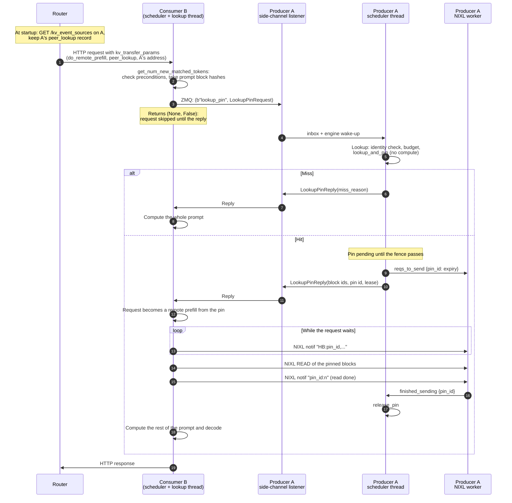

# NIXL Peer Prefix Lookup and Pin

An engine (B) that receives a request can ask another engine (A) whether A already caches the KV of the request's prompt prefix. A looks the prefix up by block hash, pins the blocks it has, and replies with their block ids. A computes and schedules nothing for B. B reads the pinned blocks over NIXL, as a decoder reads a prefiller, and computes only the rest of the prompt.

This implements [RFC #65967](https://github.com/vllm-project/vllm/issues/65967). It builds on the lease, heartbeat and stale-read handling in [NIXL KV Cache Lease Renewal](nixl_kv_cache_lease.md). The feature is off by default and works only in the pull (NIXL READ) mode of `NixlConnector`.

Each section below covers one part and can be read on its own:

| Section | Covers |
|---|---|
| [Request flow](#request-flow) | Router to both engines, lookup, pin and read |
| [Discovery: the `peer_lookup` record](#discovery-the-peer_lookup-record) | What an engine reports on `/kv_event_sources` |
| [Router to consumer: `kv_transfer_params`](#router-to-consumer-kv_transfer_params) | Fields the router adds to the request |
| [Consumer to producer: the lookup](#consumer-to-producer-the-lookup) | `LookupPinRequest` and its transport |
| [Producer to consumer: the reply](#producer-to-consumer-the-reply) | `LookupPinReply` |
| [Response labels](#response-labels) | Every miss reason and outcome, and who sets it |
| [Producer: matching and pinning](#producer-matching-and-pinning) | `lookup_and_pin` and the pin budget |
| [Producer: the fence](#producer-the-fence) | Why and when a pin is revealed |
| [Lease and heartbeats](#lease-and-heartbeats) | Lease length, renewal, expiry |
| [Consumer: using the reply](#consumer-using-the-reply) | Turning a hit into a remote prefill |
| [Releasing a pin](#releasing-a-pin) | Every path that frees the blocks |
| [Configuration](#configuration) | Settings and requirements |
| [Supported layouts and limitations](#supported-layouts-and-limitations) | What is not covered |

Paths below are relative to `vllm/distributed/kv_transfer/kv_connector/v1/nixl/` unless they start with `vllm/`.

## Request flow



### Transports

The feature adds no gRPC service and no HTTP route.

| Hop | Transport | Encoding |
|---|---|---|
| Router to B | HTTP, OpenAI-compatible API | JSON `kv_transfer_params` |
| Router discovery | HTTP `GET /kv_event_sources` | JSON |
| B to A, lookup and reply | ZMQ `REQ` to `ROUTER` on A's NIXL side-channel port | msgpack (msgspec) |
| B to A, heartbeats and read done | NIXL notifications | UTF-8 text |
| B reads A's blocks | NIXL READ | raw KV |

## Discovery: the `peer_lookup` record

An engine that serves lookups adds a `peer_lookup` object to its rank's entry on `GET /kv_event_sources`. The Python and the Rust frontends both report it. A rank with the record but no KV events still gets an entry, with the disabled KV-events defaults. Ranks without the record are unchanged.

```json
{
  "0": {
    "enable_kv_cache_events": true,
    "publisher": "zmq",
    "endpoint": "tcp://*:5557",
    "topic": "",
    "peer_lookup": {
      "enabled": true,
      "engine_id": "8a4c...",
      "side_channel_host": "10.0.0.2",
      "side_channel_port": 5600,
      "tp_size": 1,
      "dcp_size": 1,
      "pp_size": 1,
      "connector": "NixlConnector",
      "connector_version": "<NIXL_CONNECTOR_VERSION>",
      "layout_fingerprint": "<compatibility hash>"
    }
  }
}
```

`PeerLookupInfo` (`vllm/v1/engine/__init__.py`):

| Field | Type | Meaning |
|---|---|---|
| `enabled` | `bool` | Always `true` when present |
| `engine_id` | `str` | Goes into `remote_engine_id` |
| `side_channel_host` | `str` | Goes into `remote_host` |
| `side_channel_port` | `int` | Goes into `remote_port` (`VLLM_NIXL_SIDE_CHANNEL_PORT` plus the DP index) |
| `tp_size` | `int` | The producer's transfer TP size, goes into `tp_size` |
| `dcp_size` | `int` | Goes into `dcp_size` |
| `pp_size` | `int` | Goes into `pp_size` |
| `connector` | `str` | `kv_transfer_config.kv_connector`, for example `NixlConnector` |
| `connector_version` | `str` | `NIXL_CONNECTOR_VERSION` |
| `layout_fingerprint` | `str` | The NIXL compatibility hash the producer checks on each lookup |

The record is built at startup (`NixlBaseConnectorScheduler.get_peer_lookup_info`) and carried to the frontend in `EngineCoreReadyResponse.peer_lookup`. It is absent unless `peer_lookup` is enabled, the connector is in pull mode, and the compatibility hash is known.

## Router to consumer: `kv_transfer_params`

```json
"kv_transfer_params": {
  "do_remote_prefill": true,
  "peer_lookup": true,
  "remote_engine_id": "<engine_id>",
  "remote_host": "<side_channel_host>",
  "remote_port": 5600,
  "tp_size": 1,
  "dcp_size": 1,
  "pp_size": 1
}
```

| Field | Type | Required | Meaning |
|---|---|---|---|
| `do_remote_prefill` | `bool` | yes | A hit is loaded as a remote prefill. Without it the lookup is skipped (`local_precondition`) |
| `peer_lookup` | `bool` | yes | Look the prefix up on the named producer |
| `remote_engine_id` | `str` | yes | Producer `engine_id` |
| `remote_host` | `str` | yes | Producer side-channel host |
| `remote_port` | `int` | yes | Producer side-channel port |
| `tp_size` | `int` | for heartbeats, reads and orphan release | Producer TP size |
| `dcp_size`, `pp_size` | `int` | no, default 1 | Producer sizes |

The router sends no block hashes. B hashes its own prompt (`Request.block_hashes`).

After the lookup, B writes these back into the request's params: `peer_lookup` (set to `false`), `do_remote_prefill` (`false` on a miss), `peer_miss_reason` (on a miss), and on a hit `remote_block_ids`, `remote_request_id`, `remote_num_tokens`, `remote_blocks_expiry_time` and `remote_lease_extension`.

## Consumer to producer: the lookup

B's lookup thread (`PeerLookupClient`, `peer_lookup_client.py`) opens one ZMQ `REQ` socket per lookup and sends one frame:

```text
msgpack( (b"lookup_pin", msgpack(LookupPinRequest)) )
```

A's listener receives it on the `ROUTER` socket that also serves NIXL handshakes (`GET_META_MSG`), as `[identity, b"", frame]`.

```python
@dataclass
class PeerKVIdentity:
    compatibility_hash: str     # compute_nixl_compatibility_hash
    block_size: int
    hash_algo: str              # CacheConfig.prefix_caching_hash_algo
    cache_salt: str | None = None

@dataclass
class LookupPinRequest:
    block_hashes: list[bytes]   # prefix-cache hashes, prefix order
    identity: PeerKVIdentity
    lease_duration: float | None = None   # seconds; None = producer default
```

| Field | Type | Set by B from |
|---|---|---|
| `block_hashes` | `list[bytes]` | `request.block_hashes[: num_prompt_tokens // block_size]` |
| `identity.compatibility_hash` | `str` | B's NIXL compatibility hash |
| `identity.block_size` | `int` | B's block size |
| `identity.hash_algo` | `str` | B's `prefix_caching_hash_algo` |
| `identity.cache_salt` | `str \| None` | `request.cache_salt` |
| `lease_duration` | `float \| None` | B's `kv_lease_duration` |

One socket per lookup is deliberate: A answers misses at once but hits only after its fence, so replies can arrive out of order, and the reply carries no correlation id. The scheduler thread never blocks: `get_num_new_matched_tokens` returns `(None, False)` while the lookup is out, so the scheduler skips the request for that step.

## Producer to consumer: the reply

A's listener sends `[identity, b"", msgpack(LookupPinReply)]`.

```python
@dataclass
class LookupPinReply:
    hit_tokens: int
    remote_block_ids: list[list[int]]   # per KV cache group; empty on a miss
    remote_request_id: str              # pin id; empty on a miss
    miss_reason: PeerMissReason
    remote_blocks_expiry_time: float | None = None
    remote_lease_extension: int | None = None
```

| Field | Type | Meaning |
|---|---|---|
| `hit_tokens` | `int` | Tokens pinned, a multiple of `block_size`; 0 on a miss |
| `remote_block_ids` | `list[list[int]]` | A's block ids per group, in prefix order. A list, not `BlockIds`, because msgspec cannot decode its `tuple \| list` union |
| `remote_request_id` | `str` | `peer-pin-<32 hex>`, used for heartbeats and release |
| `miss_reason` | `PeerMissReason` | See [Response labels](#response-labels). Can be set on a partial hit |
| `remote_blocks_expiry_time` | `float \| None` | Lease deadline, in A's scheduler `perf_counter` |
| `remote_lease_extension` | `int \| None` | Seconds each heartbeat renews the lease by |

The last two have the same meaning as the `kv_transfer_params` fields of the same name in a P/D handoff, so the stale-read check applies to pins unchanged.

## Response labels

### Sent by the producer (`PeerMissReason`)

| Label | When |
|---|---|
| `none` | Every requested block was pinned |
| `not_cached` | The run stops at a block A never held (or held too long ago to remember), or a pending pin's block failed to load |
| `evicted` | The run stops at a block A evicted recently. The router's index is stale |
| `pin_refused` | A holds it but cannot pin it now: pin budget reached, free-block floor, or the fence did not pass in `peer_lookup_serve_timeout`. On a partial hit, the budget cut the run |
| `identity_mismatch` | Compatibility hash, block size or hash algorithm differ, A's hashes are not reproducible across processes, A does not serve lookups, or A's KV layout cannot be pinned |

`evicted` comes from a bounded record of recently evicted hashes in `BlockPool` (`enable_evicted_hash_tracking`, `was_evicted`). It holds up to as many hashes as the pool has blocks, is cleared on a prefix-cache reset, and ignores blocks dropped because their load failed.

### Set by the consumer (`peer_miss_reason` and `PeerLookupStats.misses`)

| Label | When |
|---|---|
| `local_precondition` | B cannot look up this request: `do_remote_prefill` not set, compatibility hash unknown, `hash_block_size != block_size`, more than one KV cache group, peer address missing, the request skips external KV, no full prompt block, or B's hashes are not reproducible |
| `timeout` | No reply within `peer_lookup_timeout` |
| `send_failed` | The connect or send failed |
| `bad_reply` | The reply did not decode, or a hit was not whole blocks of one group within the prompt |
| `closed` | The lookup client shut down |

Every label above makes B compute the whole prompt. A lookup never fails the request.

`PeerLookupStats` also counts `lookups`, `full_hits`, `partial_hits`, `cancelled`, `notify_only_releases`, `orphans_released` and `orphans_unreleased`. These counters are not exported to `/metrics`.

## Producer: matching and pinning

The listener thread only queues the lookup (`PeerLookupChannel.inbox`) and calls the engine wake-up callback (`set_engine_wakeup`), so an idle engine runs a step. All block-pool work runs on the scheduler thread, in `build_connector_meta`, through `PeerPinServer.serve` (`peer_pins.py`):

1. **Identity.** Compatibility hash, block size and hash algorithm must match, and A's hashes must be reproducible (`sha256`, or `xxhash` with `PYTHONHASHSEED` set).
2. **Budget.** `budget = int(peer_pin_max_fraction * num_gpu_blocks) - num_pinned_blocks`. Zero or less is `pin_refused`.
3. **`KVCacheManager.lookup_and_pin(hashes, max_blocks=budget, min_free_blocks)`** (`vllm/v1/core/kv_cache_manager.py`):
    - walks the hashes from block 0 with `FullAttentionManager.find_longest_cache_hit` and stops at the first miss (the hashes are chained);
    - does not cap the hit below the last token and keeps the EAGLE block, since the reader recomputes what it needs;
    - refuses (pins nothing) if pinning would leave fewer than `ceil(peer_pin_min_free_fraction * num_gpu_blocks)` free blocks;
    - takes a reference on each block (`block_pool.touch`), so none can be evicted or reused.
4. **Pending pin.** A hit gets the id `peer-pin-<uuid hex>` and a fence, and waits.

The result is a `PrefixPin`:

```python
@dataclass(eq=False)
class PrefixPin:
    blocks: tuple[list[KVCacheBlock], ...]   # per group, prefix order
    num_tokens: int
    miss: PrefixPinMiss   # NONE, NOT_CACHED, EVICTED, REFUSED, UNSUPPORTED
    released: bool        # set by release_pin, which is idempotent
```

A lookup is never a request on A. It does not enter `waiting`, does not take a `max_num_seqs` slot and runs no forward pass.

## Producer: the fence

A block's hash is registered in the prefix cache when its step is scheduled, before the GPU writes its KV. A remote RDMA read is not ordered against that write. So A reveals a pin only after every step scheduled before the lookup has been processed.

`PeerPinServer` counts steps on the scheduler thread:

| Counter | Incremented in |
|---|---|
| `_steps_scheduled` | `build_connector_meta`, right after the lookups are served |
| `_steps_processed` | `NixlConnector.take_events`, called once per `update_from_output` |

```text
lookup served in build_connector_meta of step S+1   (its blocks are already allocated)
fence = S + 1
ship when _steps_processed >= fence                 (normally in build_connector_meta of S+2)
```

On ship, `take_new_sends` stamps the expiry, adds `{pin_id: expiry}` to `reqs_to_send` and `reqs_in_batch`, and queues the reply. The reply is handed to the listener after that, so the worker learns the pin id in the same step the reply leaves. This costs up to one extra step of latency on A, about 20 to 90 ms when A has no queue.

A pin still pending after `peer_lookup_serve_timeout` is released and answered `pin_refused`.

## Lease and heartbeats

Once shipped, a pin is tracked in the worker's `_reqs_to_send` like a finished prefill waiting for its decoder, so the [lease mechanism](nixl_kv_cache_lease.md) applies unchanged.

```text
lease      = min(B's requested lease, A's kv_lease_duration)
expiry     = A perf_counter at ship + lease
extension  = int(lease) * 2 // 3            # exported in the reply
heartbeat  = B sends every B's kv_lease_duration // 6 s
on A       = expiry = max(expiry, now + A's kv_lease_duration * 2 // 3)
stale read = B declines the read if the rebased expiry is within 5 s
```

With the default `kv_lease_duration` of 30 on both sides: 30 s lease, 20 s extension, a heartbeat every 5 s.

A peer-lookup request has no `remote_request_id` when it arrives, so heartbeats cannot start in `on_new_request`. On a hit, B calls `_register_heartbeat(request_id, params)` with the pin id, and the pin is batched into B's existing `HB:` notification to A.

## Consumer: using the reply

On a hit, B checks the reply is consistent (one group, whole blocks, no more than it asked for), then sets the `remote_*` params, `_peer_hit = True`, and registers heartbeats. From there it is an ordinary remote prefill:

```python
load_end = min(remote_num_tokens, remote prefill token count)
count = load_end - num_computed_tokens          # B's own local hit is not reloaded
if count <= 0 or count < kv_recompute_threshold:
    return 0, False                             # notify-only release of the pin
return count, True
```

After allocation, `_align_peer_blocks` cuts `remote_block_ids` to end where the load ends, because the worker pairs B's unhashed local blocks with the tail of that list. B then reads the blocks and computes the rest of the prompt.

## Releasing a pin

| Case | Path |
|---|---|
| B read the blocks | Read-done notif, `finished_sending`, `PeerPinServer.on_finished_sending`, `release_pin` |
| B loads nothing | Stock notify-only recv frees the pin |
| B's request ends before it is scheduled | `request_finished` sends a notify-only recv |
| B's request ends while the lookup is out | The lookup is cancelled. A hit that arrives is an orphan and is freed by a notify-only recv in `_release_orphaned_pins` |
| B never learns the pin id | The pin expires with its lease |
| B stops heartbeating | The lease expires (`vllm:nixl_num_kv_expired_reqs`) |
| Pending past `peer_lookup_serve_timeout` | Released, reply `pin_refused` |
| A pending pin's block failed to load | Released, reply `not_cached` |

Pin ids are kept out of the scheduler's request loop, and repeated reports of a released pin are dropped.

## Configuration

All settings go in `kv_connector_extra_config` in `--kv-transfer-config`. There are no new command-line flags.

| Key | Default | Side | Meaning |
|---|---|---|---|
| `peer_lookup` | `false` | producer | Serve lookups and report the `peer_lookup` record |
| `peer_pin_max_fraction` | `0.25` | producer | Most of the GPU block pool peer pins may hold |
| `peer_pin_min_free_fraction` | `0.05` | producer | Refuse a pin that would leave fewer free blocks than this fraction |
| `peer_lookup_serve_timeout` | `5.0` s | producer | Release and refuse a pin not shipped by then |
| `peer_lookup_timeout` | `2.0` s | consumer | Give up on a lookup after this long |
| `kv_lease_duration` | `30` s | both | Existing lease setting; caps the pin lease |

A consumer sends a lookup whenever a request carries `peer_lookup: true`; it does not need the setting.

```bash
PYTHONHASHSEED=0 vllm serve <MODEL> \
  --kv-transfer-config '{
    "kv_connector": "NixlConnector",
    "kv_role": "kv_both",
    "kv_connector_extra_config": {"peer_lookup": true}
  }'
```

`PYTHONHASHSEED` must be the same on every engine when the prefix-cache hash algorithm is seeded per process (`xxhash`, `xxhash_cbor`). Otherwise use `sha256`.

## Supported layouts and limitations

- **One KV cache group of full attention or MLA, without DCP or PCP.** Sliding-window, chunked local, Mamba and hybrid layouts are refused (`identity_mismatch`).
- **GPU blocks only.** Blocks in a CPU offload tier are not looked up.
- **Pull mode only.** The push connector does not serve lookups.
- **No lookup metrics.** Pins only appear inside the existing NIXL transfer and lease metrics.
- **One TCP connect per lookup** on the consumer.
- **`NIXL_CONNECTOR_VERSION` is not bumped**, so mixed-version P/D pairs keep working. A lookup must only go to an engine that reports a `peer_lookup` record: others answer `identity_mismatch`, and older ones may not answer.
