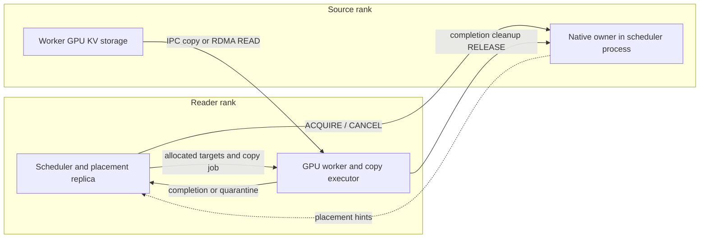

# Peer L1 ownership

## Overview

Requests routed to different data-parallel ranks can repeatedly compute the same
prompt prefix even when another GPU already caches it. `PeerL1Connector` copies
compatible, completed KV blocks from a peer into the requesting rank's cache,
falling back to computation when no read can be safely authorized or completed.

| Component | Process and execution context | Responsibility |
| --- | --- | --- |
| `PeerL1Connector` / `PeerScheduler` | Each rank's engine scheduler process, scheduler thread | Match prefixes, acquire source grants, allocate targets through the KV manager, publish completed rows and reconcile pool references. |
| `PeerWorker` / `LoadStoreMover` | Each rank's GPU worker process, model execution thread and copy stream | Import IPC mappings, enqueue copies, fence KV writers and report completion. |
| `NativeOwner` / native `Owner` | Scheduler process, native RPC and subscription threads | Validate exact keys and epochs, grant source pins and serve placement updates under an owner mutex. Native threads serve while Python holds the GIL; GPU completion callbacks also enqueue cleanup without entering Python. |
| `PlacementReplica` | Scheduler process, native subscription thread with scheduler-thread queries | Maintain advisory placement, generation and window hints. |
| `Resolver` | Scheduler process, Python discovery thread | Validate compatible cross-instance membership and replace placement replicas away from request ingress. |
| `RdmaReadMover` / `PeerReadTransport` | GPU worker process, startup registration and dedicated RDMA I/O thread | Register backing memory, open remote sessions, post reads and distinguish completion from DMA drain. |
| `CleanupQueue` | Scheduler and GPU worker processes, native sender thread | Retry grant releases; GPU callbacks only enqueue preallocated nodes. |

Each rank can be both a source and a reader. All pool mutation stays on the
scheduler thread. Source pins belong
to the native owner; an **absorb** reconciles those pins with physical block-pool
references between allocations.

The directory contains full-block hashes and physical KV rows. Placement hints
can lag or collide and never authorize a copy: the source owner revalidates the
complete keys and its epoch. Compatibility checks cover model/KV geometry and
prefix hash settings.



### One same-instance IPC hit

1. **Lookup:** the reader scheduler checks local KV first and probes placement
   hints for the missing prefix. A miss or stale candidate falls back to another
   candidate or computation.
2. **Acquire lease:** the source owner validates every required key and its epoch
   and pins the rows as one grant. IPC grants require explicit release after
   commit; a timer cannot expire an active copy. Busy or deferred replies allow
   retries within the reader's busy budget; missing keys or a closed admission
   gate yield no hit.
3. **Allocate:** the reader KV manager allocates local targets; the scheduler
   pairs them with granted source rows. An unused or unallocated grant is
   cancelled before a copy can start.
4. **Copy:** the worker waits on prior target writers, enqueues IPC copies on its
   copy stream and orders the model stream after completion. A possible IPC
   copy failure stops execution while retaining ownership.
5. **Publish/release:** a native GPU completion callback queues source release.
   The worker reports consecutive completed step fences; the scheduler publishes
   eligible full-block aliases. Lost cleanup replies are retried; owner pin
   changes become pool references or releases at the next absorb.

### One cross-instance RDMA hit

1. **Lookup:** the resolver discovers compatible owners in the background. The
   scheduler checks placement hints, preferring IPC unless RDMA provides the
   required additional prefix. Incompatible or unavailable owners yield no hit.
2. **Acquire lease:** an exact acquire pins source rows for a finite lease.
   Deferred retries retain the original acquisition time. Failed authorization,
   an exhausted busy budget or a closed gate falls back to computation.
3. **Allocate:** the scheduler allocates targets and emits an asynchronous copy
   job with the source descriptor and grant. Allocation not selecting that hit
   cancels the grant. Submitted targets remain owned through completion or drain.
4. **Copy:** the worker records the last target-write fence and queues the read.
   The I/O thread revalidates the source epoch, waits for the fence and posts
   ranges within the original half-lease bound and transfer timeout. Setup,
   queueing, owner-change, provider and deadline failures report a failed receive
   for recomputation; possible DMA additionally quarantines targets.
5. **Publish/release:** a successful receive allows the request to resume and
   participate in normal fence-based publication. The worker queues source
   release only after DMA drains. Failed undrained targets keep extra pool
   references until drain or process exit; status failure or lease expiry alone
   cannot free them. Source cooldown and the quarantine limit restrict new reads.

## 1. Lookup invariants

Only finalized full blocks in supported device attention groups may be shared.
The external lookup coordinator determines the required full-attention,
sliding-window and speculative replay-boundary rows. A locally available row
need not be copied. Every missing required row must come from one authorized
peer; placement hints alone cannot substitute for a grant.

Discovery and replica refresh run off the request ingress path. Each acquire or
cancel RPC is synchronous with a 50 ms timeout; one scheduler lookup can contact
multiple peers. The 1000 ms busy budget bounds retries across lookups, not the
sum of all RPC time in one scheduler step.

## 2. Acquire invariants

### Immediate and deferred grants

Exact acquire is all-or-nothing, including aliases that map to the same physical
row. The native mutex serializes grants, retirement, gate changes and absorb.
A missed key, epoch mismatch or rejected grant never authorizes a partial copy.

An oversized request queues keys without pinning rows. The scheduler snapshots
candidate rows and their refcounts, then commits eligible grants under the
native mutex. Entries arriving after the snapshot wait for another absorb.
Free-row touches are limited to half the remaining free headroom after immediate
touches. No allocation may interleave between snapshot and applying these pool
references.

Pins become absorbed before a committed result is visible. A concurrent release
dirties the row for a later absorb, preserving the reference even if release
precedes application of the returned touch. Reset refuses pending entries as
well as active pins. Queue capacity is bounded by total key positions.

An idle owner receives an engine wakeup after enqueue. The callback requests a
step only; all pool operations stay on the scheduler thread. Uncommitted entries
survive until an eligible absorb or reader cancellation. A late reader consumes
a decided result before applying its busy deadline to an undecided result.

## 3. Allocation and pool protection

The native owner can grant rows between scheduler steps. A retired pinned free
row is withheld rather than reused. If `W` is the interval's initial reserve and
`h` rows have been withheld, the remaining reserve is `W - h`. Allocating `a`
rows and withholding `d` changes admissible capacity by exactly `a`:

```text
(F - a - d) - (W - h - d) = F - (W - h) - a
```

The new-pin window bounds all rows that could still become withheld before
absorb. Absorbed pins hold pool references. Retiring a pinned in-use row adopts
its pool reference before the local reference can be freed.

At absorb, the window is bounded by 16384 rows and free headroom. It need not
reserve the configured maximum in a busy pool. Owner pins never block eviction
or force the owner to wait for a reader.

## 4. Copy and read transport

`PeerReadTransport(storage, host)` registers the complete backing
allocation synchronously. Its class `name` is the wire identity: discovery
requires equal transport names as well as KV and hash compatibility. A lazy
registry resolves registered `rdma_transport` names;
without a selection, exactly one implementation must be available.

The interface separates preparation, posting, completion and drain:

- `available()` checks dependencies; `advertisement() -> bytes` exports opaque
  registration metadata; `open(advertisement) -> RemoteSession` creates a session.
- `prepare(ranges) -> ReadBatch` prepares `(local_offset, remote_offset, bytes)`
  ranges without posting. `post(batch) -> None` can partially submit before raising.
- `ReadBatch.state() -> ReadState` returns `PENDING`, `SUCCEEDED` or `FAILED`.
  Success proves quiescence; failure alone does not.
- `ReadBatch.quiesced() -> bool` never waits, including during concurrent posts,
  status checks or cleanup. A serialized backend must return `False` if its lock
  is held; handle release must use that same lock.
- `close() -> None` returns promptly without revoking published registrations
  or freeing anything an unquiesced batch can use.

The executor splits and batches ranges using `max_range_bytes` and
`max_ranges_per_post`. It owns queueing, step fences, deadlines, HELLO checks and
process-lifetime retention, independently of the transport implementation.
An exception from `post()` leaves that read permanently unknown, even if a
returned status later indicates success. A normal post followed by a deadline
still permits drain queries and removal of quarantine once quiesced; the failed
request never becomes successful afterward.

Published registrations and their backing storage remain retained until process
exit even when no local read is outstanding: remote unilateral reads cannot be
enumerated or revoked. Unquiesced reads additionally retain batches, sessions,
descriptors and submission arguments. The MoRI-IO implementation uses the
existing engine wrapper and its owned-read helpers.

## 5. Publication, release and failures

### Publication

A cached block is initially pending. The worker records completion after all
step writers, including speculative draft writes, and reports consecutive
completed fences. The scheduler publishes only keys covered by that watermark.
Invalidation removes a pending key or retires a published row before reuse.
Only finalized full blocks may be shared.

### Completion and failure ownership

IPC batches share a copy stream and one completion callback releases all grants
for the step. A possible failed load retains ownership under fail-stop; there is
no timer that can release a possibly active IPC read.

RDMA grants retain their original lease clock. Queueing, setup and the GPU fence
must fit within half that lease. The first possible post starts the transfer
budget, capped by the same bound; subsequent segments do not renew it.

An unsubmitted failure is cancelled and released. A possible post releases only
when drained. Otherwise the worker reports both failed and finished, and the
scheduler takes an extra reference on each target row before recomputation,
abort or normal finish can free the request's references. Quarantine belongs to
the transfer identity, independently of the request, until drain or process exit.
An elapsed lease or failed status alone is not drain proof.

After failure, that live admission excludes RDMA sources; source cooldown and the
quarantine circuit breaker apply independently. Source cleanup uses epoch and
sequence, so a restarted owner cannot lose a newer grant through stale cleanup.

Published registrations and potentially referenced argument/status objects live until
process exit when revocation or drain cannot be proven. Discovery and replica
refresh run off the request ingress path; HELLO revalidation before a post rejects
an already observable owner restart while the job was queued.
