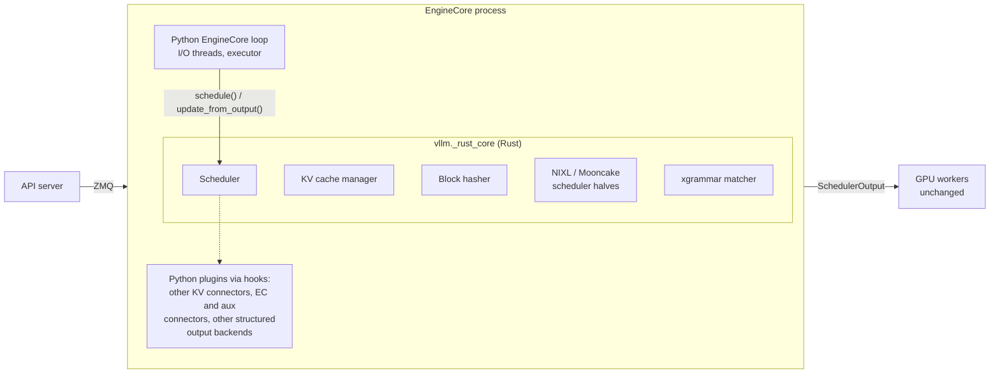

# Rust Engine Core

!!! warning
    The Rust engine core is experimental and off by default. Its outputs are
    meant to be bitwise identical to the Python implementation; please report
    any difference you observe.

The Rust engine core is an optional native port of the CPU-side components of
the `EngineCore` process. It is a Python extension module, `vllm._rust_core`,
that replaces these components with Rust implementations producing the same
outputs:

- the scheduler (`Scheduler` and `AsyncScheduler`): `schedule`,
  `update_from_output`, request queues, the encoder cache manager, stop
  checks and stats;
- the KV cache manager: block pool, free queue, every single-type manager
  (full attention, sliding window, chunked local attention, Mamba, cross
  attention, HiSparse) and the coordinators;
- prefix-caching block hashing (`sha256`, `sha256_cbor`, `xxhash`,
  `xxhash_cbor`);
- the scheduler halves of the NIXL and Mooncake store KV connectors, and the
  Mooncake store worker's lookup paths;
- structured output with the xgrammar backend (grammar matching, bitmasks,
  accept and rollback), built on a vendored copy of xgrammar's C++ sources.

GPU workers, the model runner, the worker halves of KV connectors and the API
frontend are not part of it. The Python `EngineCore` loop, ZMQ I/O and the
executor stay in Python.

## Enabling it

`vllm._rust_core` is built from `rust/src/engine-core-py` as a
setuptools-rust extension together with vLLM's other Rust artifacts, so wheels
and source installs include it. In a source checkout, `tools/build_rust.sh`
(or `tools/build_rust.sh --debug`) rebuilds it in place. The extension is
optional: if it is missing or fails to build, vLLM uses the Python
implementation of every component.

| Setting | Default | Effect |
| --- | --- | --- |
| `VLLM_USE_RUST_CORE=1` | `0` | Use the Rust scheduler, KV cache manager, block hasher and Mooncake store lookup paths where supported, falling back to Python otherwise. |
| `--scheduler-cls vllm.v1.core.sched.rust_scheduler.RustScheduler` | unset | Select the Rust scheduler explicitly (`RustAsyncScheduler` for async scheduling). Fails at startup if the configuration is unsupported. |
| `VLLM_RUST_CORE_NATIVE_HOOKS=0` | `1` | Keep the Python NIXL / Mooncake store scheduler halves and the Python structured output manager, called from the Rust scheduler through hooks. |

For example:

```bash
VLLM_USE_RUST_CORE=1 vllm serve Qwen/Qwen3-8B --enable-prefix-caching
```

With `VLLM_USE_RUST_CORE=1` and no `--scheduler-cls`, the scheduler class is
`RustScheduler` or `RustAsyncScheduler` depending on async scheduling.

## Architecture



The crates are:

| Crate | Owns |
| --- | --- |
| `rust/src/engine-core` (`vllm-engine-core`) | Pure Rust, no PyO3: hashing (pickle protocol 5 and canonical CBOR serializers), KV cache manager, scheduler, connector scheduler halves, structured output |
| `rust/src/engine-core-py` (`vllm-engine-core-py`) | PyO3 bindings (`vllm._rust_core`): config conversion, request bridging, Python output objects, hook adapters |
| `rust/src/xgrammar` (`vllm-xgrammar`) | Vendored xgrammar C++ (with its `LICENSE` and `NOTICE`) behind a C shim |

Python collaborators that are not ported are reached through traits
(`KvConnector`, `StructuredOutput`, ...) that the binding crate implements over
the Python objects. On the native path there are two Python-to-Rust crossings
per engine step, and the binding builds the regular Python `SchedulerOutput`
and `EngineCoreOutputs`, so the executor, workers and frontend are unchanged.
Connector metadata sent to workers is the same Python object type, so the
connector worker halves are unchanged too.

Rust owns the mutable request state (tokens, counters, status, block hashes,
queue membership). The Python `Request` keeps opaque payloads (sampling
parameters, multimodal data, LoRA) and is brought up to date only before a
Python hook or caller reads it through the scheduler. Rust panics become Python
exceptions.

## Fallback rules and unsupported configurations

Each component checks its configuration when it is constructed. Unsupported
configurations fail closed: with `VLLM_USE_RUST_CORE=1` the Python component is
used instead and the reason is logged once.

- **Extension missing**: all components use Python (a warning is logged).
- **Scheduler** (`vllm/v1/core/sched/rust_scheduler.py`) falls back to
  `Scheduler` / `AsyncScheduler` for:
    - custom encoder cache managers;
    - KV cache managers registered by platforms or plugins (any manager class
      outside `vllm.v1.core.single_type_kv_cache_manager`);
    - KV cache layouts the port does not model, for example
      `EncoderOnlyAttentionSpec` or spec subclasses that change prefix-caching
      properties.

  With `--scheduler-cls ...RustScheduler`, these raise `NotImplementedError`
  at startup instead. Requests with prompt embeddings are rejected when KV
  cache events are enabled.
- **KV cache manager** (when the Python scheduler is used): also falls back
  when KV cache metrics collection is enabled.
- **Block hasher**: unknown hash functions fall back to Python, and blocks
  with multimodal or prompt-embeds extra keys are hashed by the Python hasher.
- **Native connector scheduler halves** (with `VLLM_RUST_CORE_NATIVE_HOOKS=1`):
    - NIXL: only the built-in pull and push `NixlConnector` classes; other
      connectors and subclasses use the Python connector through hooks.
    - Mooncake store: only `MooncakeStoreConnector` itself (not
      `MultiConnector` or subclasses), and not with KV cache events enabled.
      The per-request store lookup RPC stays in the Python client.
    - Any other KV connector is called through hooks.
- **Native structured output** (with `VLLM_RUST_CORE_NATIVE_HOOKS=1`): only
  requests using the xgrammar backend with a Hugging Face fast tokenizer.
  Mistral and PLaMo 3 tokenizers, other backends (`guidance`, `outlines`,
  `lm-format-enforcer`) and diffusion LLMs use the Python manager. Only
  think-token reasoning parsers run natively; other reasoning parsers are
  called in Python.

## Parity and how it is tested

The requirement is that the same inputs produce the same `SchedulerOutput`,
`EngineCoreOutputs`, block IDs, KV cache events, stats, grammar bitmasks and
connector metadata as the Python implementation. It is checked at several
layers:

| Layer | Where | Catches |
| --- | --- | --- |
| Unit parity | `cargo test -p vllm-engine-core` (hash, `heapq`, `set[int]` order, encoder cache fixtures) and `tests/v1/core/test_rust_core_hash.py` | Serialization and container-order differences |
| Trace replay | Python generators next to the Rust tests record every call and result of the real Python component; `cargo test` replays them | Logic differences in the pure Rust core |
| Lockstep fuzzing | `tests/v1/core/rust_core_diff.py`, `tests/v1/core/test_rust_scheduler.py`, `tests/v1/kv_connector/unit/test_*_rust*.py`, `tests/v1/structured_output/test_rust_xgrammar_parity.py` | Binding, conversion and Python-object differences |
| Existing suites | `pytest -p tests.v1.core.rust_scheduler_plugin tests/v1/core/test_scheduler.py` | Behavior covered by the Python scheduler's tests |

A few small traces are checked in so `cargo test` is meaningful offline. CI
regenerates traces from the current Python code and replays them against Rust
(`.buildkite/scripts/run-rust-engine-core-traces.sh`), so a change to the
Python scheduler, KV cache manager or connectors that is not mirrored in Rust
fails CI. `rust/src/engine-core/tests/README.md` describes how to run the
generators locally and replay their traces (`ENGINE_CORE_TRACE_DIR`).

`rust_core_diff.py` can also be run as a fuzzer:

```bash
.venv/bin/python -m tests.v1.core.rust_core_diff --mode rust-sched --seeds 0-200
```

Notable details the port reproduces: pickle memoization by object identity and
framing, the iteration order of CPython's `set[int]` (it decides encoder cache
eviction) and `heapq`'s internal order (visible when iterating the priority
queue).

## Known deviations

- `Request.__lt__` breaks a full priority and arrival-time tie with
  `id(self)`; the Rust queue uses an insertion sequence number instead.
- Pickled connector metadata is equal in value, but can differ in bytes from
  Python's because of string interning and `set` iteration order.
- Some existing tests inspect Python internals (`isinstance` checks against
  Python classes, private attributes such as `scheduler.waiting`) and fail with
  the Rust scheduler; the behavior they cover is unchanged.
- Parity with xgrammar relies on the vendored C++ matching the installed
  `xgrammar` wheel. Bump both together.

## Performance

CPU time of the ported paths, Python vs Rust (microbenchmarks, single process):

| Workload | Python | Rust |
| --- | --- | --- |
| Hash a 128K-token prompt, `sha256`, block size 16 | 16.4 ms | 1.7 ms |
| Same, `sha256_cbor` / `xxhash_cbor` | 45.9 / 42.4 ms | 1.4 / 0.6 ms |
| Decode step, `schedule` + `update_from_output`, 256 / 1024 requests | 2.24 / 8.88 ms | 0.34 / 1.68 ms |
| Same, 1024 requests, async scheduling | 10.18 ms | 1.90 ms |
| Scheduler step with the KV cache manager only, DeepSeek-V4.1 layout, 8 × 128K prompts | 0.50 ms | 0.13 ms |
| Mooncake store `build_connector_meta` per step, DeepSeek-V4.1, 16 × 128K | 366 µs | 31 µs |
| Mooncake store worker lookup, 128K-token DeepSeek-V4.1 request | 3.3 ms | 0.26 ms |
| NIXL scheduler half per step, 1000 tracked requests, 16 × 120K-token admissions | 4.7 ms | 0.7 ms |
| Structured output bitmask, 256 JSON requests, no spec / 4 spec tokens | 3.2 / 119 ms | 1.5 / 17.6 ms |

The Rust figures include building the Python output objects.
