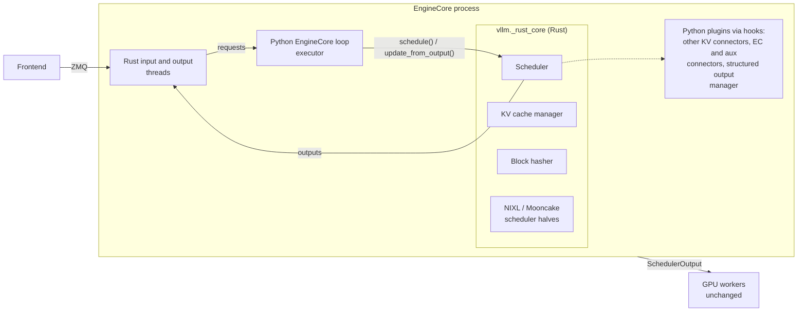

# Rust Engine Core

!!! warning
    The Rust engine core is experimental and off by default. Its outputs are
    meant to be bitwise identical to the Python implementation; please report
    any difference you observe.

The Rust engine core is an optional native port of the CPU-side components of
the `EngineCore` process. It is a Python extension module, `vllm._rust_core`,
that replaces these components with Rust implementations producing the same
outputs:

- the scheduler (`Scheduler` and `AsyncScheduler`): `schedule`,
  `update_from_output`, request queues, the encoder cache manager, stop
  checks and stats;
- the KV cache manager: block pool, free queue, every single-type manager
  (full attention, sliding window, chunked local attention, Mamba, cross
  attention, HiSparse) and the coordinators;
- prefix-caching block hashing (`sha256`, `sha256_cbor`, `xxhash`,
  `xxhash_cbor`);
- the scheduler halves of the NIXL and Mooncake store KV connectors, and the
  Mooncake store worker's lookup paths.

GPU workers, the model runner, the worker halves of KV connectors and the API
frontend are not part of it. Structured output stays in Python: the Rust
scheduler calls the Python `StructuredOutputManager` (every backend) through
hooks. The Python `EngineCore` loop and the executor stay in Python. With the
Rust scheduler, the engine's ZMQ I/O runs on Rust threads
([Native I/O](#native-io)), for the Rust and the Python frontend alike.

## Enabling it

`vllm._rust_core` is built from `rust/src/engine-core-py` as a
setuptools-rust extension together with vLLM's other Rust artifacts, so wheels
and source installs include it. In a source checkout, `tools/build_rust.sh`
(or `tools/build_rust.sh --debug`) rebuilds it in place. The extension is
optional: if it is missing or fails to build, vLLM uses the Python
implementation of every component.

| Setting | Default | Effect |
| --- | --- | --- |
| `VLLM_USE_RUST_CORE=1` | `0` | Use the Rust scheduler (with its KV cache manager), block hasher and Mooncake store lookup paths where supported, falling back to Python otherwise. |
| `--scheduler-cls vllm.v1.core.sched.rust_scheduler.RustScheduler` | unset | Select the Rust scheduler explicitly (`RustAsyncScheduler` for async scheduling). Fails at startup if the configuration is unsupported. |
| `VLLM_RUST_CORE_NATIVE_HOOKS=0` | `1` | Keep the Python NIXL / Mooncake store scheduler halves, called from the Rust scheduler through hooks. |

For example:

```bash
VLLM_USE_RUST_FRONTEND=1 VLLM_USE_RUST_CORE=1 vllm serve Qwen/Qwen3-8B \
    --enable-prefix-caching --prefix-caching-hash-algo sha256_cbor
```

With `VLLM_USE_RUST_CORE=1` and no `--scheduler-cls`, the scheduler class is
`RustScheduler` or `RustAsyncScheduler` depending on async scheduling.

## Architecture



The crates are:

| Crate | Owns |
| --- | --- |
| `rust/src/engine-core` (`vllm-engine-core`) | Pure Rust, no PyO3: hashing (pickle protocol 5 and canonical CBOR serializers), KV cache manager, scheduler and its outputs in the frontend's wire types (`vllm-engine-core-client`), the `KvConnector` trait |
| `rust/src/engine-core-connectors` (`vllm-engine-core-connectors`) | Native KV connectors on the Rust request: the NIXL and Mooncake store scheduler halves, and Mooncake store's per-block hot paths |
| `rust/src/engine-core-io` (`vllm-engine-core-io`) | The engine's ZMQ input and output threads |
| `rust/src/engine-core-py` (`vllm-engine-core-py`) | PyO3 bindings (`vllm._rust_core`): config conversion, request bridging, hook adapters, the payloads Python objects hold |

Python collaborators that are not ported are reached through traits
(`KvConnector`, `StructuredOutput`, ...) that the binding crate implements over
the Python objects. On the native path there are two Python-to-Rust crossings
per engine step. The binding builds the regular Python `SchedulerOutput`, so
the executor and workers are unchanged; the outputs go to the frontend without
Python objects ([Native I/O](#native-io)).
Connector metadata sent to workers is the same Python object type, so the
connector worker halves are unchanged too.

Rust owns the mutable request state (tokens, counters, status, block hashes,
queue membership). The Python `Request` keeps opaque payloads (sampling
parameters, multimodal data, LoRA) and is brought up to date only before a
Python hook or caller reads it through the scheduler. Rust panics become Python
exceptions.

## Native I/O

With the Rust scheduler, `EngineCoreProc` runs the input and output threads of
`vllm-engine-core-io` in place of its Python ones. The wire types are those
of the Rust frontend's client (`vllm-engine-core-client`), complete for what
the engine sends, so the Python frontend decodes the outputs as it decodes the
Python engine's.

- **Output**: `update_from_output` converts the step's outputs to the wire
  types, and the output thread encodes and sends them, off the GIL. The
  payloads `ModelRunnerOutput` holds as arrays (logprobs, sampling masks) are
  read once per step and sliced per request. Everything else the engine sends
  (utility results, DP coordinator messages, error outputs) is encoded in
  Python and sent by the same thread, so message order is kept. Without an
  output writer (an engine in process, and tests),
  `RustScheduler.update_from_output` returns the outputs as the frontend
  decodes them.
- **Input**: the input thread decodes each add request off the GIL and
  classifies it once. A request that meets no Python collaborator is admitted
  without a Python `Request` (`NativeAddRequest`), its sampling parameters
  and LoRA request decoded in Python from the bytes the frontend sent, so no
  field is lost to the Rust types; structured outputs, extra
  args such as KV transfer params, multimodal inputs, sessions and every
  other message go to the Python preprocessing with their original frames.
  With the native NIXL scheduler half, `kv_transfer_params` stay on the fast
  path: the half reads them off the wire and truncates a P-side prompt in the
  Rust request; the native Mooncake store half reads the Rust request too.
  The native input thread needs no Python KV connector, no EC or aux output
  connector, and a `*_cbor` prefix-caching hash algorithm; otherwise the
  Python input thread is used. It announces no `prefix_hash_config`, so the frontend does not
  hash prompt blocks the engine hashes itself.

## Fallback rules and unsupported configurations

Each component checks its configuration when it is constructed. Unsupported
configurations fail closed: with `VLLM_USE_RUST_CORE=1` the Python component is
used instead and the reason is logged once.

- **Extension missing**: all components use Python (a warning is logged).
- **Scheduler** (`vllm/v1/core/sched/rust_scheduler.py`) falls back to
  `Scheduler` / `AsyncScheduler` for:
    - pooling models;
    - custom encoder cache managers;
    - KV cache managers registered by platforms or plugins (any manager class
      outside `vllm.v1.core.single_type_kv_cache_manager`);
    - KV cache layouts the port does not model, for example
      `EncoderOnlyAttentionSpec` or spec subclasses that change prefix-caching
      properties.

  With `--scheduler-cls ...RustScheduler`, these raise `NotImplementedError`
  at startup instead. Requests with prompt embeddings are rejected when KV
  cache events are enabled.
- **Block hasher**: unknown hash functions fall back to Python, and blocks
  with multimodal or prompt-embeds extra keys are hashed by the Python hasher.
- **Native connector scheduler halves** (with `VLLM_RUST_CORE_NATIVE_HOOKS=1`):
    - NIXL: only the built-in pull and push `NixlConnector` classes; other
      connectors and subclasses use the Python connector through hooks.
    - Mooncake store: only `MooncakeStoreConnector` itself (not
      `MultiConnector` or subclasses), and not with KV cache events enabled.
      The per-request store lookup RPC stays in the Python client.
    - Any other KV connector is called through hooks.

## Parity and how it is tested

The requirement is that the same inputs produce the same `SchedulerOutput`,
`EngineCoreOutputs`, block IDs, KV cache events, stats, grammar bitmasks and
connector metadata as the Python implementation. It is checked at several
layers:

| Layer | Where | Catches |
| --- | --- | --- |
| Unit parity | `cargo test -p vllm-engine-core` (hash, `heapq`, `set[int]` order, encoder cache fixtures) and `tests/v1/core/test_rust_core_hash.py` | Serialization and container-order differences |
| Trace replay | Python generators next to the Rust tests record every call and result of the real Python component; `cargo test` replays them | Logic differences in the pure Rust core |
| Lockstep fuzzing | `tests/v1/core/rust_core_diff.py`, `tests/v1/core/test_rust_scheduler.py`, `tests/v1/kv_connector/unit/test_*_rust*.py` | Binding, conversion and Python-object differences |
| Existing suites | `pytest -p tests.v1.core.rust_scheduler_plugin tests/v1/core/test_scheduler.py` | Behavior covered by the Python scheduler's tests |

A few small traces are checked in so `cargo test` is meaningful offline. CI
regenerates traces from the current Python code and replays them against Rust
(`.buildkite/scripts/run-rust-engine-core-traces.sh`), so a change to the
Python scheduler, KV cache manager or connectors that is not mirrored in Rust
fails CI. `rust/src/engine-core/tests/README.md` describes how to run the
generators locally and replay their traces (`ENGINE_CORE_TRACE_DIR`).

`rust_core_diff.py` can also be run as a fuzzer:

```bash
.venv/bin/python -m tests.v1.core.rust_core_diff --mode rust-sched --seeds 0-200
```

Notable details the port reproduces: pickle memoization by object identity and
framing, the iteration order of CPython's `set[int]` (it decides encoder cache
eviction) and `heapq`'s internal order (visible when iterating the priority
queue).

## Known deviations

- `Request.__lt__` breaks a full priority and arrival-time tie with
  `id(self)`; the Rust queue uses an insertion sequence number instead.
- Pickled connector metadata is equal in value, but can differ in bytes from
  Python's because of string interning and `set` iteration order.
- Some existing tests inspect Python internals (`isinstance` checks against
  Python classes, private attributes such as `scheduler.waiting`) and fail with
  the Rust scheduler; the behavior they cover is unchanged.

## Performance

CPU time of the ported paths, Python vs Rust (microbenchmarks, single process):

| Workload | Python | Rust |
| --- | --- | --- |
| Hash a 128K-token prompt, `sha256`, block size 16 | 16.4 ms | 1.7 ms |
| Same, `sha256_cbor` / `xxhash_cbor` | 45.9 / 42.4 ms | 1.4 / 0.6 ms |
| Decode step, `schedule` + `update_from_output`, 256 / 1024 requests | 2.24 / 8.88 ms | 0.34 / 1.68 ms |
| Same, 1024 requests, async scheduling | 10.18 ms | 1.90 ms |
| Mooncake store `build_connector_meta` per step, DeepSeek-V4.1, 16 × 128K | 366 µs | 31 µs |
| Mooncake store worker lookup, 128K-token DeepSeek-V4.1 request | 3.3 ms | 0.26 ms |
| NIXL scheduler half per step, 1000 tracked requests, 16 × 120K-token admissions | 4.7 ms | 0.7 ms |

The Rust figures include building the Python output objects.
