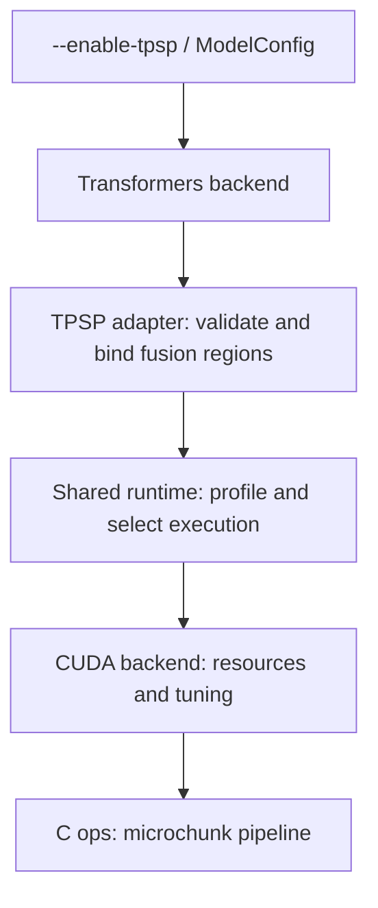

# TPSP Design

## 1. Motivation

Tensor parallelism (TP) partitions projection weights and computation across ranks, but some computation between projections remains replicated. After a row-parallel projection and its AllReduce, every rank holds the same hidden states and independently executes the same residual addition and normalization.

TPSP temporarily introduces sequence parallelism (SP) inside this region. It replaces the AllReduce boundary with ReduceScatter (RS) and AllGather (AG), assigning different tokens to different ranks while preserving the complete hidden dimension for each token:

```text
Conventional TP:
    local projection -> AllReduce -> replicated residual add and norm

TPSP:
    local projection -> ReduceScatter -> local residual add and norm -> AllGather
```

For `T` tokens, hidden size `H`, and `P` TP ranks, each rank normalizes approximately `[T / P, H]` instead of `[T, H]`. The next TP projection still receives the full `[T, H]` normalized tensor. This is a local change to the execution region, not sequence sharding throughout the model.

The opportunity resembles arbitrage: exchange one execution strategy for another only when the net result is favorable. The comparison is not simply duplicated computation versus two additional communications, because the conventional path already performs an AllReduce. Instead, TPSP decomposes the reduction and replication into RS and AG, distributes the intermediate computation, and overlaps communication with projection computation using microchunks.

The relevant decision is:

```text
latency(projection + AllReduce + replicated add/norm)
    >
latency(pipelined projection + RS + sharded add/norm + AG)
```

Smaller GEMMs, packing, synchronization, memory traffic, and pipeline startup or drain can consume the savings. Long prefills provide more work to pipeline, but neither a long prompt nor structural compatibility guarantees a benefit. TPSP must identify an advantageous operating range and retain conventional execution elsewhere.

## 2. Design Challenges

- **Finding the opportunity:** Identify profitable token ranges and microchunk configurations for each projection shape, TP size, and device, without excessive profiling cost.
- **Balancing performance and generality:** Preserve the HF forward while exposing enough of the intermediate computation to pipeline it with communication.
- **Falling back safely:** Retain conventional execution when TPSP is unsupported or unprofitable, with minimal impact on existing behavior and performance. Execution errors must remain visible.
- **Maintaining correctness:** Preserve residual and normalization semantics across layer boundaries, and synchronize chunk ownership and buffer reuse across ranks.

## 3. Design Overview

### Architecture



The adapter validates fusion regions before installing local AST rewrites and projection/norm wrappers; it does not replace the decoder with a model-specific forward. Shared profiling policy lives in `tpsp_runtime.py`, CUDA resource management in `vllm/platforms/tpsp_cuda.py`, and native execution in `csrc/cuda_tpsp.cu`.

### Fusion regions

The current dense implementation has two sites per layer:

```text
o_proj    -> RS -> residual add + post-attention norm -> AG -> MLP
down_proj -> RS -> residual add + next-layer input norm -> AG -> next attention
```

The last down projection uses the final model norm. The first input norm executes normally and initializes a token-sharded residual; subsequent fused projections update that residual and return gathered normalized states. Active wrappers skip the residual additions and norm computations already performed by the fused path.

The MoE design extends the same idea to routing and expert reordering:

```text
o_proj -> RS -> add/norm -> routing + AG/permute -> grouped GEMM
grouped GEMM -> unpermute/RS -> add/next norm -> AG
```

Routing runs on token shards, with reordering preparation overlapping AG. This extension is not implemented by the current dense adapter.

### Microchunk pipeline

Each chunk executes `GEMM -> RS -> add/norm -> AG`. Later GEMMs overlap earlier chunks' communication and normalization on a separate stream. Three reusable slots are protected by readiness/completion events and peer handshakes; uneven token partitions use padding, but only valid rows update residuals and outputs.

The chunk loop stays inside the native operator, not the HF modeling code. Gathered output borrows a shared backend workspace and must be consumed before the next TPSP call.

### Profiling and fallback

After weights load, TPSP prepares projection weights and tunes microchunk size and CUDA SM-count targets independently for representative `o_proj` and `down_proj` groups. Candidate numerical checks precede a token-threshold search comparing the sum of their conventional and fused timings, using the slowest rank. The threshold estimates operator-level benefit, not guaranteed end-to-end speedup.

Each forward selects TPSP by its actual batched token count. Unsupported regions, unavailable kernels/P2P, inconclusive profiles, or calls below the threshold use original forwards. Invalid configurations and active execution errors propagate rather than silently retrying. With TPSP disabled, no adapter is constructed.

`--tpsp-microchunk-tokens` and `--tpsp-threshold-tokens` override automatic choices. Supplying both bypasses configuration scanning and its numerical check; an override is not evidence of benefit.

## 4. Constraints

- **Execution:** Transformers backend, CUDA BF16, TP size at least two, hidden size divisible by TP size, pipeline parallel size one, and working direct P2P support.
- **Features:** Standard RMSNorm without norm bias; no quantization, LoRA, or intermediate HF outputs. Speculative methods requiring extracted target hidden states are restricted.
- **Model structure:** Sequential decoder layers and validated projection/residual/norm patterns, with matching projection shapes within each group. Extra post-norms, layer scales, side branches, or heterogeneous shapes may require dedicated adaptation.
- **Resources:** Calls must fit the profiled token maximum; CUDA microchunks are capped at 4096 tokens per rank. Transposed weights and pipeline buffers consume extra memory, and shared workspace assumes sequential invocation.

## 5. To-do

- [ ] **FP8 dense:** Support quantized projections and scale handling across microchunks.
- [ ] **MXFP4 / NVFP4 dense:** Support low-bit weight layouts, scaling, and compatible fused execution.
- [ ] **Specific dense models:** Support the Gemma family and other models requiring specialized normalization or residual patterns.
- [ ] **Hybrid dense models:** Adapt fusion regions for models mixing linear and full attention.
- [ ] **MoE:** Support MoE models.
