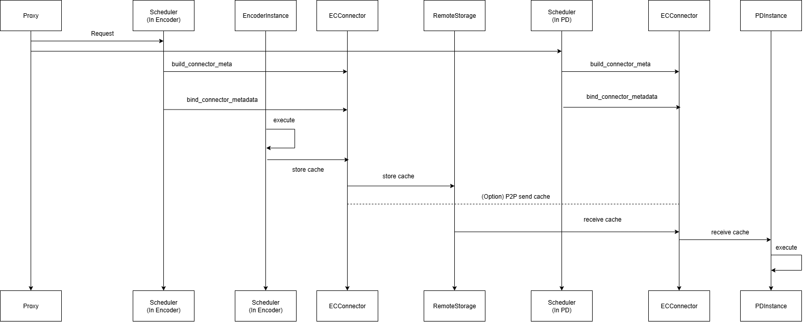

# Disaggregated Encoder

A **disaggregated encoder** runs the vision-encoder stage of a multimodal LLM in a process that is separate from the pre-fill / decoder stage. Deploying these two stages in independent vLLM instances brings three practical benefits:

1. **Independent, fine-grained scaling**  
2. **Lower time-to-first-token (TTFT)**  
3. **Cross-process reuse and caching of encoder outputs**

Design doc: <https://docs.google.com/document/d/1aed8KtC6XkXtdoV87pWT0a8OJlZ-CpnuLLzmR8l9BAE>

---

## 1  Motivation

### 1. Independent, fine-grained scaling

* Vision encoders are lightweight, while language models are orders of magnitude larger.  
* The language model can be parallelised without affecting the encoder fleet.  
* Encoder nodes can be added or removed independently.

### 2. Lower time-to-first-token (TTFT)

* Language-only requests bypass the vision encoder entirely.  
* Encoder output is injected only at required attention layers, shortening the pre-fill critical path.

### 3. Cross-process reuse and caching

* In-process encoders confine reuse to a single worker.  
* A remote, shared cache lets any worker retrieve existing embeddings, eliminating redundant computation.

---

## 2  Usage Example

### ExampleConnector

The following scripts demonstrate the workflow with **ExampleConnector**:

1 Encoder instance + 1 PD instance:
`examples/disaggregated/disaggregated_encoder/disagg_1e1pd_example.sh`

1 Encoder instance + 1 Prefill instance + 1 Decode instance:
`examples/disaggregated/disaggregated_encoder/disagg_1e1p1d_example.sh`

### ECMooncakeConnector

**ECMooncakeConnector** transfers encoder outputs using the Mooncake TransferEngine.
See the [ECMooncakeConnector Usage Guide](mooncake_ec_connector_usage.md) for
producer/consumer `--ec-transfer-config`, proxy `--ec-consumer-zmq-addrs`, and
transport options. The [Mooncake integration example](../../tests/v1/ec_connector/integration/run_epd_mooncake_ec_full_pipeline.sh)
is a complete 1 Encoder instance + 1 PD instance setup.

With vLLM and Mooncake installed, run the example from the repository root:

```bash
GPU_E=0 GPU_PD=1 MOONCAKE_EC_PROTOCOL=tcp \
    bash tests/v1/ec_connector/integration/run_epd_mooncake_ec_full_pipeline.sh
```

The script uses `Qwen/Qwen2.5-VL-3B-Instruct` by default, runs a single-GPU baseline,
and compares the disaggregated outputs against it. Set `MODEL` to use another model
or `MOONCAKE_EC_PROTOCOL=rdma` to use RDMA on supported hardware. See the script for
additional configuration options.

### Audio inputs

The Python EPD proxy also rewrites audio in `/v1/chat/completions` into
metadata-only references for Qwen2-Audio, AudioFlamingo3, Ultravox,
Qwen2.5-Omni, and Qwen3-Omni. The encoder publishes `audio_num_tokens`
(the placeholder token count of each audio) together with any feature
lengths the model needs; the consumer uses them to reconstruct the audio
placeholders and receives the embeddings through its EC connector without
repeating audio preprocessing.

Qwen2.5-Omni and Qwen3-Omni also support videos with an embedded audio track
using `mm_processor_kwargs={"use_audio_in_video": true}` in the request. Start
both instances with `--trust-request-mm-kwargs` only for trusted clients.
The proxy keeps one
`video_embeds` content part per video, with an additional `audio_embeds` payload
for its audio track. Both features share the source UUID but retain their own
EC hashes and transfer handles. Audio lengths and video timing reconstruct the
interleaved placeholders and M-RoPE positions without decoding the media again.
If any item lacks metadata, the entire audio/video request falls back to raw
media rather than mixing raw and metadata-only inputs.

This does not add `/v1/audio/transcriptions` or realtime routes to the example
proxy.

### Token-level HTTP handoff

Enable `--enable-scale-out` on each worker to use
`POST /inference/v1/generate`. Send the Python EPD proxy a Generate request
with `token_ids` containing unexpanded media markers and `content_parts`
in marker order. Each part has a `type` (for example, `image_url`), a
`url`, and an optional `uuid`. The final response has the regular Generate
format, including streaming when requested. For inline audio, use an
`input_audio` part with `input_audio: {"data": "...", "format": "wav"}`.
Workers handling raw media accept `mm_processor_kwargs` and `media_io_kwargs`
when started with `--trust-request-mm-kwargs`, including `use_audio_in_video`
on models that support it. In metadata-only mode, the proxy sends those
overrides only to E.

The proxy asks E for `return_prompt_features`. It forwards the expanded
tokens, layout-only `features`, and EC parameters to P or PD. For E/P/D,
the proxy forwards the layout and P's KV parameters to D without EC
parameters. This requires a decode worker whose Generate endpoint accepts
metadata-only requests backed by remote prefill KV. If D does not support
that input, use E+PD or the existing Chat Completions path. Use dynamic
registration to advertise P's control address when using Mooncake EC with
separate P and D.

To distribute media in one request across multiple E instances, set the
corresponding `--image-fanout-token-id`, `--audio-fanout-token-id`, or
`--video-fanout-token-id` to the model's unexpanded marker ID. For example,
Qwen3-VL uses `151655` for images, and Qwen2.5-Omni uses `151646` for audio
and `151656` for video. The model's processor must declare that it can
expand the marker independently. The proxy batches images sent to the same
E, but sends each audio clip or video intact in its own subrequest. It
reassembles results in input order, including repeated media. An audio
track extracted from a video stays with that video's fragment. Mixed
media or requests with per-item option lists go to a single E.

`--decode-retries` also applies to Generate: on a decode HTTP 500 before
the response starts, the proxy reruns the worker stages from the original
input with fresh transfer handles. It does not retry an in-progress stream
or a request supplied with externally prepared features or transfer handles.
For debugging, `--no-rewrite` forwards raw media to P/PD; an independent D
still receives the expanded layout and KV parameters.

---

## 3  Test Script

For optional cross-Encoder output reuse while retaining Mooncake P2P delivery,
see [Cross-encoder output reuse](cross_encoder_cache.md).

Please refer to the directories `tests/v1/ec_connector`

## 4  Development

Disaggregated encoding is implemented by running two parts:

* **Encoder instance** – a vLLM instance to performs vision encoding.  
* **Prefill/Decode (PD) instance(s)** – runs language pre-fill and decode.
    * PD can be in either a single normal instance with `disagg_encoder_example.sh` (E->PD) or in disaggregated instances with `disagg_epd_example.sh` (E->P->D)

A connector transfers encoder-cache (EC) embeddings from the encoder instance to the PD instance.  
All related code is under `vllm/distributed/ec_transfer`.

### Key abstractions

* **ECConnector** – interface for retrieving EC caches produced by the encoder.  
    * *Scheduler role* – checks cache existence and schedules loads.  
    * *Worker role* – loads the embeddings into memory.

Here is a figure illustrating disaggregate encoder flow:



For the PD disaggregation part, the Prefill instance receives cache exactly the same as the disaggregated encoder flow above. Prefill instance executes 1 step (prefill -> 1 token output) and then transfers KV cache to the Decode instance for the remaining execution. The KV transfer part purely happens after the execution of the PD instance.

`docs/features/disagg_prefill.md` shows the brief idea about the disaggregated prefill (v0)

We create the example setup with the **NixlConnector** from `vllm/distributed/kv_transfer/kv_connector/v1/nixl/` and referred to the `tests/v1/kv_connector/nixl_integration/toy_proxy_server.py` to facilitate the kv transfer between P and D;
