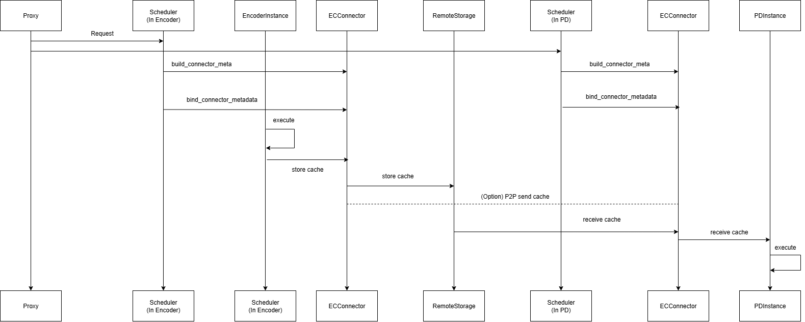

# Disaggregated Encoder

A **disaggregated encoder** runs the vision-encoder stage of a multimodal LLM in a process that is separate from the pre-fill / decoder stage. Deploying these two stages in independent vLLM instances brings three practical benefits:

1. **Independent, fine-grained scaling**  
2. **Lower time-to-first-token (TTFT)**  
3. **Cross-process reuse and caching of encoder outputs**

Design doc: <https://docs.google.com/document/d/1aed8KtC6XkXtdoV87pWT0a8OJlZ-CpnuLLzmR8l9BAE>

---

## 1  Motivation

### 1. Independent, fine-grained scaling

* Vision encoders are lightweight, while language models are orders of magnitude larger.  
* The language model can be parallelised without affecting the encoder fleet.  
* Encoder nodes can be added or removed independently.

### 2. Lower time-to-first-token (TTFT)

* Language-only requests bypass the vision encoder entirely.  
* Encoder output is injected only at required attention layers, shortening the pre-fill critical path.

### 3. Cross-process reuse and caching

* In-process encoders confine reuse to a single worker.  
* A remote, shared cache lets any worker retrieve existing embeddings, eliminating redundant computation.

---

## 2  Usage Example

### ExampleConnector

The following scripts demonstrate the workflow with **ExampleConnector**:

1 Encoder instance + 1 PD instance:
`examples/disaggregated/disaggregated_encoder/disagg_1e1pd_example.sh`

1 Encoder instance + 1 Prefill instance + 1 Decode instance:
`examples/disaggregated/disaggregated_encoder/disagg_1e1p1d_example.sh`

### ECMooncakeConnector

**ECMooncakeConnector** transfers encoder outputs using the Mooncake TransferEngine.
See the [ECMooncakeConnector Usage Guide](mooncake_ec_connector_usage.md) for
producer/consumer `--ec-transfer-config`, proxy `--ec-consumer-zmq-addrs`, and
transport options. The [Mooncake integration example](../../tests/v1/ec_connector/integration/run_epd_mooncake_ec_full_pipeline.sh)
is a complete 1 Encoder instance + 1 PD instance setup.

With vLLM and Mooncake installed, run the example from the repository root:

```bash
GPU_E=0 GPU_PD=1 MOONCAKE_EC_PROTOCOL=tcp \
    bash tests/v1/ec_connector/integration/run_epd_mooncake_ec_full_pipeline.sh
```

The script uses `Qwen/Qwen2.5-VL-3B-Instruct` by default, runs a single-GPU baseline,
and compares the disaggregated outputs against it. Set `MODEL` to use another model
or `MOONCAKE_EC_PROTOCOL=rdma` to use RDMA on supported hardware. See the script for
additional configuration options.

### Audio inputs

The Python EPD proxy also rewrites audio in `/v1/chat/completions` into
metadata-only references for Qwen2-Audio, AudioFlamingo3, Ultravox,
Qwen2.5-Omni, and Qwen3-Omni. The encoder publishes `audio_num_tokens`
(the placeholder token count of each audio) together with any feature
lengths the model needs; the consumer uses them to reconstruct the audio
placeholders and receives the embeddings through its EC connector without
repeating audio preprocessing.

Qwen2.5-Omni and Qwen3-Omni also support videos with an embedded audio track
using `mm_processor_kwargs={"use_audio_in_video": true}` in the request. Start
both instances with `--trust-request-mm-kwargs` only for trusted clients.
The proxy keeps one
`video_embeds` content part per video, with an additional `audio_embeds` payload
for its audio track. Both features share the source UUID but retain their own
EC hashes and transfer handles. Audio lengths and video timing reconstruct the
interleaved placeholders and M-RoPE positions without decoding the media again.
If any item lacks metadata, the entire audio/video request falls back to raw
media rather than mixing raw and metadata-only inputs.

This does not add `/v1/audio/transcriptions` or realtime routes to the example
proxy.

---

## 3  Test Script

For optional cross-Encoder output reuse while retaining Mooncake P2P delivery,
see [Cross-encoder output reuse](cross_encoder_cache.md).

Please refer to the directories `tests/v1/ec_connector`

### Python proxy with native Rust gRPC workers

The Python proxy accepts `grpc://host:port` worker URLs in static mode and
through its dynamic registration API. This uses vLLM's native Rust
`Inference`/`Control` services, not the SMG `VllmEngine` protocol. Start workers
with `vllm-rs serve ... --grpc-port PORT`, using the same model and processing
configuration as the proxy. E is an EC producer; P is an EC consumer and KV
producer; D is a KV consumer. E+PD is also supported.

Run the proxy from a vLLM source checkout matching the workers and install the
Python gRPC dependencies. At startup, the proxy generates bindings
from `rust/proto/` in a subprocess and imports only the generated Python modules,
keeping the native proto compiler isolated from model extensions:

```bash
uv pip install --python .venv/bin/python grpcio-tools grpcio-health-checking

ADMIN_API_KEY=example-key .venv/bin/python -m \
  examples.disaggregated.disaggregated_encoder.disagg_epd_proxy \
  --dynamic-registration --port 8000 \
  --grpc-model Qwen/Qwen2.5-VL-3B-Instruct
```

The launcher registers each running worker over HTTP. For example, with E, P
and D listening on gRPC ports 18001, 18002 and 18003:

```bash
curl -f http://localhost:8000/instances -H 'X-API-Key: example-key' \
  -H 'Content-Type: application/json' \
  -d '{"role":"encode","url":"grpc://localhost:18001"}'
curl -f http://localhost:8000/instances -H 'X-API-Key: example-key' \
  -H 'Content-Type: application/json' \
  -d '{"role":"prefill","url":"grpc://localhost:18002"}'
curl -f http://localhost:8000/instances -H 'X-API-Key: example-key' \
  -H 'Content-Type: application/json' \
  -d '{"role":"decode","url":"grpc://localhost:18003"}'
```

For Mooncake PUSH, include P's `ec_zmq_addrs` in its registration, one address
per `dp_size` replica, exactly as for HTTP workers. The proxy pins P's DP rank
and gives E the corresponding transfer destination. NIXL PULL and the example
connector do not need these addresses. Register `prefill_decode` instead of
separate `prefill`/`decode` workers for E+PD. Existing registration, removal
and health-probe behavior applies to gRPC workers too.

Clients continue to call `/v1/chat/completions` over HTTP, including streaming.
The proxy renders and tokenizes the chat template without fetching or
preprocessing raw media. E receives the original media URL or data URI over
gRPC, then preprocesses it and expands its prompt placeholders. After encoding,
the proxy reuses the existing metadata-only rewrite: P and D receive placeholder
metadata rather than pixels when available. The proxy prepares these small
metadata-only features using vLLM's Python renderer; it loads no model weights.
The adapter loads sampling defaults once per model and reuses identical P/D
prompt rendering within one request attempt when no request-adjusting parser
is involved. Sampling limits and transfer handles remain stage-specific.
EC and KV tensors still move through their configured connectors, not gRPC.
P's EC handles are not forwarded to D. Cancellation and RPC errors trigger a
best-effort `Control.Abort` for the affected engine request.

Use `--grpc-reasoning-parser` when output needs a reasoning parser, and
`--grpc-trust-request-mm-kwargs` only for trusted clients that override media
processing options. The current gRPC adapter supports one output sequence
(`n=1`); streaming stop strings, prompt logprobs, echo, and beam search are
rejected. Inline embedding/metadata features must fit the Rust frontend's
16 MiB per-request limit; raw image URLs and data URIs do not use this inline
feature budget. Raw media uses the worker's processing
configuration; per-request media/processor overrides, raw/embedding mixtures
and tool calls with raw media are rejected. `--grpc-request-timeout` sets the
RPC deadline (300 seconds by default). The existing HTTP backend path is unchanged.

## 4  Development

Disaggregated encoding is implemented by running two parts:

* **Encoder instance** – a vLLM instance to performs vision encoding.  
* **Prefill/Decode (PD) instance(s)** – runs language pre-fill and decode.
    * PD can be in either a single normal instance with `disagg_encoder_example.sh` (E->PD) or in disaggregated instances with `disagg_epd_example.sh` (E->P->D)

A connector transfers encoder-cache (EC) embeddings from the encoder instance to the PD instance.  
All related code is under `vllm/distributed/ec_transfer`.

### Key abstractions

* **ECConnector** – interface for retrieving EC caches produced by the encoder.  
    * *Scheduler role* – checks cache existence and schedules loads.  
    * *Worker role* – loads the embeddings into memory.

Here is a figure illustrating disaggregate encoder flow:



For the PD disaggregation part, the Prefill instance receives cache exactly the same as the disaggregated encoder flow above. Prefill instance executes 1 step (prefill -> 1 token output) and then transfers KV cache to the Decode instance for the remaining execution. The KV transfer part purely happens after the execution of the PD instance.

`docs/features/disagg_prefill.md` shows the brief idea about the disaggregated prefill (v0)

We create the example setup with the **NixlConnector** from `vllm/distributed/kv_transfer/kv_connector/v1/nixl/` and referred to the `tests/v1/kv_connector/nixl_integration/toy_proxy_server.py` to facilitate the kv transfer between P and D;
