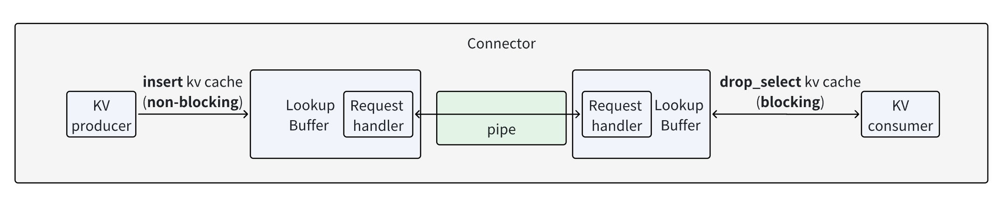
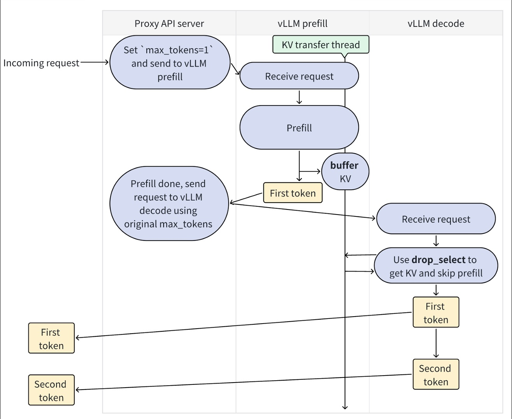
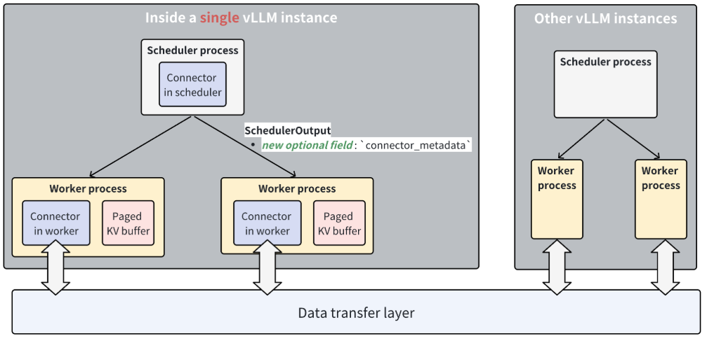
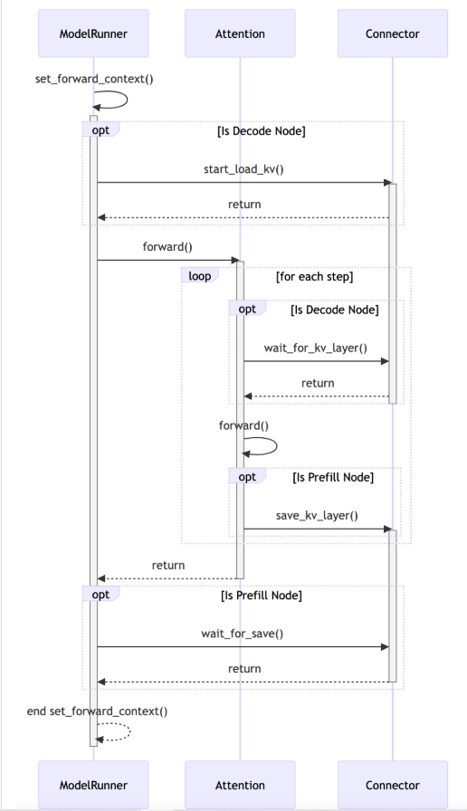

# Disaggregated Prefilling (experimental)

This page introduces you to the disaggregated prefilling feature in vLLM.

!!! note
    This feature is experimental and subject to change.

## Why disaggregated prefilling?

Two main reasons:

- **Tuning time-to-first-token (TTFT) and inter-token-latency (ITL) separately**. Disaggregated prefilling put prefill and decode phase of LLM inference inside different vLLM instances. This gives you the flexibility to assign different parallel strategies (e.g. `tp` and `pp`) to tune TTFT without affecting ITL, or to tune ITL without affecting TTFT.
- **Controlling tail ITL**. Without disaggregated prefilling, vLLM may insert some prefill jobs during the decoding of one request. This results in higher tail latency. Disaggregated prefilling helps you solve this issue and control tail ITL. Chunked prefill with a proper chunk size also can achieve the same goal, but in practice it's hard to figure out the correct chunk size value. So disaggregated prefilling is a much more reliable way to control tail ITL.

!!! note
    Disaggregated prefill DOES NOT improve throughput.

## Usage example

Now supports 9 types of connectors:

- **ExampleConnector**: refer to [examples/disaggregated/example_connector/run.sh](../../examples/disaggregated/example_connector/run.sh) for the example usage of ExampleConnector disaggregated prefilling.
- **LMCacheConnectorV1**: refer to [examples/disaggregated/lmcache/disagg_prefill_lmcache_v1/disagg_example_nixl.sh](../../examples/disaggregated/lmcache/disagg_prefill_lmcache_v1/disagg_example_nixl.sh) for the example usage of LMCacheConnectorV1 disaggregated prefilling which uses NIXL as the underlying KV transmission. LMCache also offers a multi-process (MP) mode via `LMCacheMPConnector`, where a standalone `lmcache server` holds the KV cache shared by one or more vLLM instances; see the [LMCache examples](../../examples/disaggregated/lmcache/README.md) and the [LMCache docs](https://docs.lmcache.ai) for setup.
- **NixlConnector**: refer to [tests/v1/kv_connector/nixl_integration/run_accuracy_test.sh](../../tests/v1/kv_connector/nixl_integration/run_accuracy_test.sh) for the example usage of NixlConnector disaggregated prefilling which support fully async send/recv. For detailed usage guide, see [NixlConnector Usage Guide](nixl_connector_usage.md). For feature compatibility details, see [NixlConnector Compatibility Matrix](nixl_connector_compatibility.md). You may specify one or multiple NIXL transfer backends, such as:

  ```bash
  --kv-transfer-config '{"kv_connector":"NixlConnector","kv_role":"kv_both", "kv_buffer_device":"cuda", "kv_connector_extra_config":{"backends":["UCX", "GDS"]}}'
  ```

- **MooncakeConnector**: refer to [examples/disaggregated/mooncake_connector/run_mooncake_connector.sh](../../examples/disaggregated/mooncake_connector/run_mooncake_connector.sh) for the example usage of MooncakeConnector disaggregated prefilling. For detailed usage guide, see [MooncakeConnector Usage Guide](mooncake_connector_usage.md). For multimodal encoder-cache transfer, see [ECMooncakeConnector Usage Guide](mooncake_ec_connector_usage.md).
- **MoRIIOConnector** (ROCm only): see [MoRI-IO Usage Guide](moriio_connector_usage.md) for example usage and detailed documentation.
- **MultiConnector**: take advantage of the kv_connector_extra_config: dict[str, Any] already present in KVTransferConfig to stash all the connectors we want in an ordered list of kwargs.such as:

  ```bash
  --kv-transfer-config '{"kv_connector":"MultiConnector","kv_role":"kv_both","kv_connector_extra_config":{"connectors":[{"kv_connector":"NixlConnector","kv_role":"kv_both"},{"kv_connector":"ExampleConnector","kv_role":"kv_both","kv_connector_extra_config":{"shared_storage_path":"local_storage"}}]}}'
  ```

- **OffloadingConnector**: enable offloading of KV data to CPU memory, customizing the CPU block size (in tokens) and total CPU memory bytes to allocate:

  ```bash
  --kv-transfer-config '{"kv_connector":"OffloadingConnector","kv_role":"kv_both","kv_connector_extra_config":{"block_size": 64, "cpu_bytes_to_use": 1000000000}}'
  ```

  For multi-tier offloading (e.g., CPU + filesystem tier) and the full configuration reference, see the [KV Offloading Usage Guide](kv_offloading_usage.md).

- **FlexKVConnectorV1**: refer to [examples/disaggregated/flexkv_connector/prefix_caching_flexkv.py](../../examples/disaggregated/flexkv_connector/prefix_caching_flexkv.py) for the example usage of FlexKVConnectorV1. FlexKV is a distributed KV Store and multi-level cache management system for ultra-large-scale LLM inference.

  ```bash
  --kv-transfer-config '{"kv_connector":"FlexKVConnectorV1","kv_role":"kv_both"}'
  ```

## Reusing prefill token ids on decode

!!! note
    This applies to disaggregated prefill and decode serving on the `/v1/chat/completions` endpoint, using a KV connector configured as in the Usage example above. It is experimental and subject to change.

In disaggregated serving, the prefill and decode stages both render the chat prompt from `messages` and tokenize it. Because the prefill stage has already produced the token ids, the decode stage can reuse them and skip its own templating and tokenization. The output is otherwise identical to a normal chat completion: it is detokenized to text, and tool and reasoning parsing, streaming, and structured output constraints all still apply.

The token ids are passed to the decode stage through `kv_transfer_params`, the dict already attached to the decode request to coordinate the transfer:

1. Send the prefill request with `return_token_ids` enabled, and read `prompt_token_ids` from the response.
2. Set `kv_transfer_params["prompt_token_ids"]` to those ids on the decode request. `messages` is still required, but its content is not tokenized when the ids are present.

```python
prefill = client.chat.completions.create(
    model=model,
    messages=messages,
    extra_body={"return_token_ids": True, "kv_transfer_params": {"do_remote_decode": True}},
)
ids = prefill.prompt_token_ids

decode = client.chat.completions.create(
    model=model,
    messages=messages,
    stream=True,
    extra_body={"kv_transfer_params": {"do_remote_prefill": True, "prompt_token_ids": ids}},
)
```

If `messages` has non-text content or `echo` is set, the ids are ignored and `messages` is rendered instead, so it must match the prefill request. Otherwise `kv_transfer_params["prompt_token_ids"]` must be a non-empty list of non-negative integers, or the request fails with HTTP 400, as it always does on `/v1/chat/completions/batch`.

## Generate API output modes

When the prefill and decode stages use the [Generate API](../serving/online_serving/token_in_token_out.md) (`/inference/v1/generate`), only the decode response reaches the client, so set `output_mode` on the decode request only. A proxy that reuses the client's request body for the prefill request must reset `output_mode` to `tokens` there. A prefill instance started with `--tokens-only` has no tokenizer and rejects `output_mode: "text"` with a 400.

A decode instance that returns text needs a tokenizer, so start it with `--enable-scale-out` and without `--tokens-only`. Prefill instances can keep `--tokens-only`.

## Development

We implement disaggregated prefilling by running 2 vLLM instances. One for prefill (we call it prefill instance) and one for decode (we call it decode instance), and then use a connector to transfer the prefill KV caches and results from prefill instance to decode instance.

All disaggregated prefilling implementation is under `vllm/distributed/kv_transfer`.

Key abstractions for disaggregated prefilling:

- **Connector**: Connector allows **kv consumer** to retrieve the KV caches of a batch of request from **kv producer**.
- **LookupBuffer**: LookupBuffer provides two API: `insert` KV cache and `drop_select` KV cache. The semantics of `insert` and `drop_select` are similar to SQL, where `insert` inserts a KV cache into the buffer, and `drop_select` returns the KV cache that matches the given condition and drop it from the buffer.
- **Pipe**: A single-direction FIFO pipe for tensor transmission. It supports `send_tensor` and `recv_tensor`.

!!! note
    `insert` is non-blocking operation but `drop_select` is blocking operation.

Here is a figure illustrating how the above 3 abstractions are organized:



The workflow of disaggregated prefilling is as follows:



The `buffer` corresponds to `insert` API in LookupBuffer, and the `drop_select` corresponds to `drop_select` API in LookupBuffer.

Now every process in vLLM will have a corresponding connector. Specifically, we have:

- Scheduler connector: the connector that locates in the same process as the scheduler process. It schedules the KV cache transfer ops.
- Worker connectors: the connectors that locate in the worker processes. They execute KV cache transfer ops.

Here is a figure illustrating how the above 2 connectors are organized:



The figure below shows how the worker connector works with the attention module to achieve layer-by-layer KV cache store and load:



## Third-party contributions

### Asynchronous connector initialization

`KVConnectorBase_V1` connectors are ready by default. A connector that permits
GPU-only serving during initialization can inherit `SupportsAsyncInit` instead
(Model Runner V2 only) and implement `is_init_done()`. The hook reports whether
the current worker's setup has finished; how that setup runs is up to the
connector. Raise any initialization error from that hook; errors terminate the
engine.

Readiness is latched: this interface supports startup, not runtime disable or
reconfiguration. The scheduler activates a connector only after every worker has
reported ready. Workers continue reporting until the scheduler acknowledges
readiness by sending real connector metadata. Reports travel with ordinary engine
steps; initialization alone does not keep an idle engine stepping. After an idle
period, requests admitted before the scheduler observes readiness are served
without that connector for their whole lifetime, even if workers have already
finished initializing. Initialization errors are also observed when stepping
resumes. Workers raise if setup is not done within
`VLLM_KV_CONNECTOR_INIT_TIMEOUT` seconds (default 1800), checked on engine steps.

Requests admitted before readiness remain excluded for their whole lifetime,
including chunked prefill, preemption and completion notifications. With
`MultiConnector`, eligibility is tracked separately for each child, so ready
children can serve while others initialize. Only opt into asynchronous startup
when skipping the connector is valid; a required P/D transfer cannot be skipped.

Scheduler-side callers route request hooks through a handler resolved once per
connector with `get_request_handler()`, which owns exclusions, metadata filtering
and completion cleanup. Connector implementations keep their existing hooks;
`MultiConnector` uses each child's handler to apply the same rules independently.

Request exclusion does not hide physical block reuse. The scheduler-local
`SchedulerOutput.kv_connector_block_state.allocated_block_ids` includes allocations
for **all** requests, including asynchronous loads. Allocations are recorded by
the block pool and drained once per scheduler step. Connectors with pending
transfers must use these IDs, together with copy-on-write destinations in
`kv_cache_block_copies`, to fence transfers before GPU memory is overwritten.
These allocation notifications remain available even when the connector's request
view is empty.

Initialization does not suppress lifecycle hooks. Metadata reporting, worker
output updates, statistics, cache reset and shutdown must be safe while the
connector is initializing. Request transfer hooks are skipped until the
scheduler sends real metadata. Background allocation or other initialization
work remains the connector's responsibility.

Async initialization requires Model Runner V2. `SupportsAsyncInit` raises during
construction if Model Runner V1 is selected, including automatic fallback to V1.
It also currently rejects multi-rank `external_launcher` and Ray pipeline
parallelism due to limitations in collecting readiness from every worker in those
output paths. Synchronous connectors remain supported on Model Runner V1.

### Implementing a connector

Disaggregated prefilling is highly related to infrastructure, so vLLM relies on third-party connectors for production-level disaggregated prefilling (and vLLM team will actively review and merge new PRs for third-party connectors).

We recommend three ways of implementations:

- **Fully-customized connector**: Implement your own `Connector`, and call third-party libraries to send and receive KV caches, and many many more (like editing vLLM's model input to perform customized prefilling, etc.). This approach gives you the most control, but at the risk of being incompatible with future vLLM versions.
- **Database-like connector**: Implement your own `LookupBuffer` and support the `insert` and `drop_select` APIs just like SQL.
- **Distributed P2P connector**: Implement your own `Pipe` and support the `send_tensor` and `recv_tensor` APIs, just like `torch.distributed`.
