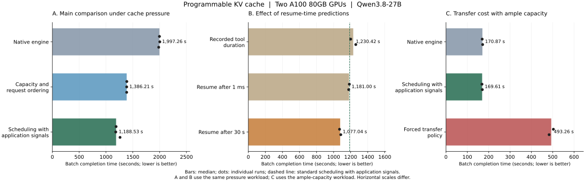

# Programmable KV Caching for Multi-Turn Agent Inference: Design, Implementation, and Experimental Results

## 1. The RFC and the Implemented Design

### 1.1 Why Cache Management Needs Application Information

Large language models process text as tokens and compute intermediate key and value states during attention. An inference system retains these states in a KV cache so that subsequent generation can reuse context that has already been computed. When multiple requests begin with the same content, that content forms a shared prefix. If its cache remains available, the engine can avoid computing that part of the input again. vLLM is an inference engine that executes models, schedules requests, and manages these caches. This work builds on its existing prefix reuse capabilities to improve cache efficiency across multiple model calls.

Agent applications commonly alternate between model generation and external tool calls. A task may generate a tool invocation, wait for a retrieval or calculation result, and then continue with the preceding context. It may also create several parallel branches from the same context. We refer to a task that spans multiple model calls as a session. While a session is paused, its cache may have no active request referencing it, even though the next call will need it. Competing sessions can then cause that cache to be reclaimed, requiring the context to be recomputed when the session resumes.

Recent access history alone cannot reliably distinguish a tool call that will resume shortly, an abandoned branch, and a task that will remain idle for a long time. The application knows these lifecycle details, but it does not have an accurate, immediate view of available GPU memory, ongoing generation, or transfer completion. Cooperation therefore requires each side to contribute the information it owns: the application describes future needs, and the engine determines what can execute under current resource conditions.

The design proposal, or Request for Comments (RFC), [*Programmable KV Cache: Composable Policies for Agentic Serving*](https://github.com/vllm-project/vllm/issues/57103), proposes a programmable cache framework around this division of responsibility. Programmability allows applications to express intentions about cache retention, movement, and sharing, while allowing different decision policies to run inside the engine. The engine continues to validate and execute operations; applications do not receive arbitrary access to GPU memory.

The RFC distinguishes two kinds of application input. Explicit commands request an operation, such as raising the retention priority of a prefix or copying it to a storage location. Lifecycle signals describe task state, such as the start of a tool call, an expected resume time, or a cancelled branch. Commands require feedback about what actually happened, while signals inform local policy decisions. Both use the same execution mechanism, allowing direct application control to coexist with autonomous engine decisions.

The RFC's central contribution is a common contract for resource decisions and completion. Policies for retention, movement, and request scheduling observe the same capacity, waiting demand, and transfer state, and the engine checks their proposals against a shared resource budget. If two policies request the same prefix, their requests should share one physical load. If they request different content that cannot fit simultaneously, some work must be selected, deferred, or rejected. This makes policies composable without giving each algorithm an independent and potentially inconsistent account of available capacity.

### 1.2 From the Proposal to Executable Cache Control

The related code contribution is [PR #62382](https://github.com/vllm-project/vllm/pull/62382). The implementation follows the RFC's responsibility boundaries and integrates them with vLLM's request scheduling, cache allocation, and data transfers. Applications submit a common control message that identifies the target session or context range, the requested operation, and an identifier for correlating its result. A message can accompany a model request or arrive independently during a tool pause, allowing cache management between model calls.

The engine resolves the logical target to actual cache content, checks capacity and current use, and then delegates approved work to a storage connector. Connectors exchange data with storage backends; the engine retains authority over resource use. The implementation supports local host memory and Mooncake shared storage. With shared storage, a compatible destination engine can load cache saved by another engine and continue the task.

| Capability | Implemented behavior | Resource constraint |
| --- | --- | --- |
| Adjust retention priority | Prefer important sessions or shared prefixes when choosing which cache to reclaim | Priority can yield under pressure and does not guarantee permanent GPU residency |
| Copy cache | Create a reusable copy at the destination while retaining the source | The destination must have sufficient capacity, and the copy becomes usable only after completion |
| Move cache | Establish a valid destination copy before reclaiming eligible source capacity | Source data still used by a request or transfer cannot be released early |
| Manage sessions and branches | Track sharing and handle resume, cancellation, and completion | Ending one branch must preserve shared content still needed by another session |

Asynchronous transfers make completion semantics essential: submitting a transfer does not make the destination cache usable. In inference across two GPUs, the necessary cache components are distributed across participating devices. A later request can reuse the transferred content only after all required components have arrived and been registered as available. Components that arrive early must also remain protected while the rest of a prefix is loading. If a transfer fails or resources are insufficient, the request can fall back to ordinary context recomputation.

The implementation tracks session relationships separately from physical cache locations. A session can therefore remain associated with content after it leaves GPU memory, and sessions sharing one physical load can cancel their own demand independently. Cache compatibility also depends on model weights: after a weight change, cache produced under the old weights must remain isolated from the new version. Reusing that old cache requires restoring the same weight version.

The implemented scope is narrower than the full range discussed in the RFC. It provides retention priorities that remain subject to reclamation, rather than an application guarantee that cache cannot be reclaimed for an extended period. Cross-engine reuse uses shared storage; direct device-to-device transfers and a complete system for distributing requests across machines are outside the implemented scope. The focus is on connecting application intent, engine decisions, and actual cache availability while preserving model computation semantics.

### 1.3 Capacity and Request Ordering: Deciding What Runs Next

On top of this control mechanism, a local policy called **capacity and request ordering** addresses two related questions: how much cache capacity each session may use, and which waiting requests should execute next. Session shares are soft coordination limits. They do not permanently partition GPU memory, unused shares can be borrowed, and a request that has waited long enough can receive relief from its share limit. Every allocation must still satisfy physical capacity constraints.

Capacity accounting considers both running and waiting requests. Running requests need additional cache as they generate new output, so the engine cannot assign all currently free space to new work. Waiting requests may already have a reusable prefix and need space only for the remaining content. For example, if two requests share a long prefix already present in GPU memory, that prefix should not be charged as a new allocation twice. The implementation consequently rechecks free space, expected growth of running requests, and actual cache hits before each allocation.

Request ordering combines importance, elapsed waiting time, and the amount of reusable cache. Favoring requests with more reusable context can reduce recomputation, while increasing priority with waiting time prevents the same class of sessions from always receiving preference. The evaluated configuration uses a 120-second waiting budget for session share restrictions and a 30-second scale for increasing waiting priority. This policy operates on engine state, performs no cache transfers itself, and does not require a tool-pause prediction for every call. It therefore provides a separate comparison for the benefits of capacity accounting and request ordering.

### 1.4 Scheduling with Application Signals: Using Pauses for Retention and Movement

**Scheduling with application signals** extends capacity and request ordering with tool pauses, expected resume times, and branch state. These inputs help decide which cache should remain on the GPU, which can be saved temporarily in host memory or shared storage, and when it should return. Loading cache into GPU memory before a request executes is called prefetching. Its value depends on completing in time and on the request actually consuming the prepared content.

The application reports the pause and its estimated duration when the tool starts, allowing cache movement to overlap with tool execution. A longer pause can provide time to save cache and release GPU memory for other sessions. During a short pause, however, writing out and reloading the cache may cost more than the computation it avoids. The policy therefore filters movement using observed transfer costs, actual cache occupancy, and sustained waiting demand. Estimates can be updated from the history of similar tools, and branch cancellation or task completion cancels preparation that has not yet been consumed.

Prefetching must also follow the request execution order. A tool returning does not imply that the GPU can immediately serve the next request. If many requests remain ahead of it, loading too early can occupy scarce memory for a long time or allow the prepared cache to be reclaimed before use. Under queue contention, the implementation associates preparation with a session selected to execute, checks capacity for the complete prefix, and permits recomputation if loading fails. Application knowledge of future demand thus works together with the engine's knowledge of current execution opportunities.

## 2. Experimental Design and Performance Results

### 2.1 Comparison Method and Workloads

The evaluation compares three progressively broader configurations. The **native engine** uses vLLM's existing cache management and request scheduling. **Capacity and request ordering** adds session capacity coordination and ordering based on reuse and waiting time. **Scheduling with application signals** additionally uses application state to guide retention, movement, and prefetching. These comparisons show the contribution of local resource decisions and the further benefit of application information combined with cache movement.

| Item | Configuration |
| --- | --- |
| Hardware | Two NVIDIA A100 80GB PCIe GPUs |
| Model and execution | Qwen3.8-27B using BF16, a 16-bit floating-point format; model computation is distributed across both GPUs |
| GPU memory budget | Engine memory utilization set to 50%, yielding approximately 12.12 GiB of KV capacity per GPU |
| Request scale | Up to 64 concurrent requests, with a maximum context length of 16,384 tokens |
| Additional cache resources | Transfer configurations use Mooncake shared storage, with the cache storage region configured to 64 GB |
| Timing scope | Includes model requests, control result collection, cleanup, and completion of outstanding transfers; excludes service startup and warmup |

All configurations use the same GPU cache budget, but configurations that move cache also use host memory storage. The results therefore describe system gains under a fixed GPU budget; total memory resources differ across configurations.

The workload comes from GSM8K mathematical question-answering tasks. A complete sequence of model calls and tool interactions is a task trajectory. Trajectories that share the same prefix form a prefix group. The pressure workload contains 32 prefix groups, 256 trajectories, 920 model calls, approximately 8.78 million input tokens, and 60,136 output tokens. Its cache demand creates actual capacity contention. The ample-capacity workload reduces the reusable content to four prefix groups while retaining 256 trajectories, with 864 calls and 66,160 output tokens, to test whether the control mechanisms add overhead when cache competition is limited.

The pressure trajectories come from 64 questions with four samples per question. The ample-capacity workload selects fewer prefix groups and repeats their trajectories, so its 256 trajectories do not represent 256 independent questions. Performance comparisons replay a fixed workload: each call uses the same input token sequence and output length across configurations. The model still generates outputs, but newly generated content does not change the recorded inputs of later calls. This controls the amount of work while differing from a continuously generated live task, which is evaluated separately.

Each primary pressure configuration runs independently three times; ample-capacity and prediction-sensitivity configurations run twice. Reported comparisons use medians. Throughput is the number of completed tasks per unit of time, so its improvement for a fixed workload is calculated as the native median duration divided by the comparison median duration, minus one. Different workloads are not compared using this ratio. Cache state is reset between runs, and workload consistency and resource use are checked. Runs with incomplete resource observations are excluded from performance comparisons.

### 2.2 Throughput and Latency Under Cache Pressure

In addition to the time required to finish the entire batch, the evaluation measures delays experienced by individual requests and tasks. Time to first output measures the interval from request submission to the first output token, while task completion latency covers an entire trajectory. P99 and P95 denote values at or below which approximately 99% and 95% of observations fall, respectively, describing the slower requests and tasks. The table reports the median across runs for each latency statistic.

| Configuration | Batch completion time | Throughput gain over native | Time to first output, P99 | Task completion latency, P95 |
| --- | ---: | ---: | ---: | ---: |
| Native engine | 1,997.26 s | — | 125.02 s | 758.91 s |
| Capacity and request ordering | 1,386.21 s | **44.1%** | 71.59 s | 534.92 s |
| Scheduling with application signals | 1,188.53 s | **68.0%** | 70.51 s | 469.94 s |

Capacity and request ordering accounts for a substantial part of the gain. Under cache pressure, the timing of request execution, accounting for shared content, and reserving space for ongoing generation all affect overall efficiency. Adding application signals and movement improves throughput by a further **16.6%** relative to capacity and request ordering. Against the native engine, the batch finishes approximately **40.5%** sooner; this reduction in elapsed time and the **68.0%** throughput increase describe the same result using different denominators.

To investigate the source of the improvement, the evaluation also measures cache reuse, queueing, and request execution phases. Input processing computes context that is not already cached, while subsequent generation produces the output incrementally. The elapsed time of both phases includes scheduling and concurrency effects and should not be interpreted as the execution time of a single GPU computation.

| Metric | Native engine | Capacity and request ordering | Scheduling with application signals |
| --- | ---: | ---: | ---: |
| Input tokens served from cache | 816,144 | 3,317,888 | 4,171,664 |
| Cached share of input tokens | 9.3% | 37.8% | 47.5% |
| Mean request queue time | 73.80 s | 38.87 s | 32.72 s |
| Mean input-processing time | 4.55 s | 3.51 s | 2.80 s |
| Mean subsequent-generation time | 54.04 s | 48.10 s | 41.31 s |

Scheduling with application signals reduces uncached input from approximately 7.97 million to 4.61 million tokens while also reducing queue time. These observations support an explanation based on less recomputation and better resource allocation; they do not establish that the underlying model computations themselves became faster. Both optimized configurations also lower the median task P95 for every prefix group. With only eight trajectories per group in each run, this describes the measured sample and does not establish how evenly waiting time would be distributed under more varied task populations.

Across the primary pressure runs, native completion times range from 1,983.42 to 2,003.82 seconds, capacity and request ordering from 1,385.85 to 1,388.76 seconds, and scheduling with application signals from 1,182.21 to 1,261.62 seconds. The gain remains substantial across these repetitions, with its applicability bounded by the tested model, cache demand, and task distribution.

### 2.3 Behavior When Cache Capacity Is Sufficient

Under ample capacity, the native engine, capacity and request ordering, and scheduling with application signals complete in **170.87, 168.97, and 169.61 seconds**, respectively. All three reuse 8,084,608 input tokens. The application-signal configuration performs no cache writes or loads, showing that its movement filters suppress unnecessary transfers when GPU memory can retain the shared content.

The differences are below approximately 1% and are not treated as a stable performance gain. A separate overhead comparison evaluates the native engine, cache control enabled without control messages, and both cache control and storage connectivity enabled without control messages. Their median times are 168.535, 168.486, and 168.392 seconds, differing by less than 0.1%. These experiments show no material regression in the measured ample-capacity workload, but the limited sample does not establish zero overhead across all workloads.

### 2.4 How Resume-Time Predictions Affect Performance

Because application coordination uses expected resume times, the evaluation keeps actual tool pauses and model work unchanged while varying only the prediction supplied to the policy. One configuration uses the recorded tool duration, providing an ideal reference for knowing when the tool finishes. The others predict resumption after 1 millisecond or 30 seconds to examine predictions that are too early or too late. Even exact knowledge of tool duration does not reveal when the GPU will become available for the next request.

| Resume-time information | Batch completion time | Throughput gain over native | Gain over standard scheduling with application signals |
| --- | ---: | ---: | ---: |
| Recorded tool duration | 1,230.42 s | 62.3% | −3.4% |
| Fixed prediction: resume after 1 ms | 1,181.00 s | 69.1% | +0.6% |
| Fixed prediction: resume after 30 s | 1,077.04 s | **85.4%** | **+10.4%** |

More accurate tool timing does not produce higher throughput in these measurements, and the early prediction remains close to the standard configuration. Predicting a 30-second pause increases reused input to approximately 4.64 million tokens and reduces mean queue time to about 29 seconds, consistent with its shorter completion time. The result highlights the gap between a tool finishing and the cache actually being consumed: the application can be ready to continue while the GPU is still serving other requests.

The policy permits more saving and preparation when a longer pause is predicted. A plausible explanation is therefore that the 30-second prediction induces more aggressive movement under pressure, increasing subsequent reuse. The measurements do not isolate the contributions of individual transfers, request ordering, and run-to-run variation, so they do not imply that later predictions are generally better. **The 85.4% improvement is measured under this particular prediction condition and pressure workload. The standard configuration's 68.0% improvement is accompanied by evidence that it suppresses unnecessary movement when capacity is sufficient.** These results cover different operating conditions, and 30 seconds is not a general recommendation for the prediction value.

### 2.5 Live Tool Execution, Model Quality, and Recovery

In addition to replay, the implementation runs through verl's agent tool loop, in which the model selects tools, consumes their results, and continues generating. Scheduling with application signals completes 256 trajectories, 923 model calls, and 60,231 output tokens in 1,079.34 seconds. The tasks execute problem-information lookup and calculation tools, with an automatic score of 248/256, or 96.875%. Twelve model calls reach their individual output-length limit, and one calculation-tool invocation produces a parameter-format warning. Because live generation can change later request counts and lengths, this result demonstrates execution of a real workflow and is not converted into a throughput gain against fixed replay.

Model quality is evaluated separately on 128 questions by comparing forced recomputation with generation after loading saved cache. For both the host-memory and Mooncake paths, recomputation and cache loading each answer 124 questions correctly, yielding 96.875% accuracy. There are no paired answer differences and no output-length truncations. Cache loading therefore causes no observed answer change on this sample. These correctness tests use a separate serving configuration and are not included in the main performance timings.

Recovery checks cover shared-branch completion, concurrent loading and cancellation, retries after insufficient capacity, storage failures, and engine restarts. Requests can continue through recomputation after a failed load, and cleaning up one session preserves cache still needed by another. Changing actual model parameters and then restoring them also verifies isolation from cache produced under different weights and reuse after the original weights return. These checks modify real parameters but do not execute a full training process.

## 3. Optimization Challenges and Tradeoffs

### 3.1 More Cache Movement Can Reduce Performance

The reuse gains under pressure can encourage a policy to save and load more content, yet the same behavior can become pure overhead when capacity is sufficient. An evaluated configuration triggers movement more aggressively; we refer to it as the **forced transfer policy**. Its median pressure completion time is 1,016.20 seconds, faster than the standard application-signal configuration. Under ample capacity, however, it takes 493.26 seconds, compared with approximately 170.87 seconds for the native engine on the same workload: about **2.9 times as long**.

The regression has a clear transfer pattern. Each run writes approximately 259–261 GB of cache to external storage but reads back only 2.0–2.7 GB. GPU memory could already hold the shared content, so moving it away adds transfer and control costs without enough additional reuse. The standard configuration therefore retains checks on actual occupancy, sustained waiting, and transfer cost, accepting less aggressive movement under pressure to avoid the large regression observed when capacity is sufficient.

Bars show median completion times and dots show individual runs; lower values mean the same batch finishes sooner. The left and middle panels use the same pressure workload, while the right panel uses the ample-capacity workload. The dashed line in the middle panel marks the standard application-signal configuration. Each panel has its own horizontal scale.

### 3.2 Preparation Must Preserve Complete Prefixes and Follow Execution Opportunities

Transfer volume alone cannot establish whether preparation is useful. A reusable prefix may consist of several cache components. If early arrivals are reclaimed before the remaining components finish loading, individual transfers can succeed without delivering the intended reuse. The implementation consequently protects components that are already available during preparation and checks capacity for the complete operation before starting. This protection improves reliability but occupies memory that other requests could use, so it must be tied to requests approaching execution rather than extending arbitrarily far into the future.

Capacity accounting must also follow actual allocations. A snapshot of free space can become obsolete after the preceding request starts, while a shared prefix may become available because an earlier request has just loaded it. Rechecking capacity and actual hits prevents both reuse of the same capacity budget by multiple requests and repeated charging for shared content. The gain from capacity and request ordering therefore includes both corrected accounting and request selection; the current comparison does not quantify those contributions separately.

Observations of prefetch consumption confirm that some complete preparations are followed by full prefix hits, but they do not capture every component's residency at every subsequent lookup. Several logical requests may also share one physical load, and some hits may come from content that simply remained in GPU memory. Transfer cost should therefore be counted from physical traffic, while benefit requires attribution to the requests that consume it. The measurements do not justify assigning every hit to prefetching or classifying every operation without a full prefix hit as wasted work.

### 3.3 Asynchronous Execution Reduces Waiting but Retains Control Costs

Scheduling with application signals moves some control work into the background so that model execution overlaps with result collection. Communication and state management still consume resources. In the standard pressure experiment, the program that submits requests and collects results uses median CPU times of 71.81 seconds with the native engine and 127.31 seconds with application signals. These measurements include output processing, control communication, and metric sampling; the entire difference cannot be attributed to control alone.

Each application-signal run still involves approximately 1,584 control submissions, 15,070 result queries, and 4,420 result acknowledgments, together with about 308–319 GB written out and 118–123 GB loaded. Acknowledgments tell the engine that collected result records can be released; omitting them can accumulate state over long executions. Reducing queries and acknowledgments remains an opportunity, provided failure reporting, cancellation, and resource release retain their required ordering. The measured system gains are net gains after these costs, not evidence that the control mechanism is free.

## 4. Open Questions and Future Work

Resume prediction needs to estimate when cache will actually be used, extending beyond tool duration alone. Remaining tool time determines when the application can issue another request, queueing determines when that request can execute, and transfer time determines when its cache can be ready. Together they should guide saving, loading, and cancellation after a prediction changes. The 30-second experiment shows room to improve the current rules, but further optimization needs an explanation based on actual consumption time rather than a fixed offset used as a substitute for demand estimation.

Movement decisions also need a fuller comparison of benefits and costs. The current rules mainly use pauses, pressure, and observed transfer durations. They do not yet estimate, for every candidate prefix, the cost of recomputation, its probability of reuse, or the effect of its GPU occupancy on other requests. Future decisions can compare retention, saving followed by reloading, and direct recomputation, using avoided input computation, actual reuse after transfer, task throughput, and tail latency to evaluate the outcome.

Control overhead could be reduced through combined result queries, batched acknowledgments, and completion notifications sent to applications. More detailed server CPU measurements are needed to determine whether state scanning, request scheduling, or message processing deserves priority. Evaluation should cover ordinary inference without application control messages as well as workloads with ample capacity and cache pressure, so that improvements are not limited to one operating regime.

The range of workloads also needs to expand. Current results concentrate on one model, two GPUs, and replay workloads built from fixed prefix groups, with tool pauses mostly lasting milliseconds. Tool latencies of seconds, greater timing variation, frequent branch cancellation, and resumption on another engine could change the value of cache movement. Live tool execution is functional; broader comparisons on naturally generated trajectories, followed by multi-machine scheduling and complete weight-update workflows during training, are needed to determine which applications can sustain the measured gains.
