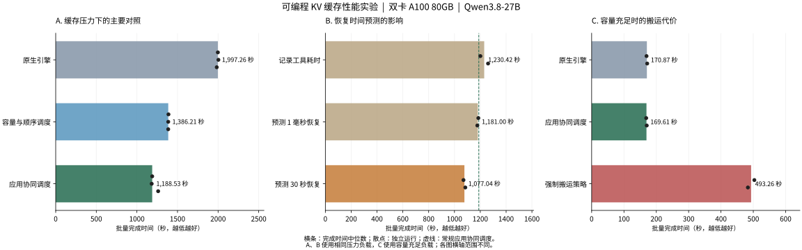

# 面向多轮智能体推理的可编程 KV 缓存：设计、实现与实验分析

## 1. RFC 提出的问题与实际设计

### 1.1 为什么缓存管理需要应用信息

大语言模型将文本转换为 token，即模型处理文本的基本单位，并在计算注意力时生成键和值等中间状态。推理系统将这些状态保存为 KV 缓存，使后续生成能够复用已经计算过的上下文。当多个请求具有相同的开头内容时，这部分共同内容称为共享前缀；如果相应缓存仍然可用，推理引擎就可以跳过这部分输入的重复计算。vLLM 是执行模型推理、安排请求和管理这类缓存的推理引擎，本项工作的目标是在它已有的前缀复用能力上，提高多轮任务中的缓存利用效率。

智能体应用通常在模型生成与外部工具调用之间交替运行。一个任务可能先生成工具调用，等待检索或计算结果，再携带此前的上下文继续生成，也可能从同一段上下文分出多个并行分支。本文将跨越多次模型调用的一个任务称为会话。会话暂停期间，下一轮仍然需要的缓存可能暂时没有正在执行的请求引用；当其他会话竞争显存时，这些缓存就可能被回收，恢复执行后又需要重新计算。

仅根据近期访问记录管理缓存，难以区分“即将恢复的工具调用”“已经放弃的分支”和“很久以后才会继续的任务”。应用掌握这些生命周期信息，但无法准确知道推理引擎此刻还剩多少显存、已有多少请求在生成，以及一次缓存传输是否真正完成。这种信息分布决定了双方需要协作：应用描述任务未来可能需要什么，引擎结合实际资源状态判断何时能够执行。

本文讨论的 RFC，即设计讨论提案[《Programmable KV Cache: Composable Policies for Agentic Serving》](https://github.com/vllm-project/vllm/issues/57103)，围绕这一协作关系提出了可编程缓存框架。“可编程”指应用能够表达缓存保留、搬运和共享意图，也允许引擎配置不同的决策策略；这些操作仍由引擎检查和执行，不向应用开放对显存的任意操作权限。

RFC 将应用输入分为两类。一类是明确的控制要求，例如提高某段缓存的保留优先级，或将它复制到指定存储位置；另一类是任务状态，例如工具已经开始执行、预计何时恢复、某个分支已经取消。明确要求需要返回实际执行结果，任务状态则供本地策略判断是否需要采取缓存操作。两类输入共用一套执行机制，使应用直接控制与引擎自主决策能够协作。

RFC 的主要贡献是规定这些决策如何共享资源和执行结果。缓存保留、缓存搬运和请求安排都使用同一份容量、等待需求及传输状态；多个策略提出建议后，由引擎统一检查资源。两个策略要求加载同一段共享前缀时，应当合并为一次物理加载；如果要求加载不同内容而容量不足，则需要选择、延后或拒绝其中一部分。这样的约束使不同算法能够组合使用，也避免每种算法各自维护一套相互矛盾的容量账目。

### 1.2 从提案到可执行的缓存控制

相关代码变更提案见 [PR #62382](https://github.com/vllm-project/vllm/pull/62382)。实际实现沿用了 RFC 的职责划分，并接入 vLLM 的请求调度、缓存分配和数据搬运过程。应用通过统一的控制消息描述目标会话或上下文范围、期望操作以及用于对应执行结果的标识。控制消息既可以随模型请求提交，也可以在工具等待期间独立发送，因此应用能够在两次模型调用之间管理缓存。

引擎收到消息后，将逻辑目标解析为实际缓存内容，检查可用空间和使用情况，再交给相应的存储连接组件执行。连接组件负责与存储后端交换数据，资源是否允许使用仍由引擎决定。当前实现支持将缓存保存到本机主机内存，也支持使用 Mooncake 共享存储；后者允许一个推理引擎保存的缓存由另一个兼容引擎加载，从而支持跨引擎继续执行任务。

| 控制能力 | 实际行为 | 资源约束 |
| --- | --- | --- |
| 调整保留优先级 | 提高重要会话或共享前缀在缓存回收时的保留顺序 | 属于可被资源压力覆盖的优先级，不承诺永久占用显存 |
| 复制缓存 | 在目标存储位置建立可复用副本，保留源端副本 | 目标端需要有足够空间，传输完成后才能使用 |
| 迁移缓存 | 先建立有效的目标副本，再回收允许释放的源端空间 | 正在被请求或传输使用的源数据不能提前释放 |
| 管理会话和分支 | 记录共享关系，处理恢复、取消和结束 | 一个分支结束不能破坏其他会话仍需使用的共享内容 |

这些约束落实到异步传输后，关键问题是“已经提交搬运”与“缓存已经可用”的区别。双卡推理中，一段上下文的缓存分布在多个参与计算的设备上，只有必要部分全部传输完成并登记为可复用状态，后续请求才能命中它。加载完整前缀期间，已经到位的部分也需要暂时保留，避免它们在其他部分尚未完成时再次被回收。传输失败或资源不足时，请求能够回到普通的上下文重算路径。

会话关系与缓存实际存放位置分别维护，因此缓存离开显存后，系统仍然知道哪些会话可能需要它；多个会话共享一次加载时，也能分别取消自己的需求。模型权重发生变化后，旧权重对应的 KV 缓存必须与新权重隔离，只有恢复完全相同的权重版本时，才能再次使用对应的旧缓存。

与 RFC 中讨论的较宽范围相比，当前实现选择了可被回收的保留优先级，没有提供应用可要求缓存长期不可回收的强制锁定能力。跨引擎复用通过共享存储完成，尚未覆盖直接的设备间传输或完整的跨机器请求分配系统。当前工作的重点是把应用意图、引擎决策和实际缓存可用性连接起来，同时保留原有模型计算语义。

### 1.3 容量与顺序调度：决定哪些请求先执行

在上述控制机制之上，实现了一项称为**容量与顺序调度**的本地策略，用于回答两个相关问题：各会话可以使用多少缓存容量，以及等待中的哪些请求应当先进入执行。这里的容量份额是协调多个会话的软约束，不会把显存永久切成互不共享的分区；暂时空闲的份额可以由其他会话借用，等待过久的请求也可以放宽份额限制，但任何分配仍须满足实际物理容量要求。

容量判断同时考虑已经运行的请求和正在等待的请求。运行中的请求每生成新内容都会增加缓存需求，因此不能把当前看似空闲的空间全部分配出去；等待中的请求则可能复用已经存在的前缀，只需为新增部分申请空间。例如，两个请求都需要同一段已驻留的长前缀，这段前缀不应在两个请求进入执行时被重复计为新增显存需求。实现因此在每次实际分配前重新检查空闲空间、运行请求的后续增长和候选请求的真实缓存命中情况。

执行顺序综合考虑请求重要性、已等待时间和能够复用的缓存量。优先安排复用较多的请求，可以减少上下文重算；随着等待时间增加，其他请求的执行机会也会提高，避免始终偏向同一类会话。实验配置使用 120 秒的份额等待预算，并以 30 秒为等待优先级的增长尺度。这项策略依赖引擎当前状态，不自行搬运缓存，也不要求应用逐次发送工具暂停预测，因而可以单独评估资源分配和请求顺序带来的收益。

### 1.4 应用协同调度：利用暂停时间安排保留与搬运

**应用协同调度**在容量与顺序调度的基础上，进一步利用工具暂停、预计恢复时间和分支状态，决定哪些缓存应当保留在显存、哪些可以暂存到主机内存或共享存储，以及何时加载回来。在请求执行前将缓存加载回显存的操作称为预取，其价值取决于能否及时完成，以及加载后的内容是否会被实际使用。

工具开始执行时，应用就提供暂停信息和预计持续时间，使搬运决策能够与工具执行重叠。对于较长的暂停，可以利用空闲窗口保存缓存并释放显存，供其他会话使用；对于很短的暂停，写出再读回的成本可能超过所节省的计算，因此策略结合已观测传输时间、实际缓存占用和持续排队情况过滤搬运。恢复时间的估计可以根据同类工具的历史耗时更新，分支取消或任务结束则会撤销尚未被消费的准备工作。

预取还需要与请求执行顺序配合。工具已经返回，并不代表请求马上就能使用 GPU；如果前面仍有大量请求等待，过早加载的缓存可能长时间占用显存，甚至在真正执行前再次被回收。当前实现在存在排队竞争时，将准备工作与即将获准执行的会话关联，检查完整前缀所需容量后再启动加载，并在加载失败时允许重算。这使应用提供的未来需求与引擎掌握的当前执行机会能够共同影响决策。

## 2. 实验设计与性能结果

### 2.1 比较方法和工作负载

实验比较三个递进配置：**原生引擎**使用 vLLM 已有的缓存和请求调度；**容量与顺序调度**增加会话容量协调及基于复用和等待的执行顺序；**应用协同调度**再增加应用状态驱动的缓存保留、搬运与预取。通过这样的比较，可以观察本地资源安排的收益，以及加入应用信息和缓存搬运后的额外收益。

| 项目 | 实验设置 |
| --- | --- |
| 硬件 | 双卡 NVIDIA A100 80GB PCIe |
| 模型与执行方式 | Qwen3.8-27B，采用 BF16（16 位浮点格式）；模型计算分布在两卡上共同执行 |
| 显存配置 | 引擎显存利用率设置为 50%，每卡实际可用于 KV 缓存的预算约 12.12 GiB |
| 请求规模 | 最多同时执行 64 个请求，最大上下文长度 16,384 token |
| 额外缓存资源 | 搬运配置使用 Mooncake 共享存储，缓存存储区域配置为 64 GB |
| 计时范围 | 包含模型请求、控制结果收集、清理及等待相关缓存传输结束；不包含服务启动和预热 |

各组使用相同的 GPU 缓存预算，但使用缓存搬运的配置额外使用了主机内存存储，因此这些结果反映固定 GPU 资源下的系统收益，不代表相同总内存资源下的纯算法收益。

工作负载来自 GSM8K 数学问答任务。每次从任务开始、经过工具交互直到完成的一串模型调用，称为一条任务轨迹；具有同一共享前缀的一组轨迹，称为一个前缀组。压力场景包含 32 个前缀组、256 条轨迹、920 次模型调用、约 878 万输入 token 和 60,136 个输出 token，这些任务需要复用的缓存会产生实际容量竞争。容量充足场景将需要复用的内容缩小到 4 个前缀组，仍运行 256 条轨迹，共 864 次调用和 66,160 个输出 token，用于观察缓存竞争较弱时是否出现额外开销。

压力轨迹来自 64 个问题、每题 4 次采样；容量充足轨迹从其中选取较少前缀组并重复执行，因此 256 条轨迹不等同于 256 道独立问题。性能比较采用固定工作量回放：每次调用使用相同的输入 token 序列和输出长度，模型仍实际生成输出，但新生成内容不会改变后续记录中的输入。这样可以控制不同策略完成的工作量，同时也意味着它与自然连续生成的真实工具任务存在区别，后者另外验证。

主压力对照各独立运行三次，容量充足与预测敏感性实验各运行两次，以下按耗时中位数比较。吞吐表示单位时间完成的任务量，因此固定工作量下的吞吐提升按“原生耗时中位数 ÷ 对照耗时中位数 − 1”计算；不同工作负载之间不直接计算提升比例。实验重置缓存状态，并检查工作量一致性和计算资源使用情况，资源观测不完整的运行不纳入性能比较。

### 2.2 缓存压力下的吞吐与延迟

除批量任务完成时间外，实验同时观察用户可感知的等待。首个输出等待时间指提交请求到收到第一个输出 token 的时间，任务完成延迟则覆盖一条完整轨迹。下表中的 P99 和 P95 分别表示约 99% 和 95% 的样本不超过该值，用于描述耗时较长的请求和任务；表内延迟指标同样取各次运行结果的中位数。

| 配置 | 批量完成时间 | 相对原生吞吐提升 | 首个输出等待 P99 | 任务完成延迟 P95 |
| --- | ---: | ---: | ---: | ---: |
| 原生引擎 | 1,997.26 秒 | — | 125.02 秒 | 758.91 秒 |
| 容量与顺序调度 | 1,386.21 秒 | **44.1%** | 71.59 秒 | 534.92 秒 |
| 应用协同调度 | 1,188.53 秒 | **68.0%** | 70.51 秒 | 469.94 秒 |

容量与顺序调度已经贡献了较大部分收益，说明缓存紧张时，请求何时进入执行、共享内容如何计费，以及为运行请求预留多少增长空间，会显著影响整体效率。加入应用协同后，相对容量与顺序调度的吞吐进一步提高 **16.6%**；相对原生引擎，批量完成时间缩短约 **40.5%**，与 **68.0%** 的吞吐提升是同一结果的两种不同表述。

为了判断收益来源，进一步统计了缓存复用、排队和请求执行阶段。输入处理阶段负责计算尚未缓存的上下文，后续生成阶段逐步产生输出；这两个阶段的经过时间都会受到调度和并发影响，不能直接等同于某个 GPU 计算函数的运行时间。

| 指标 | 原生引擎 | 容量与顺序调度 | 应用协同调度 |
| --- | ---: | ---: | ---: |
| 复用缓存的输入 token | 816,144 | 3,317,888 | 4,171,664 |
| 缓存复用占输入量的比例 | 9.3% | 37.8% | 47.5% |
| 请求平均排队时间 | 73.80 秒 | 38.87 秒 | 32.72 秒 |
| 请求平均输入处理时间 | 4.55 秒 | 3.51 秒 | 2.80 秒 |
| 请求平均后续生成时间 | 54.04 秒 | 48.10 秒 | 41.31 秒 |

应用协同调度将未命中的输入量从约 797 万 token 降至 461 万 token，同时减少了排队时间。这些变化支持“减少重算、改善资源安排”这一收益解释，不能据此归因于底层模型计算本身变快。按前缀组分别统计时，两种优化配置的任务完成延迟 P95 均低于原生引擎；每组每次运行只有 8 条轨迹，该结果反映当前样本中未观察到某些前缀组被整体拖慢，尚不能说明更复杂任务分布下不同会话的等待是否仍然合理。

主压力对照中，原生引擎的完成时间范围为 1,983.42–2,003.82 秒，容量与顺序调度为 1,385.85–1,388.76 秒，应用协同调度为 1,182.21–1,261.62 秒。收益在这组重复实验中保持明显，但仍受到模型、缓存需求规模和任务分布的限制。

### 2.3 容量充足时的表现

容量充足负载下，原生引擎、容量与顺序调度、应用协同调度的完成时间分别为 **170.87、168.97、169.61 秒**，三组复用的输入量均为 8,084,608 token。应用协同调度没有发生缓存写出或加载，表明当显存足以保留共享内容时，搬运过滤规则能够避免启动不必要的传输。

这些完成时间的差异不足约 1%，不作为稳定性能收益。另行比较原生引擎、仅启用控制功能但不发送控制消息、同时启用存储连接功能但不发送控制消息时，完成时间分别为 168.535、168.486、168.392 秒，中位数差异小于 0.1%。这说明已测容量充足场景中没有观察到明显退化，仍不能将有限样本解释为所有负载下均无额外开销。

### 2.4 恢复时间预测如何影响结果

应用协同调度依赖预计恢复时间，因此实验保持实际工具暂停和模型工作量不变，只改变提供给策略的预测：一组直接使用记录中的真实工具耗时，代表已知工具完成时间的理想参照；另外两组分别预测 1 毫秒和 30 秒后恢复，用于考察过早与过晚预测的影响。即使知道真实工具耗时，策略仍然不知道请求将来何时能获得 GPU 执行机会。

| 恢复时间信息 | 批量完成时间 | 相对原生吞吐提升 | 相对常规应用协同调度 |
| --- | ---: | ---: | ---: |
| 记录中的真实工具耗时 | 1,230.42 秒 | 62.3% | −3.4% |
| 固定预测 1 毫秒后恢复 | 1,181.00 秒 | 69.1% | +0.6% |
| 固定预测 30 秒后恢复 | 1,077.04 秒 | **85.4%** | **+10.4%** |

更准确的工具耗时信息没有带来更高吞吐，过早预测的结果与常规配置也较为接近。预测 30 秒后恢复时，复用的输入量增加到约 464 万 token，平均排队降至约 29 秒，与更短的完成时间一致。这一结果揭示了工具完成时间与缓存实际使用时间之间的差异：应用已经准备好继续生成，GPU 仍可能在服务其他请求。

从策略规则看，较长暂停预测允许更多缓存进入保存和准备流程，因此一个合理解释是，这组预测使压力场景中的搬运更加积极，增加了后续复用。不过，现有结果尚不能分离每一次搬运、请求排序和运行波动各自的贡献，不能将它概括为“预测越晚越好”。**85.4% 是该预测条件下已经测得的压力场景收益；常规配置的 68.0% 则同时具备容量充足场景下抑制无效搬运的验证。** 两者覆盖的使用条件不同，30 秒预测不作为通用推荐值。

### 2.5 真实工具调用、模型质量与恢复能力

固定工作量回放之外，实验接入了 verl 的智能体工具循环，即让模型实际选择工具、读取返回结果并继续生成的执行流程。应用协同配置完成 256 条任务轨迹、923 次模型调用和 60,231 个输出 token，用时 1,079.34 秒，实际执行了题目信息查询与计算工具，自动评分为 248/256，约 96.875%。其中 12 次模型调用达到单次输出长度上限，并出现一次计算工具参数格式警告。由于实际生成过程会改变后续请求数量和长度，这组时间用于说明真实任务流程可运行，不与固定回放直接换算吞吐提升。

模型质量使用独立的 128 道题，对比强制重算与从外部存储加载缓存后继续生成。主机内存和 Mooncake 两条路径的重算、加载组均答对 124 道题，准确率均为 96.875%，配对答案差异为零，也未出现输出长度截断。缓存加载在这批样本上没有造成可观察的答案变化；正确性测试采用独立服务配置，其结果不用于替代主要性能计时。

恢复验证覆盖了共享分支结束、并发加载与取消、容量不足后的重试、存储服务故障和引擎重启。系统能够在加载失败时继续重算，并避免一个会话的清理破坏其他会话仍需使用的缓存。通过实际修改模型参数再恢复原参数，还验证了权重变化后的旧缓存隔离，以及恢复原权重后的对应缓存复用。这些验证涉及实际参数变化，但没有执行完整的模型训练。

## 3. 优化问题与取舍

### 3.1 搬运更多缓存可能降低性能

压力场景中的缓存复用收益容易促使策略更积极地保存和加载内容，但同样的行为在容量充足时可能成为纯粹的额外成本。实验评估过一项更积极触发搬运的配置，本文称为强制搬运策略：它在压力负载下的完成时间中位数为 1,016.20 秒，快于常规应用协同调度；在容量充足负载下却需要 493.26 秒，而相同负载的原生引擎约为 170.87 秒，耗时接近原生的 **2.9 倍**。

这项退化具有明确的数据特征：每次运行向外部存储写出了约 259–261 GB 缓存，实际读回仅约 2.0–2.7 GB。显存原本能够容纳共享内容，提前搬走它们并未创造足够的复用价值，却增加了传输与控制成本。因此，常规配置保留了实际占用、持续排队和传输成本约束，接受压力场景下较保守的搬运强度，以避免在已测容量充足场景中发生大幅退化。

图中横条表示完成时间中位数，散点表示各次独立运行，数值越低表示完成同批任务越快。左图和中图使用同一压力工作负载，右图使用容量充足工作负载；中图虚线标出常规应用协同调度的完成时间，三幅图的横轴范围分别设置。

### 3.2 缓存准备需要服从完整性与实际执行时机

缓存准备的效果不能只看“传输了多少”。一段可复用前缀可能由多个缓存部分组成，如果早到的部分在其余部分加载完成前被回收，即使传输操作分别成功，请求仍可能无法获得预期复用。当前实现因此在准备期间暂时保护已到位的成员，并在开始前检查完整准备所需的容量。这种保护提高了准备过程的可靠性，也占用了原本可以服务其他请求的空间，因此必须与即将执行的请求关联，不能无限提前准备。

容量计算同样需要跟随实际分配更新。一次观察得到的空闲空间，在前一个请求进入执行后就可能失效；共享前缀也可能因为前一个请求刚完成加载而变得可用。逐次复核容量和真实命中，既避免多个请求重复使用同一份预算，也避免把已经共享的内容反复算作新增需求。容量与顺序调度的收益因此包含了容量核算修正和请求选择的共同作用，现有对照没有将二者分别量化。

关于预取是否被消费，已有观测能够确认部分完整准备之后发生了完整前缀命中，但还不足以追踪每次缓存查找时所有内容的实际驻留情况。多个逻辑请求也可能共享同一次物理加载，部分命中可能来自自然保留的缓存。因此，统计搬运成本应以实际传输量为准，分析收益则需要进一步对应具体请求，不能将所有命中都算作预取贡献，也不能把未形成完整前缀命中的操作全部判为浪费。

### 3.3 异步执行减少等待，但控制成本仍然存在

应用协同调度把部分控制操作放到后台，使模型工作能够与结果收集重叠，但这不会消除通信与状态管理成本。正常压力实验中，负责发起请求和收集结果的测试程序，在原生引擎和应用协同配置下消耗的 CPU 时间中位数分别为 71.81 秒和 127.31 秒。该程序的 CPU 时间包含生成结果处理、控制通信和指标采样，不能把全部差额解释为纯控制开销。

每次协同运行仍有约 1,584 次控制提交、15,070 次结果查询、4,420 次结果确认，以及约 308–319 GB 的缓存写出和 118–123 GB 的加载。结果确认用于通知引擎释放已收集的详细记录；如果缺少这一步，长时间运行可能积累状态。减少查询和确认次数有优化空间，但仍需保留失败反馈、取消和资源释放的正确顺序。现有结果说明系统在承担这些成本之后仍获得净收益，尚不能据此声称控制机制没有开销。

## 4. 后续问题与研究方向

恢复预测需要从单一的工具耗时，扩展为对实际缓存使用时间的估计。工具剩余时间决定应用何时能继续发出请求，排队时间决定请求何时能够进入执行，传输时间决定缓存何时准备完成；三者应当共同决定何时保存、何时加载，以及预测修正后是否取消尚未使用的工作。30 秒预测实验表明当前规则仍有调整空间，但进一步优化需要围绕实际消费时刻建立解释，避免用一个固定偏移值代替需求估计。

搬运决策也需要更完整地比较收益与成本。当前规则主要根据暂停、压力和已观测传输耗时工作，还没有为每个候选前缀估计重算成本、再次使用概率，以及它占用显存时对其他请求的影响。后续可以在保留、迁出后加载和直接重算之间进行比较，并以减少的重复输入计算、传输后实际复用比例、任务吞吐和尾部延迟共同判断效果。

控制成本的优化方向包括合并结果查询、批量确认以及在操作完成时主动通知应用。实施前还需要进一步测量服务端 CPU 时间花在状态扫描、请求调度还是消息处理上，使改动针对实际占用较高的部分。相应评估应同时覆盖没有应用控制消息的常规推理、缓存充足和缓存紧张的负载，避免仅改善高压力情况下的表现。

适用范围仍需扩大。当前结果集中于一个模型、双卡配置，以及由固定前缀组构造的回放负载，工具暂停也多为毫秒级；秒级工具延迟、较大抖动、频繁分支取消和跨引擎恢复可能改变搬运价值。真实工具循环已验证可运行，后续需要在自然生成轨迹中完成更充分的策略比较，并逐步覆盖多机调度和训练中的完整权重更新流程，以判断当前收益能够延伸到哪些实际应用。
