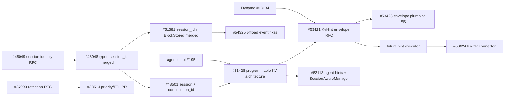

# Programmable KV Cache 相关提案阅读记录

本文整理各提案的目标和职责边界，条目中的合并状态采用阅读时的记录。
这些提案包含 Pin 和上下文编辑等方向；本分支的实现范围以 OpenSpec 和接口文档为准。

## 会话标识与分支

[RFC #48049](https://github.com/vllm-project/vllm/issues/48049) 提出跨请求保留 `session_id`，用于关联同一会话的多次调用。
[RFC #48501](https://github.com/vllm-project/vllm/issues/48501) 提出按会话管理 KV，并通过 `continuation_id` 区分对话分支及其进度。
[PR #51381](https://github.com/vllm-project/vllm/pull/51381) 为 KV 事件增加 `session_id`。

## 按会话控制 KV

[RFC #51428](https://github.com/vllm-project/vllm/issues/51428) 提出由路由器提供会话信息和 KV hint，由引擎执行缓存控制。
其设计包含会话到缓存块的映射，以及 Share、Prefetch、Demote、Pin、Retain 操作。

- `--enable-session-to-block-indexing` 控制是否维护工作进程内的会话与缓存块索引。
- `SessionPrefixIndex` 使用 `BlockHash` 表示逻辑前缀关系。
- 本地阅读时提出的疑问是：持续维护索引会增加多少 CPU 时间和内存占用？
  该开销需要测量。

[RFC #53421](https://github.com/vllm-project/vllm/issues/53421) 进一步定义 KV hint 消息格式。
[PR #53423](https://github.com/vllm-project/vllm/pull/53423) 提供相应的类型与传输支持。

## Agent hint 与 SessionAwareManager

[RFC #52113](https://github.com/vllm-project/vllm/issues/52113) 提出会话层的请求管理和 `SessionAwareManager`，后者与 KVCacheManager 协作。
该提案包含以下内容：

- 请求保留可选的 `block_offset`、`block_start` 和 `block_end` 字段。
- 管理会话及可选的父子关系，维护会话到缓存块、缓存块到会话的索引。
- 维护块级 TTL，校验并执行上下文管理修改。
- 为 KVCacheBlock 增加 `_session_ref_cnt: int = 0` 和 `_ttl_expire_at: float = 0.0` 两个聚合字段。
- 为 KVCacheManager 增加元数据接口，支持尽力保留的 TTL、会话生命周期操作和远端 KV 存储。

提案覆盖多个模块，并提出可拆成多个 PR 实现。

## SGLang 的路由器与缓存操作

[SGLang RFC #27574](https://github.com/sgl-project/sglang/issues/27574) 将 router 定义为多个引擎之上的编排组件，并讨论以下操作：

- Share 允许不同引擎复用 KV。
- Prefetch 在使用前从其他存储层加载 KV。
- Demote 将 KV 移至较冷的存储层，供暂停期间减少 GPU 占用。
- Pin 在有限 TTL 内保护前缀，避免常规淘汰。
- Retain 提高淘汰优先级，使内存压力下的低优先级 KV 更早被淘汰。

## Dynamo 的提示消息

[Dynamo PR #13134](https://github.com/ai-dynamo/dynamo/pull/13134) 已合并，提供类型化的 KV hint 消息及引擎桥接。

## Agentic API 的缓存状态

[agentic-api PR #195](https://github.com/vllm-project/agentic-api/pull/195) 定义 Messages API 的服务端缓存状态，讨论以下内容：

- 服务端保存私有缓存状态，公共 Messages API 继续使用无会话状态的对话契约。
- 协调引擎亲和性、检查点、保留、分支和各模型服务的缓存对象。
- 与已有 Claude Code 集成设计对齐。
- Agentic API 生成可信的逻辑坐标和生命周期策略，llm-d 选择工作进程，vLLM 执行物理 KV 操作。
- 提供可复现的亲和性测试证据，单独说明尚未提交的 Claude Code 采集记录。
- 定义分阶段部署、失败处理、安全控制、观测指标、基准测试和验收条件。

## 按 token 范围保留 KV

[RFC #37003](https://github.com/vllm-project/vllm/issues/37003) 和 [PR #38514](https://github.com/vllm-project/vllm/pull/38514) 讨论按 token 范围设置保留优先级和 TTL，用于工具暂停等场景。
