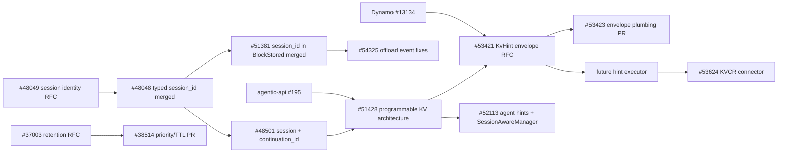

RFC：https://github.com/vllm-project/vllm/issues/48049

提出要增加相应的session id

RFC：https://github.com/vllm-project/vllm/issues/48501

提出了seesion-aware的KVC管理办法，提出了要增加continuation_id去判断现在对LLM对话分支进行到哪里，进行KVC管理

PR：https://github.com/vllm-project/vllm/pull/51381

添加了session id

RFC：https://github.com/vllm-project/vllm/issues/51428

实现了一个对programmable KVC的RFC

增加KV hint，用于处理相关的信息，由router处理相关的session信息，通过KV hint给engine保留KVC

1. Session 2 block mapping

   1. `--enable-session-to-block-indexing` to maintain a persistent worker-local index of "which block does each session own"

   2. `SessionPrefixIndex` stores logical topology using `BlockHash`

   3. > 这样会导致一个overhead过大的问题

2. KvHint-driven KV cache management

   1. Share | Prefetch | Demote | Pin | Retain

同一个提出的相关RFC，细化了KV hint的标准：https://github.com/vllm-project/vllm/issues/53421

vLLM中的PR：https://github.com/vllm-project/vllm/pull/53423，支持了相关的kv hint

RFC：https://github.com/vllm-project/vllm/issues/52113

添加了agent hint：

1. 添加了session层级的请求管理
2. 在请求中添加相应的管理字段：`block_offset`, `block_start`, and `block_end` remain in the request model as optional fields
3. Add a small SessionAwareManager：和KVC manager相同层级
   1. session and optional parent/child relationships;
   2. session-to-block and block-to-session indexes;
   3. block-level TTL entries;
   4. validation and execution of context-management edits.
4. Add two aggregate fields to KVCacheBlock
   1. _session_ref_cnt: int = 0
   2. _ttl_expire_at: float = 0.0
5. Add one KVCacheManager metadata API
6. Best-effort TTL retention
7. Session lifecycle and management operations
8. Pooling and remote KV stores

做的比较全面，提出后续可以拆分为多个PR

SGLang相关的RFC：https://github.com/sgl-project/sglang/issues/27574

Nvidia的工作人员提出：define “router” as an orchestrator on top of multiple engine units

1. 提出了相关的KV hint的操作
   1. share：在不同engine之间复用相关的KVC
   2. prefetch：提前在不同的存储级之间获取KVC
   3. demote：将KVC降级到更冷的存储级（只有对知道未来不会使用的请求对应的KVC实用）
   4. pin：将高价值前缀在有限的 TTL 内保护起来，避免被常规驱逐
   5. retain：为KVC增加优先级。在内存压力下，引擎会优先淘汰低优先级的 KV

Dynamo中的PR，merged：https://github.com/ai-dynamo/dynamo/pull/13134

已经支持了相关的KV hint envlope

vllm-agentic-api中的相关工作：https://github.com/vllm-project/agentic-api/pull/195

定义了想要做的事情的全面框架

- define private, non-authoritative server-managed cache state for the Messages API
- preserve the conversation-stateless public Messages contract while coordinating affinity, checkpoints, retention, branches, and provider cache artifacts
- reconcile the proposal with the existing Claude Code integration design
- define the ownership boundary: Agentic API derives trusted logical coordinates and lifecycle policy, llm-d owns routed worker selection, and vLLM owns physical KV execution
- link the reproducible affine KV benchmark evidence and qualify the uncommitted Claude Code capture
- provide staged rollout, failure semantics, security controls, observability, benchmarks, and acceptance criteria

RFC：https://github.com/vllm-project/vllm/issues/37003

PR：https://github.com/vllm-project/vllm/pull/38514

实现了continuum中的保留KVC ttl的优化