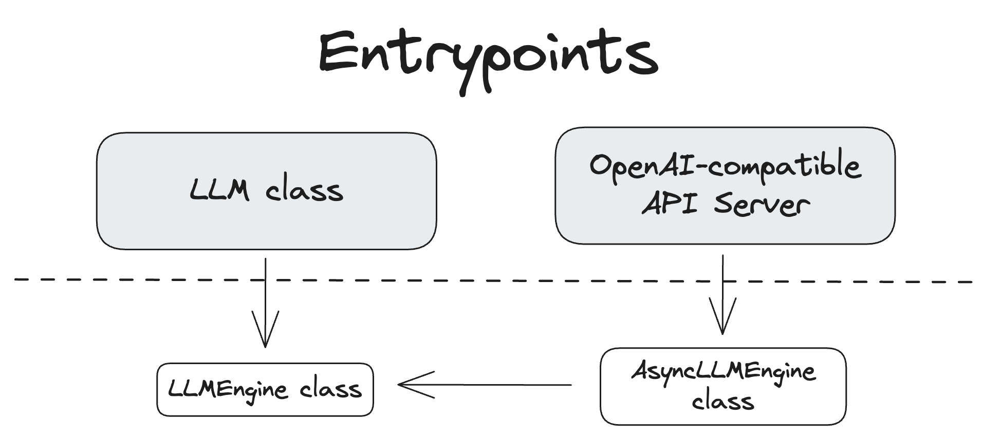
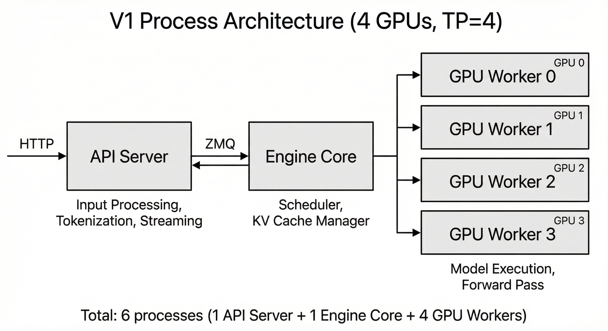
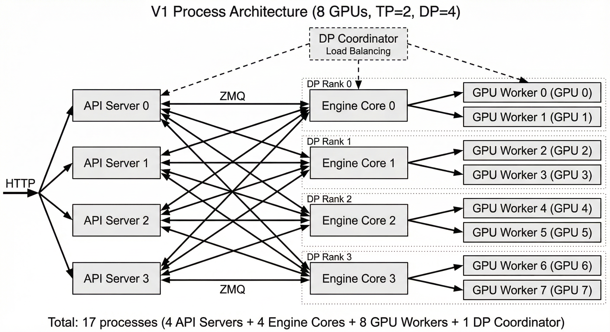
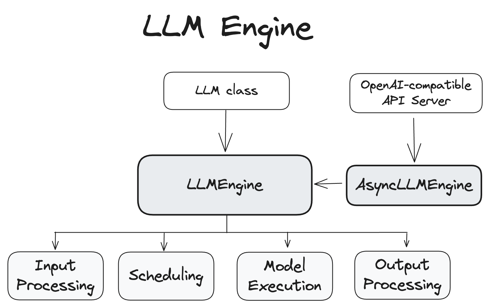
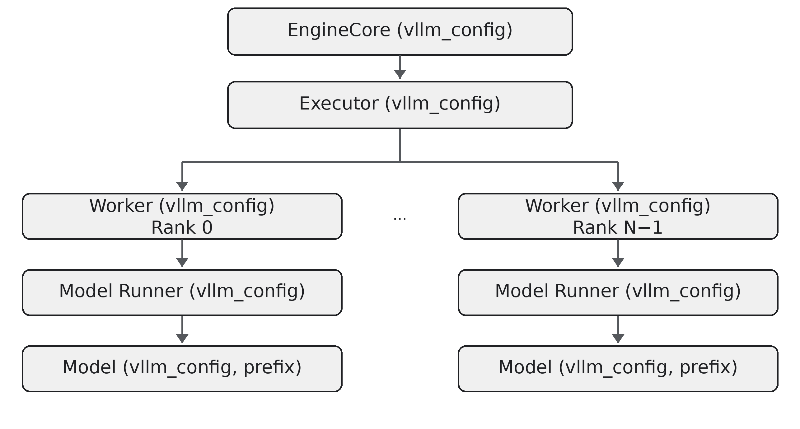

# 架构与请求执行链

## 一句话概览

vLLM 将输入适配、请求调度、KV Cache 管理和设备计算分层：入口负责接收并规范化请求，Engine Core 决定每一步运行哪些 token，Worker/Model Runner 在设备上执行模型，结果再回到入口层编码或流式返回。

从架构角度看，需要同时看两张图：**逻辑对象关系**（调用方如何进入引擎）和 **V1 运行时进程关系**（功能实际分布在哪些进程）。它们描述不同层次，不能把图中的 `LLMEngine` 直接等同于 V1 的某个单独进程。

## 两类主要入口

- **离线推理（offline inference）**：把 vLLM 当作 Python 库使用，在程序里创建 `vllm.LLM` 对象并直接调用 `generate`、`chat`、`embed` 等方法。程序提交输入后拿到 Python 结果对象，适合批量处理数据、离线评测、实验脚本和嵌入 Python 应用。
- **在线服务（online serving）**：用 `vllm serve` 启动一个持续运行的 HTTP 服务，客户端通过 API 请求推理结果。API Server 负责协议适配、请求预处理和响应传输，Engine Core 与 GPU Worker 执行推理，结果再以 HTTP 响应或流式数据返回。适合多个客户端、业务系统或应用通过网络共享模型。

这里的“离线”是指**不通过 vLLM HTTP 服务来提交请求**，并不表示只能在断网环境运行；首次使用时模型仍可能需要从模型仓库下载。在线服务则是一个常驻进程，不是每个请求都重新启动模型。两种入口最终都使用 vLLM 引擎完成调度和设备计算。

| 对比项 | 离线推理 | 在线服务 |
| --- | --- | --- |
| 如何启动 | Python 代码创建 `LLM` | 命令行运行 `vllm serve` |
| 如何提交请求 | 直接调用 Python 方法 | 通过 HTTP API 发请求 |
| 结果形式 | Python 输出对象 | HTTP JSON 响应或流式响应 |
| 适合场景 | 数据集批处理、评测、研究脚本、Python 应用集成 | 多用户访问、产品后端、服务化部署 |
| 服务生命周期 | 由 Python 程序创建并管理 `LLM` 实例 | 模型常驻服务进程，持续接收多个客户端请求 |
| 批处理/并发 | 可一次传入多个 prompt，也可使用 enqueue API | 服务端持续接收请求，由调度器连续批处理 |
| 核心计算 | V1 scheduler、Worker、Model Runner 和模型 | 同一套核心执行系统 |

### 离线推理示例

下面的脚本直接加载模型并生成文本。`prompts` 可包含多个输入；`SamplingParams` 控制生成行为，返回值是 Python 输出对象：

```python
from vllm import LLM, SamplingParams

llm = LLM(model="facebook/opt-125m")
sampling_params = SamplingParams(temperature=0.0, max_tokens=16)
prompts = ["The capital of France is", "The largest ocean is"]

outputs = llm.generate(prompts, sampling_params)
for output in outputs:
    print(output.outputs[0].text)
```

使用前需安装 vLLM，并确保模型文件可从本地路径或模型仓库获取。`LLM` 对象通常应复用，而不是为每条 prompt 反复创建，以避免重复加载模型。

### 在线服务示例

先启动常驻服务：

```bash
vllm serve facebook/opt-125m --host 0.0.0.0 --port 8000
```

服务就绪后，在另一个终端向 OpenAI-compatible Completions API 发送请求：

```bash
curl http://localhost:8000/v1/completions -H 'Content-Type: application/json' -d '{"model":"facebook/opt-125m","prompt":"The capital of France is","max_tokens":16,"temperature":0}'
```

服务端进程继续运行时，可以接收后续请求；客户端不需要直接导入 vLLM 或持有 GPU 上的模型对象。实际可用 API 取决于模型任务类型：生成模型支持文本生成接口，Embedding、分类、重排和语音模型有各自适用的接口。接口列表和模型适用范围见[在线服务文档](../serving/online_serving/README.md)。



离线 `LLM` 和在线 API Server 是两种用户入口。它们的输入和输出适配方式不同，但最终都需要引擎完成调度、模型执行和结果处理。在线请求通常包含 HTTP 路由、请求校验、tokenization/多模态数据处理和流式响应；离线调用则由 Python API 接收输入并返回生成对象。

从调用关系看，可以先记住下面这张简图：

```text
OFFLINE: App -> vllm.LLM -> Engine Client
ONLINE: Client -> HTTP API -> API Server -> Engine Client
BOTH: Engine Client -> Engine Core
BOTH: Engine Core -> Executor -> GPU Worker -> Model Runner -> Model
```

这是逻辑调用关系，不表示所有方框都对应独立进程。V1 的进程边界见下文。

## V1 进程职责

V1 将服务拆分为 API Server、Engine Core 和 GPU Worker；启用数据并行（DP）时还会使用 DP Coordinator。API Server 负责客户端协议和输入/输出处理，Engine Core 负责调度与 KV Cache 协调，GPU Worker 负责设备上的模型计算。各组件通过进程间通信协作，因此 CPU 核数、进程数和 GPU 并行配置都会影响部署资源。

| 组件 | 主要职责 | 建议的源码入口 |
| --- | --- | --- |
| API Server | HTTP 路由、请求/响应适配、流式输出 | `vllm/entrypoints/` |
| Engine Core | 请求生命周期、调度、KV Cache 协调、worker 编排 | `vllm/v1/engine/`、`vllm/v1/core/` |
| Scheduler | 每个执行步选择请求及 token 数量 | `vllm/v1/core/sched/` |
| Executor / Worker | 建立设备执行进程、加载模型并运行 | `vllm/v1/executor/`、`vllm/v1/worker/` |
| Model Runner | 准备张量和注意力元数据，驱动模型 forward、图捕获与执行 | `vllm/v1/worker/gpu_model_runner.py` |
| Model | 具体架构、层、权重映射和任务适配 | `vllm/model_executor/models/`、`vllm/model_executor/layers/` |

#### 进程拓扑与数量

单节点 4 卡、`TP=4` 的典型服务包含 1 个 API Server、1 个 Engine Core 和 4 个 GPU Worker，共 6 个进程：



8 卡、`TP=2, DP=4` 时，每个 DP rank 有一个 Engine Core 和两个 GPU Worker；API Server 默认随 DP 扩展为 4 个，并增加一个负责负载均衡/协同的 DP Coordinator，共 17 个进程：



可用以下数量关系快速估算典型部署进程数。这里 `A` 是 API Server 数量，`DP` 是 data-parallel size，`TP` 和 `PP` 分别是 tensor/pipeline-parallel size，`N` 是 GPU Worker 数量：

| 进程/角色 | 数量 | 说明 |
| --- | --- | --- |
| API Server | `A`，单副本默认 1；内部 DP 负载均衡时通常默认 `DP` | HTTP 路由、输入/输出处理和流式响应 |
| Engine Core | 在线服务通常每个本地 DP rank 一个 | Scheduler、请求状态、KV Cache 管理和执行协调；由 API Server 连接 |
| GPU Worker 进程 | 取决于 executor | `UniProcExecutor`（常见于 `world_size=1`）不另起 Worker 进程；MP/Ray 等分布式 executor 会按执行 rank 创建 Worker 进程/actor |
| DP Coordinator | 按配置需要时启动，通常至多一个协调进程 | 用于内部/混合负载均衡统计，或 MoE rank 协调；不是所有 DP 配置都无条件启动 |
| ZMQ | **不是进程** | PyZMQ/ZeroMQ 通信库，在 API Server、Engine Core 等进程内创建 socket |
| **总进程数** | **`A + Engine Core 数 + Worker 进程数 + Coordinator 数`** | 仅为典型在线拓扑估算；单进程 executor、headless、外部负载均衡等会改变数量 |

API Server 与 Engine Core 之间通过 ZMQ socket 交换请求和结果；在 DP 部署下，连接关系可为多对多，API Server 可以把请求路由给任一受管 Engine Core。每个 Engine Core 再协调其负责的执行组。ZMQ 是应用进程链接/导入的通信库（Python 侧依赖 `pyzmq`，底层使用 ZeroMQ），不是需要单独启动的 `zmq` daemon；地址会按本机或跨节点场景选择 IPC/TCP 等传输。Worker 之间的计算通信也不都经过 ZMQ，还可能使用共享内存队列、设备 collective 或节点间通信。

典型进程拓扑的文本图例如下。TP/PP 是一个模型执行组内的 Worker 切分方式；DP 会复制执行组，并相应增加 Engine Core：

```text
SINGLE REPLICA: TP=4, DP=1
Client -> API Server --ZMQ--> Engine Core -> Executor
Executor -> Worker0
Executor -> Worker1
Executor -> Worker2
Executor -> Worker3
Workers 0-3 form one TP group.

MULTIPLE REPLICAS: TP=2, DP=2 (schematic)
Client -> API Server pool --ZMQ (many-to-many)--> Engine Core DP0
Client -> API Server pool --ZMQ (many-to-many)--> Engine Core DP1
Engine Core DP0 -> Executor -> Workers 0,1 (TP group)
Engine Core DP1 -> Executor -> Workers 2,3 (TP group)
DP Coordinator <--> Engine Core DP0 and Engine Core DP1
```

多节点时，Worker 可以跨节点分布，Executor 负责启动/编排执行进程，TP/PP 通信还会使用设备间及节点间通信原语。部署文档中的 Ray、multiprocessing 等是执行运行时的选择，不会改变“Engine Core 负责调度、Worker 负责计算”的基本分工。

### `vllm serve` 命令会启动什么

对于普通的单机命令：

```bash
vllm serve facebook/opt-125m --host 0.0.0.0 --port 8000
```

在没有另外设置 TP、PP、DP 的常见配置下，API Server 在 CLI 启动的服务进程中运行，并创建后台 Engine Core。单卡通常是 `DP=1, TP=1, PP=1`，执行器选择 `UniProcExecutor`；模型和 Model Runner 在 Engine Core 进程内执行，因此**通常不会出现独立的 GPU Worker 子进程**：

```text
CLI process: API Server (HTTP)
API Server --ZMQ sockets--> Engine Core process
                                                            Scheduler + KV Cache Manager
                                                            UniProcExecutor + Model Runner + Model
```

API Server 负责客户端协议、HTTP 请求和响应；Engine Core 独立运行调度循环和请求状态管理；Model Runner 才负责准备张量并调用设备上的模型。将 API 与 Engine Core 分开，可以让服务处理/流式返回请求的同时，核心循环推进 GPU 执行，并分别监控和关闭这些组件。

当一个模型副本跨多个 GPU 时，可显式选择 MP executor，例如：

```bash
vllm serve facebook/opt-125m \\
    --tensor-parallel-size 4 \\
    --distributed-executor-backend mp
```

这个单机 TP=4 的常见拓扑是 1 个 API Server、1 个 Engine Core 和 4 个 `VllmWorker` 进程（每个执行 rank 绑定一个 GPU）；DP Coordinator 不需要。多个 Worker 不是多份各自独立的完整模型：TP 下它们共同持有模型分片并通过设备通信完成一次 forward；PP 下它们承载不同层/阶段。具体是否采用 MP、Ray 或其他 executor 由配置决定。

### DP rank 和多个 Worker

**DP rank** 是数据并行组中一个模型副本/执行组的编号，范围通常是 `0` 到 `DP-1`。它不是 GPU 编号，也不等同于 TP worker rank。每个 DP rank 处理分配给该副本的一部分请求；该副本可以只用一张卡，也可以再由 TP/PP 切到多张卡。以 `DP=2, TP=2` 为例：

```text
请求分流 -> DP rank 0 的 Engine Core -> TP Worker 0,1 -> 模型副本 0
                 -> DP rank 1 的 Engine Core -> TP Worker 2,3 -> 模型副本 1
```

这里共有两份数据并行副本、两个 Engine Core 和四个 TP Worker。内部 DP 负载均衡时 API Server 数通常默认跟随 DP size；是否另有 DP Coordinator 取决于负载均衡和模型协同配置。简言之：**DP 增加可并行处理请求的副本；TP/PP 增加构成单个副本的 GPU Worker 数量**。多 Worker 的意义是分担模型权重/层并利用多 GPU，而不是单纯增加 HTTP 并发。

以上目录用于定位，不代表每条请求都经过每个组件。实际执行路径会受单机/多机、进程后端、任务类型和模型结构影响。

## 调度器与每一步执行

Scheduler 运行在 Engine Core 中，主要职责是**决定本轮要推进哪些请求、为每个请求安排多少 token，并协调所需 KV Cache block**。它不运行模型 forward；真正的设备计算由 Worker 中的 Model Runner 执行。



V1 Scheduler 使用 token budget 驱动连续调度：每一步在 `max_num_batched_tokens` 限制内组合运行中的请求和等待请求，而不是把系统切成互不相干的“先 prefill、再 decode”两个阶段。Scheduler 跟踪每个请求已计算的 token 数，给它安排尚未计算的部分；因此同一调度循环可以处理 chunked prefill、prefix caching 和 speculative decoding 等场景。实现入口是 [scheduler.py](../../vllm/v1/core/sched/scheduler.py)。

调度策略和内存压力会改变请求顺序：

- **FCFS** 是默认策略，按先到先服务；KV Cache 不足时，系统会选择运行中的请求进行抢占。
- **Priority** 根据请求优先级及到达顺序排序；KV Cache 不足时，优先抢占低优先级请求。
- **抢占**会释放该请求占用的 KV Cache block，并将请求放回等待队列。重新获准执行时通常需要重新计算已完成部分；prefix caching 或 KV connector 等机制可能恢复部分进度。
- **异步调度**由 [async_scheduler.py](../../vllm/v1/core/sched/async_scheduler.py) 实现，使 CPU 在 GPU 执行第 N 步时准备第 N+1 步。此时 CPU 可能需要使用 GPU 尚未返回的 token 占位；若请求发生抢占，已经在途的输出通常仍可交付，但在同一步重置 prefix cache 等会导致输出失效的情形下会丢弃。

因此追一条请求时，可以把每一步理解为：Engine Core 产出执行计划 → Executor 将计划交给 Worker → Model Runner 准备模型输入并运行 forward → 执行结果返回 Engine Core，由其推进请求状态并最终交给入口层。

## 请求与数据流

下图把普通文本请求从入口到响应的主路径放在一起。不同任务可能省略某些步骤，异步调度也会让 CPU 侧准备与 GPU 侧执行部分重叠：

```text
Client request
ONLINE: Client -> API Server
OFFLINE: Python caller -> LLM API
API Server / LLM API -> Renderer / Tokenizer
Renderer / Tokenizer -> Engine Client -> IPC -> Engine Core
Engine Core -> Scheduler + KV Cache Manager
Scheduler -> execution plan -> Executor -> Worker -> Model Runner
Model Runner -> Model forward -> tokens / embeddings
tokens / embeddings -> Engine Core -> update request state
ONLINE: Engine Core -> API Server -> HTTP / stream response
OFFLINE: Engine Core -> LLM API -> Python result object
```

### 多模态数据支路

多模态请求在文本路径上增加媒体加载和模型专属预处理。原始媒体通常先被解码、缩放或采样帧；processor 会产生模型所需的张量和与 prompt 对应的占位 token。多模态数据可能在 API/输入处理阶段准备，也可能有部分工作延迟到 Worker 上执行，具体由模型实现决定：

```text
Text + image/video/audio
TEXT: input -> Renderer / Tokenizer -> token IDs + placeholders
MEDIA: input -> load / decode / resize / sample -> Model Processor
MEDIA: Model Processor -> media tensors
TEXT + MEDIA -> Engine Core -> Worker / Model Runner
Worker -> Modality encoder -> modality embeddings
Embeddings + placeholders -> merge into model input
Model input -> Decoder forward -> sampler -> output
```

对图片/视频而言，Encoder 产出的特征数量可能由分辨率、裁剪/切块或帧数决定；所以“一个媒体对象”不一定对应一个 token，也不一定对应固定大小的张量。模型的 processor、输入选择和 embedding 拼接逻辑是模型适配层的一部分，不能只从通用 API 入口推断。

## Engine、Executor、Worker 与 Model Runner

从职责看，这几层是逐步靠近设备计算的：

| 层 | 职责 | 代码入口 |
| --- | --- | --- |
| Engine Core | 管理请求状态、运行调度循环、协调 KV Cache 与执行 | [core.py](../../vllm/v1/engine/core.py)、[scheduler.py](../../vllm/v1/core/sched/scheduler.py) |
| Executor | 管理执行进程并把执行计划分发给 Worker | `vllm/v1/executor/`，例如 [multiproc_executor.py](../../vllm/v1/executor/multiproc_executor.py) |
| Worker | 绑定一个设备，初始化运行环境和模型执行器 | [gpu_worker.py](../../vllm/v1/worker/gpu_worker.py) |
| Model Runner | 准备输入张量、注意力元数据和 KV Cache 视图，调用模型，并管理相关执行优化 | [gpu_model_runner.py](../../vllm/v1/worker/gpu_model_runner.py) |
| Model | 实际的 `torch.nn.Module` 结构、权重和模型 forward | `vllm/model_executor/models/` |

架构资料里的 `LLMEngine` / `AsyncLLMEngine` 图描述的是上层引擎 API 及其输入处理、调度、模型执行和输出处理职责。V1 运行时则把这些职责进一步拆分到 API Server、Engine Core 和 Worker 等进程中；阅读实现时应以 V1 的具体调用路径为准，不要把逻辑对象图当作进程部署图。

### 为什么要分层

这些名称首先代表**职责边界**，不代表每一层都要单独启动一个进程。将服务、调度、设备执行和模型结构拆开，是为了让每一层只处理自己最了解的问题：API 协议变化不需要改模型层；调度策略变化不需要重写 GPU kernel；同一个模型实现也能由不同 executor 放到单卡、多卡或多节点执行。

| 抽象层 | 一次文本生成请求中做什么 | 为什么单独抽象 | 是否一定是独立进程 |
| --- | --- | --- | --- |
| API Server / 离线 API | 接收 HTTP 请求或 Python 调用，校验参数并组织 prompt | 隔离客户端协议和 Python API；核心引擎不必知道请求来自哪种接口 | 否；离线 API 在调用方进程中，API Server 是服务进程中的组件 |
| Engine Core | 跟踪请求状态，调用 Scheduler，管理 KV Cache，并决定何时结束请求 | 集中管理并发请求和每一步调度；不把业务协议或设备细节塞进调度循环 | 在线服务通常单独运行；离线模式取决于引擎配置 |
| Executor | 接收本步执行计划，把调用分发给一个或多个 Worker，并收集结果 | 隐藏本地调用、multiprocessing、Ray 等执行方式差异，让 Engine Core 使用统一执行接口 | Executor 是对象/策略；它可以在当前进程内工作，也可以管理其他进程 |
| Worker | 绑定执行 rank 和设备，初始化 CUDA/分布式通信，持有该 rank 的运行状态 | 把设备资源、rank 和模型运行环境放在设备执行边界内；便于扩展到多个 GPU | 由 executor 决定；`UniProcExecutor` 可不创建独立 Worker 子进程，多进程 executor 会创建 |
| Model Runner | 把调度计划转成设备张量、位置、KV slot 和注意力元数据，调用模型并处理运行时执行 | 模型 forward 不应重复实现请求 batching、KV Cache 地址和设备执行细节；Runner 统一承接这些运行时工作 | 通常是 Worker 内的对象，不是独立进程 |
| Model | 实现模型层、权重参数、模型 forward 和模型专属输入/输出逻辑 | 让不同 Transformer/MoE/多模态架构复用相同的调度和设备运行框架 | 通常是 Model Runner 所在执行环境中的对象，不是独立进程 |

### 用一次 OPT 生成串起各层

例如客户端提交 `The capital of France is`，生成最多 16 个 token：

```text
HTTP client
    -> API Server: 校验请求，按模型 tokenizer 处理 prompt
    -> Engine Core: 建立 request 状态
    -> Scheduler: 选择本轮 token，并安排 KV Cache block / slot
    -> Executor: 将 SchedulerOutput 送到执行 rank
    -> Worker: 确保设备与分布式环境已初始化
    -> Model Runner: 准备 input_ids、positions、注意力元数据和 KV 映射
    -> OPT model: 执行模型层，产生 hidden states / logits
    -> sampler: 选择下一个 token
    -> Engine Core: 更新 request 和已生成 token，判断是否继续
    -> API Server: 将结果编码为响应；流式请求则逐步返回
```

每生成一个 token，Engine Core 都可能再次调度该请求与其他请求的工作。Scheduler 负责“这一步做什么”，Executor/Worker 负责“在哪里执行”，Model Runner 负责“怎样把这一步准备成模型可执行的张量”，Model 负责“按架构计算结果”。对于离线 `LLM.generate()`，入口和返回形式变为 Python API，但这些核心职责仍然适用。

单卡下，`world_size=1` 常使用 `UniProcExecutor`，它可在当前进程内通过 Worker wrapper 调用设备执行；“Worker”仍是职责对象，但不一定对应额外 OS 进程。TP/PP 等多 rank 配置通常使用 MP、Ray 或其他分布式 executor 创建/管理多个 Worker 进程或 actor。多个 Worker 是为了共同组成模型执行组：TP 分摊张量/权重并协同完成同一次 forward，PP 将不同模型层放在不同 stage；它们不是简单复制多个完整模型来增加 HTTP 并发。

从代码目录看，主模块可以压缩成下面这张图。箭头表示主要依赖/数据方向，不是严格的 Python import 图：

```text
PUBLIC AND INPUT ADAPTATION
vllm/entrypoints/
vllm/renderers/
vllm/tokenizers/
vllm/multimodal/

V1 CONTROL AND EXECUTION
vllm/v1/engine/
vllm/v1/core/
vllm/v1/executor/
vllm/v1/worker/

MODEL AND COMPUTE
vllm/model_executor/models/
vllm/model_executor/layers/
vllm/model_executor/model_loader/
vllm/attention/
vllm/distributed/
vllm/compilation/
vllm/csrc/

TESTS
tests/
```

`entrypoints/`、`renderers/`、`tokenizers/` 和 `multimodal/` 处理用户接口与输入适配；`v1/` 是请求调度和设备执行控制面；`model_executor/`、`attention/`、`distributed/`、`compilation/` 和 `csrc/` 承载模型与计算实现；`tests/` 按功能层覆盖行为。

测试按行为所属层分布在 `tests/v1/`、`tests/models/`、`tests/kernels/` 等区域。跨层功能通常既要测核心逻辑，也要用入口或真实模型路径验证数据契约；具体应挑最轻、但能实际覆盖改动行为的测试。

## Model 类层次与配置传递



vLLM 支持大量模型架构，因此上层执行框架不应为每个模型编写一套独立启动流程。模型、Worker、Runner 等组件通过配置对象共享初始化所需的信息，模型类再提供统一的构造约定。架构上的关键点有：

- **统一配置上下文**：`VllmConfig` 聚合模型、并行、缓存、量化等配置，并沿初始化层次传递。新增仅由某个下层组件使用的配置时，通常可从配置对象读取，不必逐层扩展每个构造函数的参数。
- **统一模型构造**：模型通常以 `__init__(*, vllm_config, prefix="")` 形式构造。Runner 可以采用统一方式创建不同模型；组合式模型也能用 `prefix` 区分语言塔、视觉塔等子模块。
- **初始化时分片/量化**：张量并行分片和量化尽可能在权重初始化/加载过程中完成。这样每个 GPU 只需创建并加载自己负责的权重部分，避免先把完整大模型放到每张卡上再转换。
- **模型仍保留专属逻辑**：统一的是配置和生命周期接口，不代表所有模型有相同的层结构、权重映射、输入预处理或 forward 路径。模型实现和通用层分别位于 `vllm/model_executor/models/` 与 `vllm/model_executor/layers/`。

### 从模型名称到运行模型

以已支持的 `facebook/opt-125m` 为例，Hugging Face 提供模型仓库格式的配置、Tokenizer 和权重；vLLM 在运行时将它们转换为自己的模型执行实例。模型 ID 是解析入口，不意味着 vLLM 一定直接把 `transformers.AutoModelForCausalLM` 当作执行实现：默认自动选择时会根据模型配置里的 `architectures` 查询 Model Registry，通常命中 vLLM 自己的优化实现；显式选择 Transformers 实现或自动回退时，解析路径也可以使用 Transformers 模型类。

```text
Model ID / local model directory
    -> config.json: read model_type, architectures, dimensions, attention settings
    -> Model Registry: resolve a vLLM model class (or configured Transformers path)
    -> VllmConfig: combine model, device, cache, parallel and compilation settings
    -> Tokenizer / Processor: prepare text or model-specific multimodal inputs
    -> model loader: read checkpoint tensors and map names to model parameters
    -> Worker: initialize device and parallel rank
    -> Model Runner: construct the runtime model and load its weights
    -> request execution: prepare batches, KV Cache metadata and model inputs
    -> model forward -> logits / embeddings -> sampling or task-specific output
```

大致分为三个阶段：

1. **识别模型**：从本地目录或 Hugging Face Hub 读取配置；`model_type` 描述配置类型，`architectures` 用于识别模型架构。Registry 根据架构名、实现选择和兼容规则解析模型类；不支持的架构会在这里失败，而不是等到 forward 才发现。
2. **准备输入与权重**：加载 Tokenizer（聊天模型还可能需要 chat template）；多模态模型还要加载或实现对应 Processor。Model loader 读取 checkpoint，并由模型的权重加载逻辑把 Hugging Face 参数名映射到 vLLM 参数。分布式模型可在各 rank 上按需加载对应权重分片；量化配置也会影响参数/层的构造和加载。
3. **运行请求**：Worker 初始化设备及并行通信，Model Runner 准备请求 batch、positions、KV Cache slots 和 attention metadata，再调用已经加载权重的模型实例。生成任务将 logits 交给 sampler 选 token；池化模型则按任务返回 embedding、分类或打分结果。

对已经支持的模型，用户通常只需选择正确的模型 ID 和任务入口，无需编写模型代码。若模型未被支持，接入 vLLM 通常需要完成下面这些工作（具体取决于架构，不是每项都要新增代码）：

- **核对架构和任务**：检查 `config.json` 中的 `architectures`，确认目标任务，并先查[已支持模型列表](../models/supported_models.md)及 Registry 是否已有兼容实现。
- **实现 vLLM 模型结构**：若没有可复用实现，在 `vllm/model_executor/models/` 编写模型类；使用 `VllmConfig` 和模块 `prefix` 初始化，按 vLLM 的 flattened token 输入约定实现 forward，尽量复用 `model_executor/layers/` 中的注意力、线性层和并行层。
- **映射权重**：实现/配置 Hugging Face checkpoint 名称到 vLLM 参数的映射，处理 fused QKV、合并线性层、切分权重等布局差异，确保 checkpoint 可正确加载。
- **注册架构**：把 architecture 名称接入 Model Registry；若在仓库外维护，可通过模型插件注册，避免直接修改核心仓库。
- **补齐输入和并行适配**：仅在模型确有特殊需求时增加 config、Tokenizer/chat template 或多模态 Processor 适配；需要多 GPU 时实现并验证 TP/PP 切分，量化支持也需针对相应层和权重格式处理。
- **验证行为**：覆盖模型初始化、权重加载、代表性输入输出和目标并行路径；模型贡献应遵循[模型开发指南](../contributing/model/basic.md)、[注册指南](../contributing/model/registration.md)和[模型测试要求](../contributing/model/tests.md)。

因此，“支持一个 Hugging Face 模型”不等于只下载权重或简单包装一个 Transformers 类。vLLM 需要理解模型配置、架构、权重布局和输入契约，并把它们接到统一的 Worker/Model Runner 执行路径上。

## KV Cache 与前缀复用

KV Cache 保存注意力计算过程中生成的 key/value 张量，使后续生成不必重新计算整个上下文。Scheduler 需要为本步 token 安排可写入的 cache slots；KV Cache Manager 则负责 block 分配、复用、引用计数和回收。前缀缓存是这套内存管理上的复用机制，不是另一份模型输出缓存。

vLLM V1 的自动前缀缓存按完整 KV block 建立哈希索引。哈希结合父 block 哈希、当前 block 的 token，以及 LoRA、多模态输入哈希或 cache salt 等附加信息；新请求先查找可复用的完整前缀块，再申请缺少的块。释放请求时未被其他请求引用的 block 回到 free queue；内存不足时从 LRU 队列头部淘汰缓存映射，之后仍可重新计算：

```text
Request token sequence
Split into full KV blocks -> calculate chained hashes -> lookup
CACHE HIT: reuse cached blocks -> increment reference counts
CACHE MISS: allocate free blocks -> prefill -> write KV
CACHE MISS: register completed blocks in the hash cache
Request ends -> release references -> return blocks to free queue
Memory pressure -> evict least-recently-used cached blocks
```

多模态占位 token 本身不足以区分图片内容，因此相关输入哈希也参与 block 身份判定。多租户场景可以使用请求级 cache salt 隔离可复用范围。前缀缓存只保存完整块；缓存未命中不会改变模型语义，只意味着需要重新计算对应前缀。

## 并行维度如何落到架构

读进程图时，先把并行策略和“进程/模型切分方式”对应起来：

- **DP（Data Parallel）**：多份模型副本处理不同请求；每个 DP rank 有自己的 Engine Core，并由 DP Coordinator 协调路由/负载均衡。
- **TP（Tensor Parallel）**：单个模型的张量/权重沿设备切分；一个模型执行组包含多个 GPU Worker。
- **PP（Pipeline Parallel）**：模型层分布到不同 pipeline stage，各 stage 对应 Worker/设备，执行时传递阶段间激活。

典型 Worker 数可按 `DP × TP × PP` 估算，但实际拓扑还受多节点、executor 类型和部署方式影响。并行配置的用户参数和限制请看[配置导读](configuration.md)及[分布式执行文档](../serving/parallelism_scaling.md)；本页重点是这些配置如何映射到运行时角色。

## 请求生命周期的阅读顺序

1. **入口**：查看 [LLM 类](../../vllm/entrypoints/llm.py)、[CLI 主入口](../../vllm/entrypoints/cli/main.py)或 `vllm/entrypoints/` 下对应服务路由。
2. **请求规范化**：服务 API 会经过 renderer、tokenizer 及多模态 processor 等输入处理组件。模型相关的 prompt 处理可从[多模态处理设计](../design/mm_processing.md)与 [Hugging Face 集成](../design/huggingface_integration.md)入手。
3. **调度**：从 [V1 Scheduler](../../vllm/v1/core/sched/scheduler.py) 看每一步如何安排 token、分配 KV Cache，并生成给执行端的计划。
4. **执行**：沿 Engine Core 的执行接口进入 executor、worker 和 [GPU Model Runner](../../vllm/v1/worker/gpu_model_runner.py)，观察输入张量如何组装以及模型如何运行。
5. **模型计算**：从模型注册表找到实际模型类，再跟进通用层、注意力后端和 kernel。
6. **返回结果**：看 sampler、输出处理和服务层如何把 token/池化结果转为对应接口响应。

## 重要边界

- **调度器不是模型执行器**：Scheduler 选择工作并维护请求状态；Worker/Model Runner 才执行设备上的模型计算。
- **入口不等于引擎**：HTTP API 与离线 `LLM` 是不同入口，可以复用相同的核心执行系统。
- **V1 核心与模型/Kernel 可分层演进**：V1 重构了 scheduler、KV Cache manager、worker 等核心路径，同时复用大量模型、kernel 和通用工具。背景见 [V1 指南](../usage/v1_guide.md)。
- **配置通常集中传递**：`VllmConfig` 聚合多类配置，具体字段定义和默认值以相应配置类为准。
- **架构图不是固定实现清单**：进程数量和 IPC 方式会随部署、并行策略和执行后端改变；模块图表达责任边界，实际调用应从入口和测试中跟踪。
- **V1 改核心，不等于重写所有计算**：V1 重新组织 scheduler、KV Cache 管理、Worker 和 API 执行路径，同时复用很多模型实现、设备 kernel 和通用工具。理解代码时应把“推理控制面”和“模型计算面”分开看。

## 延伸阅读

- [架构总览（英文原文与补充说明）](../design/arch_overview.md)
- [多进程架构](../design/multiprocessing.md)
- [模型与 Hugging Face 集成](../design/huggingface_integration.md)
- [V1 KV Cache 与前缀缓存](../design/prefix_caching.md)
- [配置导读](configuration.md)