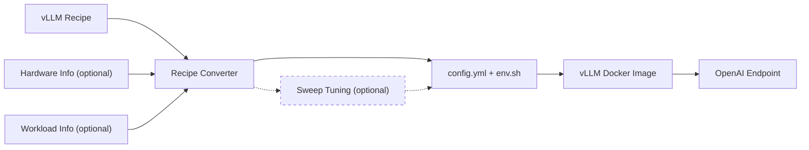

# vLLM Recipes Tools

Convert a vLLM Recipes deployment rendering into files for `vllm serve`.

## Optimized Deployment Flow



The recipe is the baseline. Hardware and workload information can optionally
refine the initial configuration. Sweep tuning is optional.

## Getting Started

Use `serve_with_recipe.sh` to fetch the selected deployment from
[vLLM Recipes](https://recipes.vllm.ai/), generate the configuration, and start
vLLM in one step:

```bash
tools/recipes/serve_with_recipe.sh \
  --model meta-llama/Llama-3.1-8B-Instruct \
  --hardware xeon6
```

The converter queries `recipes.vllm.ai` at runtime, so it can use the latest
published recipe for the requested model and hardware without rebuilding the
vLLM image.

### Find the hardware name

Open [vLLM Recipes](https://recipes.vllm.ai/), select the model, and choose the
target in the **Hardware** picker. The selected page URL contains the hardware
key. For example, `?hardware=xeon6` maps to `--hardware xeon6`.

You can also run the converter without arguments for interactive model,
hardware, and strategy discovery:

```bash
python3 tools/recipes/recipe_json_to_vllm_config.py
```

For `xeon6` and `arc_pro_b70`, the script enables hardware detection automatically. Generated
`config.yml` and `env.sh` files remain in the directory where the script was
invoked.

## Detailed Deployment Workflow

### 1. vLLM Recipes Only

Use the converter directly when the recipe already contains the deployment
settings you need. This path requires only PyYAML; the vLLM Python package is
not required unless optional runtime tuning or sweep generation is requested.

```bash
pip install pyyaml
```

For non-interactive discovery, provide the model and hardware and use the
Recipes-recommended strategy:

```bash
python3 tools/recipes/recipe_json_to_vllm_config.py \
  --model meta-llama/Llama-3.1-8B-Instruct \
  --hardware xeon6
```

#### 1.1 Interactive Discovery

Search models, then choose hardware and strategy interactively:

```bash
python3 tools/recipes/recipe_json_to_vllm_config.py
```

#### 1.2 Direct JSON Input

Use a Recipes JSON URL or a local JSON file:

```bash
python3 tools/recipes/recipe_json_to_vllm_config.py \
  https://recipes.vllm.ai/meta-llama/Llama-3.1-8B-Instruct/hw/xeon6.json

python3 tools/recipes/recipe_json_to_vllm_config.py recipe.json
```

#### 1.3 Test a Preview Recipe API

A Recipes pull request can expose the same JSON API through its Vercel preview.
Use `--api-base` to validate it before the recipe is available in production:

```bash
PREVIEW=https://vllm-recipes-git-fork-intel-ai-tce-dockerin-f4c148-inferact-inc.vercel.app

python3 tools/recipes/recipe_json_to_vllm_config.py \
  --api-base "$PREVIEW" \
  --model meta-llama/Llama-3.2-1B-Instruct \
  --hardware xeon6
```

See [REFERENCE.md](REFERENCE.md) for recipe discovery, strategy selection,
custom output files, and deployment scope.

### 2. Hardware Information (Optional)

Add `--detect-hardware` when using the converter directly so CPU/NUMA/memory
or process-visible Intel XPU resources can refine deployment-sensitive values:

```bash
python3 tools/recipes/recipe_json_to_vllm_config.py \
  --model meta-llama/Llama-3.1-8B-Instruct \
  --hardware xeon6 \
  --detect-hardware
```

For Intel Arc Pro B70, use `--hardware arc_pro_b70 --detect-hardware`.
Detection queries XPU-enabled PyTorch for device count, names and free/total VRAM.
The B70 policy validates that enough devices are visible for the recipe's
TP/PP/DP layout and conservatively reduces `gpu-memory-utilization` if needed.
It does not prove that the model and KV cache fit.

On a B70 system with fewer cards than the recipe requests, opt into conservative
TP/DP fallback with `--auto-fit-xpu-parallelism` (requires `--detect-hardware`).
The selector reduces DP first, then supported power-of-two TP layouts after
model-head, actual safetensors size and KV/VRAM estimates. Unsupported or
unverifiable candidates are skipped; estimates are never a startup guarantee.
`RECIPE_AUTO_FIT_XPU_PARALLELISM=true` enables this option through
`serve_with_recipe.sh`. A READY validation JSON contains `parallelism_adjustment`
with original and effective TP/DP, evidence and `fit_status`. A successful
startup and inference benchmark are required before calling the layout validated.

```bash
python3 tools/recipes/recipe_json_to_vllm_config.py \
  --model meta-llama/Llama-3.1-8B-Instruct \
  --hardware arc_pro_b70 \
  --detect-hardware
```

`serve_with_recipe.sh` enables detection automatically for both `xeon6` and
`arc_pro_b70`. See [RUNTIME_TUNING.md](RUNTIME_TUNING.md#hardware-information)
for details.

### 3. Workload Information (Optional)

Add workload hints when token lengths, concurrency, or latency objectives should
seed optional benchmark tuning:

```bash
python3 tools/recipes/recipe_json_to_vllm_config.py \
  --model meta-llama/Llama-3.1-8B-Instruct \
  --hardware xeon6 \
  --detect-hardware \
  --input-tokens 128 \
  --output-tokens 128 \
  --concurrency 32 \
  --ttft-sla-ms 3000 \
  --tpot-sla-ms 100
```

See [RUNTIME_TUNING.md](RUNTIME_TUNING.md#workload-information) for supported
inputs and runtime calculations.

### 4. Sweep Tuning (Optional)

Use `--generate-full-sweep` for benchmark-backed tuning of TP/DP, concurrency,
and scheduler settings:

```bash
python3 tools/recipes/recipe_json_to_vllm_config.py \
  --model meta-llama/Llama-3.1-8B-Instruct \
  --hardware xeon6 \
  --detect-hardware \
  --input-tokens 128 \
  --output-tokens 128 \
  --concurrency 32 \
  --generate-full-sweep
```

See [SWEEP_TUNING.md](SWEEP_TUNING.md) for targeted sweep modes, NUMA binding,
failure handling, recommendations, reporting, and visualization.
For Arc Pro B70, see the [XPU hardware-validation workflow](SWEEP_TUNING.md#b70-hardware-validation-workflow),
including the sweep validation helper under `sweep/`.

### 5. Start vLLM

When using the converter directly:

```bash
source env.sh
vllm serve --config config.yml
```
